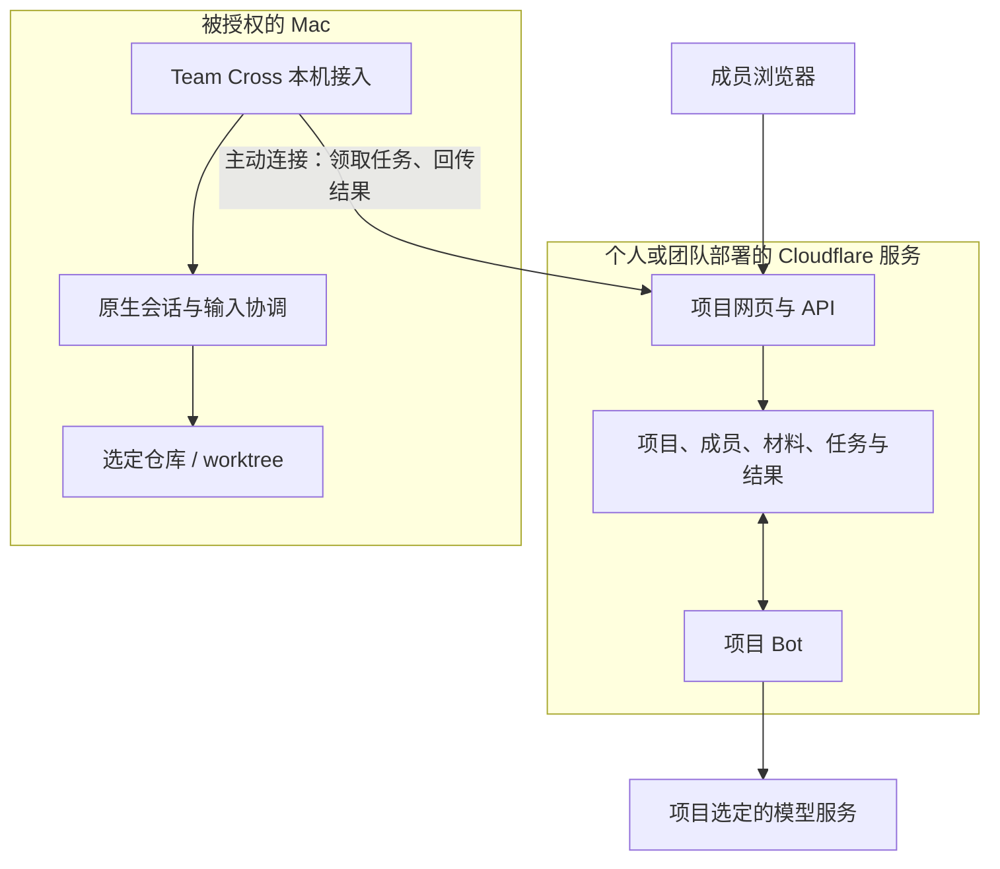

# Cloudflare 项目 Bot：产品定位、MVP 与 Team Cross 接入方案

讨论与外部资料查阅日期：2026-10-11；文档收尾与提交日期：2026-10-12（Asia/Shanghai）。文件名沿用讨论日期。

状态：活跃方案记录，尚未实施。用户已确认“个人或团队部署一次、Bot 跟随项目”的推进方向，允许必要的破坏性重构，也允许基于 Team Cross 核心思路建立独立项目；独立云端产品及下文的具体设计是本次推荐方案，不代表用户已逐项确认，也不代表现有能力或验收结论。

本次授权范围：完整记录到 `tasks/` 并提交文档。此前明确要求“先不改代码”；允许重构和独立项目是方案选择空间，没有据此开始产品实现、创建新仓库、部署云服务或迁移数据。

调研基线：当前工作树 `Meta`，提交 `f3bd25cd1477fc58441e9fe9532282c3a5e70616`。记录前工作区干净。架构、实现入口和外部平台信息均按本次讨论时的状态理解。

## 1. 讨论来源与已确认方向

用户最初要求参照 [解释 Cloudflare Bots 项目](thread://01a123c3-ae14-7f82-8865-737a775d7268?hostId=local)，重新分析 Cloudflare 能力与 Team Cross 的结合方向，并希望大胆头脑风暴。该引用会话已实际读取，作为技术背景使用，不将其中的历史判断当作当前仓库规则。

随后问题逐渐收敛为：

1. 想做 Bot 功能，但需要明确个人 Bot、项目 Bot 的定位和具体使用流程。
2. Bot 应跟随个人还是项目配置；个人、团队、Cloudflare 部署和模型凭据如何对应。
3. 用户如何配置自己的 Bot，Cloudflare 是否有免费额度。
4. 按“个人或团队部署一次、Bot 跟随项目”的方向，结合 Team Cross 现有架构，梳理配置界面、完整流程、云端与本机分工，暂不改代码。
5. 必要时可以破坏性重构，甚至可以基于 Team Cross 核心思路做独立项目。
6. 先完整记录到 `tasks/`，并提交。

明确区分三种状态：

| 状态 | 内容 |
| --- | --- |
| 用户已确认 | 个人或团队部署一次；Bot 跟随项目；需要完整 MVP 方案；允许必要重构或独立项目；当前先记录、不改产品代码 |
| 本次推荐 | 独立部署的云端项目 Bot 应用，Team Cross 作为首个本机接入端；项目长期状态在云端，本机保管私有会话、仓库和执行权限 |
| 尚待评审或技术验证 | 独立仓库与品牌、认证实现、具体模型适配、PiHarness 选型、任务/用量上限、设备授权与恢复细节，以及下文全部实现和验收事项 |

## 2. 产品定位与配置归属

Bot 的身份、项目背景、工作规则和历史任务跟随项目。Cloudflare 部署、模型密钥和费用来源由个人或组织管理。成员通知和语言等偏好属于个人。

个人使用与项目归属可以同时成立：一个人先建立只有自己的项目，随后邀请同事参与同一个 Bot。无需为了团队场景先增加复杂的组织、席位或集中计费体系。

每个项目首版只有一个 Bot，Bot 可以承担多条独立任务。任务开始、完成、暂停或失败，不改变 Bot 的项目身份。Bot 身份与模型供应商、运行引擎和原生会话 ID 分离，后续更换模型或执行设备不应丢失项目记录。

项目可以是软件产品、仓库、一项调查或一段持续工作的主题，不强制绑定 Git。创建时只需要名称；其他成员、材料和执行环境可以逐步补充。

共享 Bot 始终使用项目选定的模型连接和费用来源，不因当前发言者切换为其个人密钥，也不在凭据失效时静默换用另一位成员的账户。本机原生执行使用自己的模型设置，与云端 Bot 分开报告。

首版要验证的产品价值：同一项目的成员能把资料和明确任务交给同一个 Bot，获得可追溯的实际成果；需要本机能力时，可以接力执行并带着结果继续。

## 3. 方案演进与路线取舍

### 3.1 最初的增量接入方案

在原有空间之上增加云端 Bot：空间和成员仍由发起者的 Core 托管，Worker 承接已授权的 Bot 任务，复用空间工作台、固定引用、回执和可选专用会话角色。

这一方案的直接限制是托管 Mac 离线后，云端只能继续处理已经收到且材料已同步的任务；成员新增请求、读取未同步材料和获取空间当前权限仍依赖原 Core。它可以用于局部原型，但不能自然提供独立在线的项目 Bot 体验。

### 3.2 用户允许独立项目后的推荐方案

独立部署云端项目 Bot 应用，在云端保存项目、成员、已发布材料、任务、简报和 Bot 状态。Team Cross 作为首个本机接入端，负责选定会话材料的发布和被授权的本机执行。

管理员在自己的 Cloudflare 环境部署一次，可创建多个项目。普通成员通过浏览器加入和使用 Bot，不需要安装 Team Cross 或拥有 Cloudflare 账户。提供本机资料或执行能力的人，再连接自己的 Team Cross。

所有 Mac 离线时，成员仍可访问项目、提交新的云端分析任务、查看已有材料和产物；涉及本机的步骤等待对应设备上线，其他任务可以继续。

这个推荐会改变当前“空间由发起者 Mac 托管”的架构边界，需要新的产品与工程契约。不能把它描述为已存在的云端能力，也不能只通过反向代理整个 Core 完成。

代码组织建议：云端应用和部署模板独立成仓库，Team Cross 增加本机接入模块。可按需要重构本机会话与执行适配，但首版不复制整个 macOS 工程，不自动迁移私人会话或旧空间。

## 4. 应保留的 Team Cross 核心思路

- 成员选择明确范围发布材料；私人会话、来源目录和后续新增内容不自动公开。
- 已发布材料保留作者、版本和来源，Bot 引用可以回到固定依据。
- 材料阅读、项目成员资格、本机执行资格和输入归属分别管理。
- Bot 产物和建议与成员确认的项目决定分开。成员可以把结果整理为简报草稿，再明确保存。
- 请求提交、接收、开始运行和完成是不同状态，回执不冒充实际成果。
- 本机写入共用协调入口；断线后查询同一执行记录，不自动重放已经发送的业务输入。
- 云端 Bot、个人原生会话、本机执行会话具有不同身份和生命周期。
- 不因协作结束、暂停或解除接入而删除原目录、已有原生会话或 worktree。
- 产品不固定模型或推理强度，界面报告实际确认的设置；不把原生配置继承扩展成云端凭据继承。

对应当前依据：[产品词汇](../sources/product-core-and-glossary.md)、[空间契约](../sources/decisions/collaboration-spaces.md)、[空间工作台](../sources/decisions/space-workbench.md)、[输入协调](../sources/decisions/input-and-sharing.md)、[协作模式](../sources/decisions/runtime-modes.md)。

## 5. MVP 对象与首版能力

### 5.1 对象关系

```text
个人或团队的一次云端部署
├─ 管理员、成员身份、模型连接与服务用量限制
├─ 项目 A
│  ├─ 项目成员与邀请
│  ├─ 已发布材料、版本和讨论
│  ├─ 成员确认的项目简报
│  ├─ 一个项目 Bot
│  │  └─ 多条独立任务、引用、进度、后续请求和产物
│  └─ 一个可选默认执行环境
└─ 项目 B
   └─ 同样的结构，数据与权限独立
```

部署环境先表示共享基础设施和管理范围，不增加一个必须注册的中心化 Team Cross 组织。不同组织或客户可分别部署；同一团队的多个项目复用一个环境。

项目 Bot 承担项目层的理解、分析和任务衔接；本机原生会话承担明确的调查或执行工作。后者不自动成为另一个项目协调者，也不把私人完整历史并入云端 Bot。

### 5.2 三类实际工作

| 工作 | 用户输入示例 | 首版应交付的结果 |
| --- | --- | --- |
| 理解项目 | 比较这两份排障记录，哪些判断已经证实？ | 带固定来源的回答，区分事实、分歧、推测和缺失信息 |
| 形成产物 | 整理一个可执行的验证计划 | 完整报告、方案、操作说明或验证步骤，保存在任务中可继续讨论 |
| 连接本机执行 | 在指定测试仓库验证其中一个假设，再更新报告 | 明确的执行步骤、真实接收与执行状态、返回结果，以及基于结果的后续分析 |

首版产物以文本和 Markdown 为主，必须能阅读完整内容，不能只有“已完成”或一句摘要。是否保存成功、是否进行了本机执行、是否已有验证依据分别显示。

### 5.3 项目背景与任务上下文

项目背景提供用户可检查的三个来源：成员确认的简报、允许 Bot 使用的材料、相关历史任务结果。无需首版就建立无法审阅的隐藏长期记忆。

每条新任务读取所需的项目背景和材料；追问通过父任务关联，继承明确的上下文关系。避免将所有成员的所有工作合并成一条无限增长的模型对话。

生成摘要应保留来源及版本。材料更新或撤回后，相关缓存摘要标记失效，不再作为新任务中的有效依据。历史产物仍需表达当时依据，不能把旧结果自动当作当前结论。具体失效、清理和正在运行任务的处理是实现前需要验证的事项。

## 6. 配置界面

### 6.1 云端服务首次设置：部署管理员

入口：部署完成后的云端网页。

字段和操作：

- 服务名称。
- 管理员初始化和后续登录身份。
- 模型连接名称、可用状态、默认模型及支持的设置。
- 服务级用量限制及用量入口。
- 部署版本、健康状态、关联项目，以及明确的更新和凭据管理入口。

首次流程：

1. 点击我们提供的“部署到 Cloudflare”。
2. 登录 Cloudflare，选择账户，按模板建立资源并填写模型密钥。
3. 打开部署地址，用部署过程中生成的一次性初始化凭据建立管理员身份；不能让任意访问公开地址的人直接认领管理员。
4. 检查部署、协议版本、存储和模型连接，再创建第一个项目。

Cloudflare 的 Deploy to Cloudflare 按钮支持从公开 GitHub/GitLab 仓库部署，并按配置创建和绑定 Durable Objects 等资源。它仍有登录、仓库和配置步骤，产品表述使用“引导部署”，不承诺完全无需操作的一键完成。

首版模型密钥存入部署环境的 Secrets。云端设置展示连接名称和状态，项目只保存连接引用，不回显或分享原始密钥。可先通过 Cloudflare 控制台更新密钥，不同时开发完整密钥管理平台。

首次设置、连接检查和首次实际模型调用分开说明。创建项目和保存配置不要求为“已经准备好”额外发起一轮模型输入。

### 6.2 项目 Bot 设置：项目负责人

入口：项目 → 设置 → Bot。

| 设置项 | 推荐行为 |
| --- | --- |
| 名称 | 默认“项目名称 + Bot”，可修改 |
| 职责 | 提供简短默认描述，自定义为可选项，不把写复杂提示词作为上手条件 |
| 项目背景 | 使用成员确认的项目简报 |
| 可用材料 | 明确选择，显示版本和云端处理范围 |
| 模型 | 继承部署默认值，可选择管理员已提供的连接 |
| 谁可以使用 | 项目负责人开放给项目成员；实际成员与权限由服务端核对 |
| 用量限制 | 每日任务数、单任务最大模型调用次数及 token 上限等 |
| 默认执行环境 | 初始为空，需要时绑定；首版每项目一个 |
| 暂停 | 阻止新的 Bot 工作，当前任务与本机执行另行显示处理状态 |

共享 Bot 不自动采用发言者的个人模型设置或密钥。本次使用的模型连接和费用来源对成员可见。凭据失效、费用承担者退出或部署解绑时，应明确暂停或办理转交，不能静默向其他成员收费。

长期 Bot 身份与具体部署连接分离，是后续转交和迁移的设计目标；首版不据此承诺已经具有跨部署无损迁移能力。

### 6.3 本机连接：设备所有者

入口：Team Cross → 设置与连接 → 项目 Bot。

字段和动作：

- 云端服务地址和一次性配对流程。
- 本次允许连接的项目。
- 允许使用的仓库与执行目录；需要隔离现场时，从确认的 Git 起点创建新 worktree。
- 选择或创建明确的原生执行会话。
- 受限/信任模式，沿用当前创建时选择及固定模式的语义。
- 允许向该环境提交任务的项目成员。
- 接收任务开关、在线状态、当前任务、暂停和解除连接。

项目负责人不能仅凭云端管理权限替其他成员开启 Mac 执行能力。加入项目与获得设备执行资格分别授权。首版无需让普通成员填写 Cloudflare 凭据或本机管理 token。

云端 Bot 的模型与本机原生执行模型独立；本机仍遵循原生设置和审批。接入不能保证向任意个人 Desktop 会话主动推送，实际目标必须是已核对、可接收的原生连接，当前接入边界见 [配对契约](../sources/decisions/agent-pairing.md)。

多设备自动选择、故障转移和负载分配不进入 MVP。

### 6.4 普通成员与个人偏好

普通成员通过项目邀请获得独立身份和凭据，使用浏览器即可访问获准项目。邀请关闭与已有成员撤销分开处理，不能用共用管理员密钥代替成员身份。

通知、免打扰和语言属于个人偏好，不改变项目 Bot 的共享模型、职责、材料或费用来源。完整跨设备登录、管理员恢复和身份实现需在技术预研中确定；不将“无需中心账号”理解为无需认证。

## 7. 日常界面与结果组织

进入项目后建议显示：

```text
Bot | 材料与讨论 | 任务 | 项目简报 | 设置
```

Bot 工作页包含：

1. 任务输入：要求、附加材料、是否需要本机执行。
2. 当前任务：正在处理、等待设备、需要补充信息、需要人工操作。
3. 结果与后续：完整产物、来源、继续追问、交给本机执行、整理到项目简报。

任务页是整个项目的记录入口。Bot 页和任务页使用同一份任务数据，不维护两套互相独立的状态。已有明确任务的追问应继续关联它；新任务另起上下文。

结果卡片示例：

> 本次交付：连接失败原因分析
>
> 依据：材料 A 第 2 版、材料 B 第 1 版
>
> 结论：两个可能原因，其中一个仍待验证
>
> 产物：分析报告、验证步骤
>
> 本机执行：尚未进行
>
> 操作：继续追问 · 开始验证 · 整理到项目简报

Bot 产物可以自动保存为任务结果；成员将其加入项目简报时先生成草稿，再明确确认。保留来源与任务关联，不把模型建议直接写成团队已确认决定。

项目背景页分别呈现确认简报、材料和相关结果，标明版本及更新时间。云端已连接、背景已读取、任务已完成是不同事实，界面不以一个“在线”状态代替。

## 8. 完整使用流程

以“连接故障调查”为示例：

1. **部署。** 管理员部署云端服务并配置模型连接。
2. **创建项目。** 建立“连接故障调查”，默认有一个 Bot；创建本身不启动模型或本机运行时。
3. **邀请。** 成员通过邀请获得各自身份，在浏览器看到项目材料、讨论和任务。
4. **发布材料。** 成员在 Team Cross 选择两段已有会话，预览公开范围，明确发布到云端项目。其他成员也可以添加文本或 Markdown。材料记录作者、范围和版本，不自动上传完整私人历史或之后的新内容。
5. **第一个任务。** “比较这两份记录，列出已经确认的事实、互相矛盾的判断，以及最值得验证的假设。”
6. **云端分析。** Bot 读取授权材料，生成带引用的完整报告，把已确认、推测和待验证分开，保存到任务。
7. **继续讨论。** 成员追问或补充材料，形成关联任务或当前任务的后续上下文。
8. **选择验证。** 点击报告中的“开始验证”，确认执行环境和要求。若任务创建时已明确选择并授权相同执行，不重复要求确认相同事项；原生工具自己的审批继续有效。
9. **设备执行。** Team Cross 核对成员授权、项目、目录、准确会话、运行状态和输入归属后执行。设备离线显示等待，原生审批显示需要到执行设备处理。
10. **返回结果。** 按已授权范围回传执行状态、摘要、测试结果和选定产物，不自动上传原生会话全文或其他私人文件。
11. **完成后续。** 原任务若包含“验证后更新报告”，Bot 在结果到达后继续修正结论，链接执行依据。
12. **确认结论。** 成员将结果整理到项目简报，或继续下一条任务。任务结束、成员交接不要求重新创建项目 Bot。

首版持续处理仅需覆盖“等待明确的本机结果，然后继续一次”等已授权后续。成员发布材料、保存讨论或加入项目，不自动授权无限订阅、广播、循环追问或自动分派。

## 9. 云端与本机分工



| 内容或能力 | 主要负责方 |
| --- | --- |
| 项目身份、成员、邀请和权限 | 云端 |
| 已发布材料与版本、讨论、确认简报 | 云端 |
| Bot 配置、任务队列、进度和产物 | 云端 |
| 项目材料分析、报告生成和结果后续处理 | 云端 Bot |
| 私人会话、尚未发布材料、原始代码目录 | 本机 |
| 原生模型运行、命令、文件修改、测试和原生审批 | 本机 |
| 本机执行是否真正开始、完成或结果不明 | 本机执行记录为依据，向云端报告 |

云端项目数据是项目层的权威记录；本机执行记录是本机动作的权威记录。云端任务进度引用后者，不以模型自述代替实际执行回执。具体协议应定义稳定任务/步骤/执行标识和状态更新顺序，避免双边任意覆盖。

本机主动通过认证连接领取任务、上传明确的材料并回传结果。首版无需反向代理整个 Core，不向云端交出 Core 管理凭据，也不要求本机公网入口、隧道或公网 IP。

离线行为：

- 所有 Mac 离线时，云端项目和已有材料仍可访问，可创建新的纯云端分析任务。
- 需要本机能力的步骤等待对应环境；未上传的文件或现场状态不能由 Bot 猜测。
- 等待本机结果不应使整个项目停止接收其他任务；并发额度和排队策略需在实现时明确。
- 退出 Team Cross 表示设备离线，不关闭云端项目；云端成员资格不再随某台 Mac 退出而自然消失。这是相对于当前本机托管契约的明确变化。

## 10. 授权、状态、恢复与生命周期

### 10.1 授权层次

部署管理员管理服务与模型连接；项目负责人管理项目范围和 Bot；成员按项目权限使用；设备所有者另外授予本机执行资格。

发布到当前本机空间的历史授权，不应被自动解释为同意复制到新的云端服务。导入或发布时展示云端目的地和实际范围，由具有对应内容权限的人明确操作。

Bot 只读取获准的项目材料、快照和结果，材料中的过去指令是参考内容，不构成新的执行授权。客户端界面隐藏不能替代后端的项目、成员、版本和设备授权检查。

### 10.2 用户可见任务状态

以下为语义建议，最终字段尚未设计：

| 状态 | 应表达的事实 |
| --- | --- |
| 排队 | 任务已保存，尚未开始处理 |
| 正在分析 | 云端实际在处理当前任务 |
| 等待补充 | 缺少必要资料或用户选择 |
| 等待设备 | 所选本机环境未能领取或执行 |
| 等待本机处理 | 已出现原生审批或需要设备所有者操作 |
| 本机执行中 | 本机已确认开始，关联准确的执行记录 |
| 结果不明 | 曾提交动作但缺少足够回执，需要核对 |
| 已完成 / 失败 | 有相应结果、错误和来源，不能仅凭网络 2xx 判定 |
| 正在停止 / 已取消 | 区分停止请求和实际停止；不声称已提交动作被撤回 |

这些状态不必全部塞进单个枚举；请求投递、云端处理和本机运行可以分别记录，再投影到界面。

### 10.3 重连与不重复执行

- 尚未领取、未过期且授权仍有效的任务，可以在设备上线后领取。
- 已经发送但结果不明的任务，先查询同一执行标识，不以断线、超时或页面刷新为理由重新开始。
- 同一任务步骤使用稳定标识和内容校验，传输重试与重新执行分开。
- 状态更新不倒退；晚到回执不能覆盖新的任务归属或终态。
- 接入已有共同执行时，继续检查 `writer` 与 `epoch`，不能让 Bot 绕过当前输入者。
- Core 重启不自动恢复任意原生会话或重放输入。待领取任务、已领取任务和原生恢复分别处理。
- 设备暂停或授权撤销后，后续任务领取与写入停止；已运行步骤以实际停止结果为准。

### 10.4 暂停、关闭和保留

暂停 Bot、暂停设备接收、停止当前任务、解除设备连接和关闭项目是不同操作。暂停新任务不伪造已经在运行的本机任务完成或取消。

关闭云端项目应停止后续项目访问与新工作，但保留、导出、删除云端记录的具体选项仍待定义。本机目录和原生会话继续按现有保留契约处理。

材料撤回后，阻止后续读取和新任务引用，旧引用显示状态；已被模型处理或由成员复制的内容不能承诺召回。长期云端缓存、运行中任务和派生摘要的失效与清理需要专门验证。

## 11. 与现有实现的衔接

| 当前基础 | 推荐处理 | 入口 |
| --- | --- | --- |
| 空间、成员、材料和讨论 | 保留产品语义，在云端建立项目模型；不直接把当前本机 Record 宣称为云端服务 | [空间](../../../internal/collab/spaces.go)、[材料](../../../internal/collab/materials.go)、[类型](../../../internal/collab/types.go) |
| 简报、固定引用、父请求与分阶段回执 | 作为任务模型基础，补充步骤、完整产物和云端运行状态 | [工作台领域](../../../internal/collab/workbench.go)、[桥接](../../../internal/collab/workbench_bridge.go) |
| 空间工作台和阅读组件 | 按项目 Bot 主界面重组，复用适用的组件和语义 | [SpaceWorkbench](../../../packages/web/src/components/SpaceWorkbench.tsx)、[Settings](../../../packages/web/src/components/Settings.tsx) |
| 原生会话、fork、worktree 和输入协调 | 留在本机，作为执行接入；可重构适配边界 | [接收会话](../../../internal/collab/space_receivers.go)、[RPC](../../../internal/collab/rpc.go)、[nativecodex](../../../internal/nativecodex/)、[workspace](../../../internal/workspace/) |
| 事件和处理回执 | 借鉴事件与去重规则，为项目 Bot 定义独立协议和凭据 | [空间事件](../../../internal/collab/space_events.go)、[事件网关](../../../cmd/teamcross/events.go) |

当前工作台已有 `SpaceRequest`，保存发起者、目标、固定引用、父请求、简报快照和处理回执。可复用这些关系，但不能将云端 Bot 伪装为现有 Codex 原生 Session 或复用一个原生 ID 代表项目。

当前可选专用会话角色与共同执行分离，这个职责划分值得保留。独立产品中由项目 Bot 承担项目层角色，本机原生会话作为明确目标承担工作，不要求普通成员先建立自己的私人接收会话。

现有 `TC_EVT_…` 空间事件凭据七天到期，只用于范围受限的事件与读取，不授予项目执行、材料发布、讨论回复、简报修改或向其他会话发请求。它不能直接升级为 Bot 管理或执行凭据，现有 `/mcp` 网关也不能变成整个 Core 的代理。[当前事件契约](../sources/decisions/space-events.md)

当前个人 Desktop 的主动接收、实验性 Claude Channel 和真实 ChatGPT Cloud 宿主有各自的接入/验收边界。新 Bot 不依赖“任意原生会话都能被云端自动唤醒”这一假设。首版通过明确可控的 Team Cross 本机接入执行，其他客户端能力按对应契约分别验证。

## 12. Cloudflare 技术组成与运行引擎

推荐基础：

- Worker：项目网页/API 的服务入口、认证和请求路由。
- SQLite Durable Objects：持久状态、任务推进和项目 Bot 的运行状态；初始可按项目/Bot 隔离对象，具体对象划分须通过规模与并发验证。
- R2：已发布文件、快照正文和产物。材料身份、版本、权限和引用仍由业务层维护。
- 模型连接：使用经验证的外部模型适配，或 Workers AI；模型能力与支持参数通过适配器确认。
- 本机接入：主动连接、领取明确任务、发布选定材料、上报结果，不直接暴露原生 RPC。

Worker 中的项目 Bot 与本机原生 Codex 执行是两个运行位置。若未来要在云端运行原生命令行，需要另外评估 Linux Sandbox/Containers，不能把 Worker isolate 当作本机 CLI 进程。

可以优先验证 Cloudflare Agents SDK 的 PiHarness：它能把 Pi Durable 的对话、收件箱和运行任务保存在 Durable Object 的 SQLite 中，并通过生命周期恢复工作。但截至本次查阅，PiHarness 为 Beta、Pi Durable 为实验性，API 可能变化；官方还列出工具调用尚无审批步骤、事件流没有按游标续接等限制。

因此任务身份、权限、用量限制、本机执行授权和对外结果记录应由自己的业务层掌握，不能完全依赖运行引擎的会话 ID 或流事件。首版选型前需要验证恢复、取消、工具重试和数据清理；若某个引擎不能满足要求，替换它不应改变项目模型和用户配置。

MVP 不要求先启用 Containers 或 Dynamic Workers。云端 Linux、浏览器自动化和动态执行生成的代码均后置；第一版依靠云端材料分析与本机执行完成闭环。

## 13. 费用与免费额度快照

以下是 2026-10-11 在官方页面查到的定价快照，用于评估原型门槛，接续实施前必须重新核对。不是本项目已经部署或实测的用量结果，不保证整套 Bot 免费。

| 组件 | 当时免费额度或门槛 | 对 MVP 的影响 |
| --- | --- | --- |
| Workers | 免费计划每天 100,000 次请求；每次调用 10 ms CPU 时间 | 轻量入口有免费基础，实际认证、解析与业务逻辑需要测量 |
| SQLite Durable Objects | 每天 100,000 次请求、13,000 GB-s 时长；每天 5,000,000 行读取、100,000 行写入；5 GB 总存储 | 可用于状态和任务，免费计划支持 SQLite 后端 |
| R2 Standard | 每月 10 GB-month 存储、1,000,000 次 A 类操作、10,000,000 次 B 类操作 | 为文件与产物提供起步额度，额度不适用于所有存储类别 |
| Workers AI | 每天 10,000 Neurons；部分模型要求付费方案或预付费渠道 | 可作为体验模型选项，不能换算成统一聊天次数 |
| Containers | 需要 Workers Paid，套餐内包含一定资源用量 | 云端 Linux 执行后置 |
| Dynamic Workers | 仅适用于 Workers Paid | 动态生成代码的云端执行后置 |

Workers Paid 当时最低为每账户每月 5 美元，包含一定用量，超额和其他服务另计。不是每个 Bot 5 美元，也不是整套 Bot 的固定总价。多个项目共同消耗账户额度，创建更多 Bot 不产生独立免费套餐。

费用应区分 Cloudflare 资源、模型调用和可选执行服务。使用外部模型时另核算模型服务费用，Worker 免费额度不是外部模型 API 额度。

Worker CPU 时间不包含等待网络响应的时间；Durable Object 保持活跃时有自己的时长计量。一个任务可能包含多次模型调用、工具调用和存储操作，不能只按聊天消息数估算容量。

首版先实现可强制执行的每日任务数、每任务模型调用次数、token 和执行时长等适用上限。金额展示标明估算或未知，不将本服务估算当作整个 Cloudflare 账户的硬账单上限。本机原生模型费用也不能未经核对与云端合并成精确账单。

运行环境展示本服务用量和控制台入口即可，完整计费、套餐和分账系统不进入 MVP。免费计划能否承载选定实现，属于部署与性能验收事项。

## 14. MVP 纳入与后置范围

必须纳入：

1. 可重复完成的部署、初始化和模型连接流程。
2. 项目、稳定成员身份、邀请和逐人权限撤销。
3. 文本、Markdown 及 Team Cross 选定会话快照的发布、版本和读取。
4. 项目 Bot、明确任务、来源引用、完整结果和后续追问。
5. 一个可选默认本机执行环境及一次可靠的执行接力。
6. 收到明确结果后完成已授权的后续处理。
7. 暂停、失败、结果不明、重连、用量限制和必要的数据范围控制。

后置：

- 多 Bot 自动分工、循环分派和复杂工作流编排。
- 任意定时任务、长周期公开网站监控及多种持续订阅。
- Slack、Telegram 等额外入口；首版浏览器是主要入口。
- 云端 Linux Sandbox、动态代码执行和复杂浏览器自动化。
- 多设备自动路由、故障转移和执行环境搬迁。
- 复杂附件解析、完整向量知识库和所有历史的自动索引。
- 商业套餐、席位计费、中心化组织体系和完整分账。
- 旧空间自动迁移、私人历史自动导入和跨部署无损迁移。

MVP 以一次完整的实际工作闭环为完成标准，不以设置页、聊天框或通知转发演示代替交付。

## 15. 实施顺序与验收要求

三个阶段均属于首版必要工作，阶段通过不等于全部 MVP 完成：

| 阶段 | 工作 | 阶段应证明的结果 |
| --- | --- | --- |
| 1. 纯云端项目 | 部署、身份、项目、材料、Bot 与结果 | 不接本机也能完成有用的材料分析和产物交付 |
| 2. Team Cross 接入 | 材料发布、设备授权、任务领取、本机执行与结果后续 | 从云端明确任务到准确原生会话，再返回可核对结果 |
| 3. 完整性与恢复 | 多人隔离、撤销、重复请求、断线、重启、预算和生命周期 | 状态可信、范围受控、已发送的执行不重复开始 |

最终验收场景：

1. 同一部署创建两个项目，Bot、材料、任务和权限互不串用。
2. 至少三名独立成员参与一个项目，发布、提交任务、讨论结果，逐人撤销访问不影响其他成员。
3. 所有 Mac 离线时，云端仍接收分析任务并交付结果；本机步骤显示等待设备，不能假报完成。
4. 完成一次真实本机接力，验证准确会话、目录、授权、输入归属、模型设置和结果返回。
5. 丢失提交/领取/完成回执、断线或重启时，按同一标识核对，已有执行不重复开始，晚到状态不倒退。
6. 材料撤回、成员移除、设备授权撤销、用量耗尽和暂停均产生实际效果，界面说明阻塞原因。
7. Bot 结果有固定来源与完整产物；模型建议不会自动变成成员确认的项目决定。
8. 部署更新保留身份和有效状态，协议不兼容明确报告；不能因重新部署产生难以区分的重复 Bot 或遗失任务。

工程检查按 [验证门槛](../sources/validation/test-gates.md) 随实际改动选择。修改 Team Cross 产品代码时包括适用 Go test/vet、race 和 Web check/test/build，前端修改后更新两套嵌入资源；界面为主要改动时做真实浏览器与截图复核。

真实模型验证遵守当前仓库限制：专用会话和测试仓库，仅使用 `gpt-5.6-luna`。协议模拟、同机多 Core、多个浏览器成员、真实两台 Mac 和跨网络各自记录，不能互相替代。Cloudflare 真实部署、费用和断线恢复需要单独证据，本次尚未执行。

## 16. 接续时需要定下或验证的事项

- 确认独立云端产品作为实施路线，并确定仓库与产品名称；用户已允许独立项目，但未逐项确认本方案。
- 确定部署级管理员、成员登录、邀请、恢复和撤销的最小实现，避免把管理凭据分享给成员。
- 确定云端项目与本机接入的协议、稳定身份、任务领取、授权版本和恢复状态，明确已有协作会话的输入归属映射。
- 确定首批模型适配及支持参数，不把兼容协议声明当作所有模型/工具能力已经验证。
- 对 PiHarness 或替代运行引擎做最小验证，重点核对持久化、重试、取消、事件恢复、隔离和清理。
- 确定任务并发、排队、最大上下文、材料与产物大小、保留期限，以及预算上限的实际行为。
- 确定材料撤回、派生摘要失效、在途任务处理及云端数据清理策略。
- 确定本机执行结果回传范围，区分自动结果摘要、用户选定产物与未公开原生历史。
- 重新核对 Cloudflare 当前收费和资源启用条件，再用实际构建测量免费计划能否承载 MVP。
- 进入实现后，将已确认且影响当前架构的规则写入各自主要维护位置；本任务记录不自动取代现有 `sources/` 契约。

## 17. 查阅入口与外部来源

当前仓库主要来源：

- [Agent Wiki 任务记录规则](../README.md#任务记录)：本记录的归档、验证和职责边界。
- [Wiki 索引](../wiki/index.md)：按领域进入当前来源与代码。
- [项目简报](../sources/project-brief.md)、[产品流程](../sources/product-flows.md)：当前定位和用户入口。
- [架构](../sources/architecture.md)、[空间契约](../sources/decisions/collaboration-spaces.md)：本机托管、材料和可选执行的当前边界。
- [空间工作台](../sources/decisions/space-workbench.md)、[配对契约](../sources/decisions/agent-pairing.md)：请求、专用角色、接收会话和已接入范围。
- [空间事件](../sources/decisions/space-events.md)、[输入协调](../sources/decisions/input-and-sharing.md)：事件权限、回执和不重放原则。
- [协作模式](../sources/decisions/runtime-modes.md)、[目录与生命周期](../sources/decisions/workspace-and-lifecycle.md)：本机模式、目录和会话保留。

官方外部来源，查阅日期为 2026-10-11：

- [Deploy to Cloudflare](https://developers.cloudflare.com/workers/platform/deploy-buttons/)：部署模板、资源创建和配置流程。
- [Workers Secrets](https://developers.cloudflare.com/workers/configuration/secrets/)：模型密钥等秘密配置。
- [PiHarness](https://developers.cloudflare.com/agents/harnesses/pi/)：持久模型循环、实验状态与限制。
- [Pi AI](https://developers.cloudflare.com/agents/models/pi-ai/)：模型连接候选，具体能力仍需适配验证。
- [Workers 定价](https://developers.cloudflare.com/workers/platform/pricing/)、[运行限制](https://developers.cloudflare.com/workers/platform/limits/)：账户套餐、请求、CPU 与网络等待。
- [Durable Objects 定价](https://developers.cloudflare.com/durable-objects/platform/pricing/)：SQLite 免费计划、请求、时长和存储。
- [R2 定价](https://developers.cloudflare.com/r2/pricing/)：Standard 存储及操作额度。
- [Workers AI 定价](https://developers.cloudflare.com/workers-ai/platform/pricing/)：Neurons 免费额度与模型例外。
- [Containers 定价](https://developers.cloudflare.com/containers/platform/pricing/)、[Dynamic Workers 定价](https://developers.cloudflare.com/dynamic-workers/pricing/)：后续云端执行的付费门槛。
- [Sandbox 中运行 Codex](https://developers.cloudflare.com/sandbox/coding-agents/codex/)：未来原生 CLI 云端执行与 Worker 本身的区别，不属于本次 MVP 实现。

## 18. 本次记录与检查

本次只新增这一份活跃任务文档，不修改产品代码，不把建议写入当前能力契约，不创建云端资源、新仓库或执行环境，也未启动真实模型和测试客户端。

2026-10-11 至 2026-10-12 在上述 `Meta` 基线上完成的文档检查：

- 33 个仓库内 Markdown 链接的目标、代码路径和所用内部锚点检查通过。
- 13 个外部或会话引用作为本次调研来源保留；平台定价明确标注快照日期及接续时重新核对的要求。
- 围栏、文件末尾换行及空白检查通过；`git diff --cached --check` 无错误。
- 人工核对已确认方向、设计建议、现有实现和未验收能力的措辞，没有将旧原型概念恢复为当前要求。
- 通过正常 `rg --files` 可发现本活跃任务；引用的 Wiki 与来源入口有效。按维护规则不向工程索引追加任务报告清单。
- 暂存范围核对为仅本文件，不修改 `sources/`、`wiki/` 或产品代码。

这是纯文档变更，未运行 Go/Web 产品测试，未启动模型、客户端或云端部署；没有新增任何产品能力验收结论。
