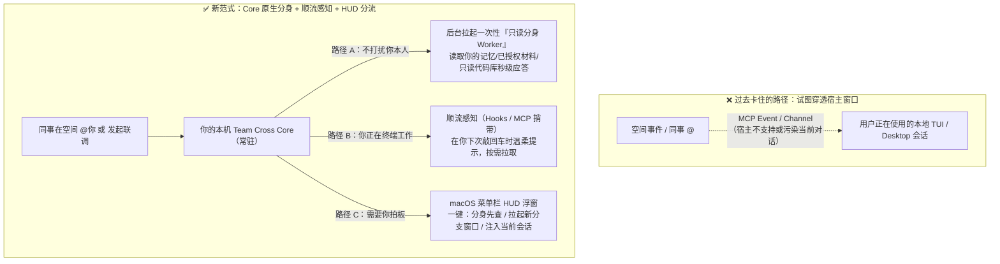
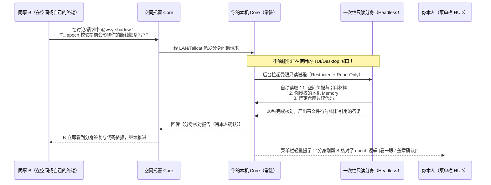
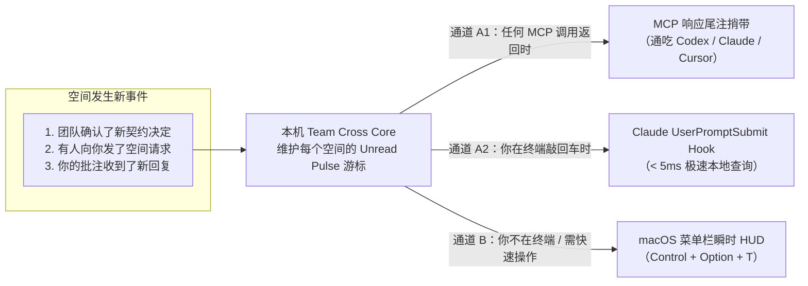
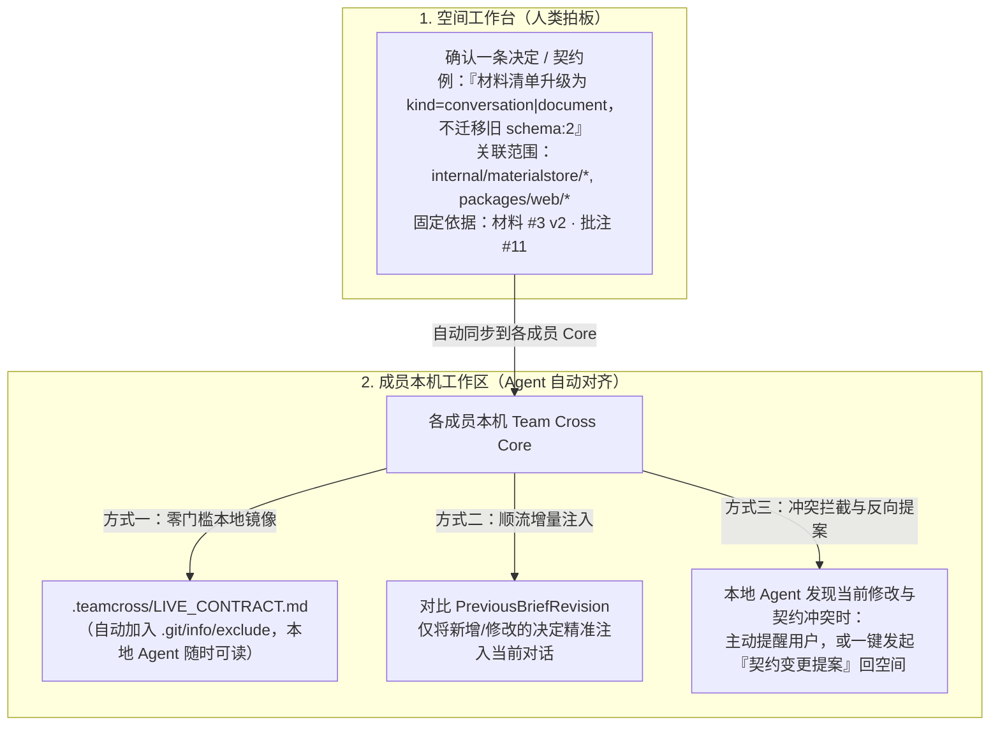

# 协作体验头脑风暴会话原样记录

## User

头脑风暴一下，我之前想要强化协作体验，想了云端Bot和IM+类似Claude Tag两种模式，还思考借助了Claude Code Channel、monitor这些功能，但是总觉得没有形成比较好的完整的体验，之前还考虑使用MCP Event去绑定Session去通知，但是MCP Event暂时还不支持Claude Code以及Codex的本地会话。这些感觉都打不到我想要的效果，是否可以大胆思考下有什么更好的功能

---

## Assistant

你之所以觉得之前探索的几条路（**云端 Bot**、**IM + `@Claude` Tag**、**Claude Code Channel / Monitor**、**MCP Event 绑定本地 Session**）都“差一口气、拼不出完整体验”，并不是因为某个技术细节没调通，而是这几条路在**交互范式**上都撞上了同一个结构性矛盾。

我们可以先把这个“觉得不对劲”的根源刨出来，然后彻底换一个视角来设计。

---

### 一、 复盘：为什么之前的四种尝试都打不到痛点？

你真正想要的效果其实很清晰：**既有 IM 里 `@` 一个人/Agent 的即时响应感和流动感，又有本地 Coding Agent 的深度代码现场与调查上下文，同时还不打断各自正在进行的心流。**

但之前尝试的四个方案，各自丢掉了一块关键拼图：

1. **云端项目 Bot（如 Cloudflare Worker Bot）：有“在线感”，但丢了“第一现场”**
   - Team Cross 最核心的护城河是**“你的工具，就是协作的入口”**——最有价值的上下文在每个人本地正在跑的 Session、本地未提交的 Git 现场、本机刚攒下的 Agent 记忆里。
   - 一旦重心变成“去云端网页里找一个公共 Bot”，它就退化成了一个**脱离代码现场的“二传手/摘要员”**。你得先把材料喂给它，它又摸不到你的本地环境，最后感觉像在维护一个额外的工单系统。
2. **IM + 类似 `@Claude` Tag：有“召唤感”，但丢了“信噪比与深度”**
   - IM 是流式的、碎片化的，而 Coding Agent 的工作是长链路的、重上下文的。
   - 在群聊里 `@Claude`，要么它只看得见群里聊的几句话（回答极其肤浅），要么它把几百行排查过程吐在聊天流里（把人类的讨论彻底刷屏淹没）。**人类的三言两语和 Agent 的深度调查，天生不该挤在同一条一维时间流里。**
3. **Claude Code Channel / Monitor（等待型工具）：把“后台监听”绑死在了“前台轮次”上**
   - `wait_for_updates` 这类 Monitor 模式要求本地会话一直挂着一轮未结束的工具调用，一旦超时、用户按了取消、或者会话空闲结束，监听就断了；而 Claude Channel 则强依赖特定实验开关与宿主门槛，体验脆弱。
4. **用 MCP Event 绑定并唤醒本地 Session：找错了“收件人”**
   - 除了现实的宿主限制（Codex 本地 STDIO 明确限制 `only supported for hosted apps`，个人 Desktop 又是独立进程），**更本质的体验问题是：就算 MCP Event 能强行唤醒你本地正在用的 Session，你真的希望它这么做吗？**
   - 想象一下：你正在本地 Session A 里全神贯注改一个状态机 Bug，同事突然在空间里 `@` 了你一下，你的终端/Desktop 突然被外部事件强行注入一轮 `turn/start` 开始读同事的材料——**你的上下文被污染了，你的思考被打断了**。如果那个 Session 已经关了，通知又石沉大海。

> **核心症结一句话总结：**
> 之前我们一直在试图**“求着第三方客户端（Codex / Claude）把一个人类正在交互的聊天窗口变成后台服务器”**。但其实，**你每台 Mac 上常驻的 `Team Cross Core + macOS 菜单栏 App` 才是真正的后台服务器与原生调度器！**

---

### 二、 破局思路：把“召唤 Agent”从“唤醒旧窗口”变成“Core 原生调度”

一旦不再执着于“用 MCP Event 往已打开的本地窗口里塞消息”，而是充分利用你手头已经握着的四张王牌：
1. **每台 Mac 常驻的 `Team Cross Core`**（局域网 / Tailcat 随时可达）
2. **本机现成的 `codex` / `claude` CLI 与只读沙箱能力**
3. **本机的历史 Session、Agent 记忆（Memory）与本地代码库**
4. **macOS 原生菜单栏速览（`Control + Option + T`）与 Claude Hooks**

我们就可以做出几个**既像 `@Tag` 一样丝滑，又保留完整本地深度，且完全不依赖未开放的 MCP Event** 的杀手级体验：



---

### 三、 大胆思考：五个能形成完整闭环的新功能方向

#### 1. 本机「Agent 数字分身（Shadow / Stand-in）」—— 真正好用的 `@某人`，但先由他的本机分身接招

为什么想要 IM 里的 `@Claude`？因为当遇到跨模块问题时，你想**立刻问问懂那块代码的同事（和他的 Agent）**。但同事可能在忙，或者不想切上下文。

* **全新体验**：
  - 每个成员可以在空间里开启自己的**「本机只读分身（譬如 `@wsy-agent`）」**，授权它仅可访问：**自己发布在该空间的材料 + 选定的本机 Agent 记忆（Memory/Instructions）+ 指定本地仓库的只读检索**。
  - 当同事 B 在看材料或查问题时，直接在批注或讨论框里写：
    > `@wsy-agent` 这里如果把 `epoch` 校验提前，会不会破坏你之前修过的断线恢复逻辑？
  - **你的电脑上会发生什么？**
    - **完全不需要唤醒你正在写代码的窗口！**
    - 你的 `Team Cross Core` 收到请求后，在后台静默启动一个**轻量、一次性、严格只读（Restricted Read-Only）的原生无头会话（Headless Worker）**，挂载你的记忆和代码库，花 20 秒核对完代码与历史，直接把**带固定文件/材料引用的回答**贴回空间！
    - 同时你的 macOS 菜单栏轻轻闪一下：“你的分身刚帮 B 核对了 `epoch` 断线逻辑，[点此看一眼 / 补充人工判断]”。
* **为什么它比云端 Bot 和 IM Tag 强得多？**
  - 云端 Bot 没有你本机刚改的代码和私人记忆；而你的「本机分身」就在你的 Mac 上，读得到你授权的最新本地真相，回答极准。
  - 既实现了 IM 里 `@Tag` 的随叫随到，又零打扰你本人的前台工作，还把你们刚设计的「Agent 记忆」直接变成了可交互的活资产。

---

#### 2. 「跨机联合会诊台（Cross-Probe Roundtable）」—— 代码留在各自电脑，调查在一张桌子上自动对齐

README 里提到了一个极典型的痛点：一个前端埋点问题，涉及**前端、后端 trace ID、客户端 Native、数据落仓**。现在的流程是大家各自查完、手动选范围、预览、发布材料，像发邮件一样慢。

* **全新体验**：
  - 围绕空间里的一个具体问题，发起一场**「联合会诊（Cross-Probe）」**，比如：*“核对 `share_token` 从前端发起、经网关转发、到 Core 校验的字段名与超时是否一致”*。
  - 参与者 A（前端仓库）和 B（后端仓库）把各自的本地接收目标（或上面的只读分身）挂上会诊台。
  - 点击开始后，不再是人手动搬运材料，而是由空间协调 **A 和 B 的本机 Agent 自动进行 2～3 轮有界的“交叉取证”**：
    1. **第 1 轮（A 本机）**：A 的 Agent 在本地查出前端实际发送的 JSON 结构和超时期望，生成一条结构化「取证卡」发到空间；
    2. **第 2 轮（B 本机自动接棒）**：B 的 Core 收到这张取证卡，自动让 B 的本机 Agent 在后端仓库里按图索骥，发现网关层在 10 秒时就截断了，贴出后端代码行号证据；
    3. **收束交付**：会诊台自动生成一份**《跨端对齐报告》**，标出：**已证实一致的链路**、**发现冲突的 1 个位置（附两端代码引用）**、**需要 A 和 B 人工拍板的决策项**。
* **为什么体验完整？**
  - 这是任何单机 Agent（Cursor/Codex/Claude）和任何普通群聊 Bot 都做不到的**“分布式代码库联合推理”**。没有人需要交出自己的完整代码库，却在 1 分钟内完成了原本要拉会对齐半小时的跨端排查。

---

#### 3. 「顺流感知（In-Flow Piggyback）」+「macOS 瞬时 HUD」—— 彻底绕开 MCP Event 的本地断联

既然 MCP Event 暂时不支持本地 Claude Code 和 Codex 会话，我们怎么让“正在写代码的你”和“空间里的动态”无缝连起来？答案是**把“通知”拆成两条完全可控的原生通道**：

* **通道一：当你在本地 Session 里正聊得火热时 —— 用「顺流捎带」代替「强行推送」**
  - **Claude Code 原生 Hooks**：Claude Code 原生支持极强的 `UserPromptSubmit` 和 `PostToolUse` Hooks。Team Cross 可以在接入本机时提供一个极轻量的 hook（耗时 `< 5ms` 查一下本机 Core 内存状态）。当空间里有新批注、有人 `@` 你、或者空间简报更新时，**不需要外部唤醒**，只要你在终端里正常敲下下一句话，Hook 就会把一条极简的一行 `<system-reminder>` 顺流带给你的 Claude：
    > `[Team Cross] 同事 B 在空间「登录排障」更新了一条与你当前文件相关的结论（#req-12），需要时可调用 read_space_brief 查看。`
  - **MCP 工具响应捎带（Piggyback）**：对于 Codex 和 Claude，只要 Agent 调用了任何一次 Team Cross MCP 工具，返回值末尾都可以附带一个极简的 `unreadSpaceSignals` 摘要。
* **通道二：当你的本地 Session 闲置或你在干别的事时 —— 用「macOS 瞬时 HUD」接管调度**
  - 别把通知往黑乎乎的闲置终端里推了！你已经有 `Control + Option + T` 的 macOS 原生浮窗。
  - 当空间有需要你处理的请求时，菜单栏浮出精简的**「协作呼入卡」**，提供三个直达动作：
    1. **`[让分身先查]`**：后台静默跑完分析，把草稿备好等你审阅；
    2. **`[新开隔离窗口处理]`**：Core 直接启动一个新的原生 TUI / 专用 Desktop 窗口，并自动把第一轮上下文喂进去，绝不弄脏你现有的工作窗口；
    3. **`[发进手头窗口]`**：如果是已接通 daemon 的会话直接发，否则一键复制短指令并自动激活你的终端窗口。
  - 顺便，当你在终端里发现一段关键排查结论时，按 `Control + Option + T` 呼出 HUD，**一键「甩出当前 Session 最后一轮到空间」**，连打开浏览器选起止轮次的步骤都省掉！

---

#### 4. 「活体契约黑板（Live Contract / Guardrail）」—— 让空间里的决定实时“护航”每个人的本地 Agent

IM 聊天最大的问题是“聊完就散”，哪怕你们在空间里讨论出了一个重要决定（比如：“定下来了，错误码统一用 `409 Conflict`，不要用 `400`”），5 分钟后同事回到自己的本地 Codex / Claude 写代码，他的 Agent 根本不知道刚才空间里定下了这个规矩，还是照旧写成了 `400`！

* **全新体验**：
  - 把现有的「空间简报（Space Brief）」从一块静态展示板，升级成**「挂载到成员本地工作区的活体护栏（Live Guardrail）」**。
  - 当成员将某个项目目录关联到某个协作空间后，Team Cross Core 可以将空间里**「已确认决定（Confirmed Decisions）」和「接口契约」**实时同步为本机工作区的一个受控只读快照（或通过前面的 Hook / MCP 上下文自动注入）。
  - **神奇时刻**：
    - A 和 B 在空间里刚确认了一条决定：“v0.3 不迁移旧 `schema:2` 数据，直接报版本不兼容”。
    - 10 分钟后，C 在自己的电脑上让本地 Claude Code 写加载逻辑，C 的 Agent 原本想写一段兼容迁移代码，但立刻读到了空间刚刚更新的「活体契约」，主动提醒 C：
      > *“注意：协作空间在 10 分钟前刚刚确认决定【不迁移 schema:2，直接报不兼容】（来源：材料 #3 / 批注 #8），我已按最新团队决定调整实现。”*
* **为什么体验完整？**
  - 这才是**“多人 + 多 Agent 协作”的终极形态**！以前是“人看完讨论，再去人肉纠正自己的 Agent”；现在是**“人类在空间里敲定共识，所有人的本地 Agent 自动同步对齐”**。

---

#### 5. 「分支擂台 / 假设微实验（Hypothesis Arena）」—— 有分歧别在评论区辩论，一键跑出并排实证

在代码审阅或排障讨论时，最容易陷入僵局的就是：
> A：“我觉得是因为 WebSocket 重连没清状态。”
> B：“不对，我觉得是锁没释放，改一下锁就行。”

如果用 IM，两个人会吵 20 条消息；如果用现在的“共同执行”，同一时刻只能有一个人抢输入权去改代码。

* **全新体验**：
  - 在任意一条批注或争议问题旁，点击**「发起假设验证（Run Hypothesis）」**。
  - 利用 Team Cross 现成的 **Git Worktree + 原生 Session Fork** 底座，允许针对同一个起点 `HEAD` 和同一份材料，**并行开出两个轻量、隔离的验证分支（Experiment A vs Experiment B）**。
  - 完成后，空间工作台不展示冗长的聊天记录，而是直接生成一张**「擂台对照卡（Arena Card）」**：
    - 方案 A vs 方案 B 各自改了哪几个文件（Diff 对比）
    - 各自的测试/复现命令跑出来是什么结果（Passed / Failed）
    - 哪一个真正复现或修复了问题
  - 团队看一眼对照卡，点击「采纳方案 B」，直接将结论记入契约黑板，或者基于方案 B 的 worktree 继续主线开发。

---

### 四、 总结：如果把它们串起来，完整的体验长什么样？

你看，这五个方向一旦组合起来，完全不需要依赖半生不熟的第三方 MCP Event，也不需要去搞一个脱离本地现场的笨重云端群聊，就能形成一条极其丝滑、只有 Team Cross 能做出来的闭环：

1. **平时各干各的（顺流感知 + 活体契约）**：你在本地 TUI/Desktop 专注写代码，团队在空间里敲定的「决定/契约」自动通过本地 Core 成为你 Agent 的护栏；有新动态时在你下一次对话时轻量捎带提醒。
2. **随时随手抛出（菜单栏 HUD 一键甩出）**：遇到卡点，按一下 `Control + Option + T`，3 秒把刚跑完的最后一轮甩进空间。
3. **秒级请教不打扰（`@本机只读分身`）**：不确定同事那块的逻辑？直接 `@同事的分身`，对方的本机 Core 后台拉起只读 Worker 查完他的记忆和代码秒回你，不打断他本人的心流。
4. **复杂跨端对齐（跨机联合会诊台）**：前后端对不上？开个会诊台，两边的本机 Agent 自动交换 2 轮证据链，直接标出哪一行代码没对齐。
5. **遇到方案分歧（假设擂台）**：不用打嘴炮，一键基于 Worktree 跑出两套实证结果对比卡，人只做最终拍板。

这五个方向里，哪一个（或哪几个的组合）最贴近你心里那个“一直想做出来但之前没抓准”的感觉？我们可以挑最让你兴奋的一两个，深入推演它的具体交互细节和基于现有 Go Core 的极简实现路径。

---

## User

1、3、4都非常好，是否可以详细讲讲

---

## Assistant

把 **1（本机 Agent 数字分身）**、**3（顺流感知 + macOS 瞬时 HUD）** 和 **4（活体契约黑板）** 挑出来组合在一起，你的直觉非常准——因为这三个功能合起来，刚好不是三个孤立的特性，而是构成了**一套完整的「本地优先多人 Agent 协同系统」的输入、输出与共识闭环**：

* **4（活体契约黑板）管「对齐」**：让空间里敲定的团队决定，自动变成每个人本地 Agent 写代码时的护栏；
* **1（本机数字分身）管「他山之石」**：别人有问题 `@` 你时，由你本机的只读分身带着你的本地记忆和代码真相先行接招，不打断你本人；
* **3（顺流感知 + HUD）管「无感触达与秒级收发」**：完全绕开半生不熟的第三方 MCP Event，在你敲代码时顺流提醒、在你切屏时一键分流。

下面我结合 Team Cross 现有的代码底座（`workbench.go`、`space_receivers.go`、`internal/mcp`、`TeamCross.swift` 以及刚设计的 `memorysource`），把这三个模块的产品交互细节与工程落地方案逐一拆开讲透。

---

### 一、 本机「Agent 数字分身（Shadow / Stand-in）」

#### 1. 为什么它能完美替代“云端 Bot”和“IM `@Claude`”？
在团队协作里，当你卡在某段逻辑时，你最想 `@` 的不是一个什么都不知道的通用云端 AI，而是**“写这块代码的同事 WSY，以及他电脑上那个最懂这块背景的本地 Agent”**。
但过去只有两个极端：要么等 WSY 本人有空看消息、手动跑完再复制给你（极慢）；要么强行往 WSY 正在干活的终端里推消息（极烦）。

**「本机数字分身」创造了第三种状态：人还在专注干自己的活，但他授权的本机只读分身已经帮他把同伴的问题查清楚了。**

#### 2. 完整产品体验与流程



1. **三秒开启分身（清晰的白名单边界）**
   你在某个协作空间的「参与会话」里打开 **「启用我的本机分身（`@wsy-shadow`）」**，只需勾选三个明确开关：
   - **可读记忆**：允许读取我绑定到该项目的 Agent 记忆/指令（恰好复用你们刚设计的 `2026-10-14-agent-memory-materials.md` 本机来源机制）。
   - **可读代码库**：允许在指定的本地 Git 目录（如 `/Users/wsy/.../Team Cross`）执行**纯只读检索**（读文件、`rg`、`git log/diff`），严禁写入文件或执行任意破坏性命令。
   - **应答模式**：`自动回复并标为分身建议` 或 `先生成草稿等我在菜单栏点发送`。
2. **像 IM 一样召唤，但交付的是深度调查报告**
   同事 B 在看材料、写批注，或者在他自己的终端里通过 MCP 发请求时，直接点名 `@wsy-shadow`。
   你的 Core 收到后，**后台静默跑完一轮一次性只读会话**，返回给 B 的不是闲聊，而是结构化卡片：
   > **🤖 `@wsy-shadow`（基于 wsy 本机只读仓库 `@8d366cc` 与已授权记忆核对）**
   > - **结论**：直接提前会破坏 `receiver_handoff` 的未决审批清理。
   > - **本地依据**：见 `internal/collab/space_receivers.go:240-265`；另见已发布材料 #2 第 4 轮。
   > - **状态**：`分身先行核对 · 等待 wsy 本人空闲时确认`
3. **本人的事后“一秒盖章”**
   你写完手头的代码，瞄了一眼菜单栏，看到分身的回答完全正确，点一下 **`[确认无误]`**，这条回复的状态就从“分身建议”升级为“wsy 已确认”；如果分身漏了一点潜规则，你点 **`[补充一句]`** 即可。

#### 3. 在现有代码上怎么极简实现？
你现有的 [`internal/collab/space_receivers.go`](../../../internal/collab/space_receivers.go) 已经实现了 `receiverRecord`（用原生引擎跑在创建者本机、绑定特定空间 MCP、采用 `restricted` 受限模式、不开放远端原生控制）。
* 你只需要给 `SpaceTarget` 增加一种 `kind: "shadow"`。
* 当收到发往 `shadow` 目标的 `SpaceRequest` 时，本机 Core 无需复用长连接会话，而是按需拉起一个临时、只读、带硬超时（例如 60 秒）与单轮预算的 worker，跑完即释放进程，不占原生会话锁！

---

### 二、 「顺流感知（In-Flow Piggyback）」+「macOS 瞬时 HUD」

#### 1. 核心思辨：为什么“不依赖 MCP Event 主动推送”反而更好？
之前你想用 MCP Event 绑定本地 Session 去推送通知，卡在 Codex STDIO 不支持、Claude Channel 门槛高、个人 Desktop 没有开放推送管道。
但我们换个角度想：**人在终端里写代码时，交互是一轮一轮（Turn-by-Turn）发生的。**
- 在 AI 没干活、你也没敲字的时候，终端就算突然蹦出一行字，你其实也没在看那个窗口（这时候真正该响的是 **macOS 菜单栏 HUD**）；
- 而当你正在那个终端窗口里跟 AI 对话时，**你每一次敲回车（Prompt Submit），或者 AI 每一次调 MCP 工具（Tool Call），都是一次天然的“主动握手”！**

利用这个“主动握手”把空间动态顺流带进会话，既 **100% 兼容所有本地客户端（Codex TUI/Desktop、Claude Code、Cursor）**，又绝对不会在半途打断或污染你的上下文。

#### 2. 双通道设计的具体细节



##### 通道 A：顺流感知（In-Flow Piggyback）—— 零打扰的“心灵感应”
1. **机制 1：MCP 响应尾注捎带（通吃所有客户端）**
   在 [`internal/mcp/server.go`](../../../internal/mcp/server.go) 的 `Backend.Invoke` 出口处，Core 原本就已经能从 `_meta`（Codex 的 `threadId` 或 Claude 的 `CLAUDE_CODE_SESSION_ID`）识别出当前调用的会话身份。
   只要这个会话关联了某个空间（或者所在 cwd 对应某个活跃空间），当该空间有**未读的高优信号**（比如：`Brief.Revision` 升了、有一条发给你的 `SpaceRequest`、或者你关注的批注有新回复），Core 在返回正常工具 JSON 结果的同时，自动附带一个极其克制的增量字段 `_spacePulse`（并且更新该会话的已读游标，**同一条变化绝不重复唠叨第二次**）：
   ```json
   {
     "_spacePulse": {
       "spaceId": "space_89a",
       "briefUpdatedTo": 4,
       "newDecisions": ["接口超时统一改为 15s，废弃 retry=3（依据：材料 #2）"],
       "inboxRequests": [{"id": "req_9", "from": "Alice", "summary": "请核对 token 刷新边界"}]
     }
   }
   ```
2. **机制 2：本地客户端 Hook 顺流注入（即使不调 MCP 也能感知）**
   在“设置与连接 → 接入本机”配置 Claude Code / Codex 时，除了写入 MCP 配置，还可以可选安装一个极轻量的 `teamcross pulse --cwd $PWD` 钩子（例如 Claude Code 的 `UserPromptSubmit` hook）。
   - 当你在终端敲下回车时，钩子用 `< 5ms` 询问本机回环接口 `GET /api/local-pulse?cwd=...`。
   - 如果过去几分钟里空间没有任何变化，钩子输出为空（0 token 消耗，0 感知）。
   - 如果空间里刚定下了一条新决定，或者有人请求你协助，钩子立刻向本轮对话注入一行精准提示：
     > `[Team Cross 空间动态] 所在空间「认证重构」新增 1 条已确认决定：【刷新失败直接返回 401，不静默重试】(Rev 5)；另有 1 条来自 Bob 的协助请求 (req_12)。`
   - 你的本地 Agent 瞬间就拥有了整个团队的最新上下文！

##### 通道 B：macOS 瞬时 HUD（`Control + Option + T`）—— 秒级接发球中枢
你已经在 [`apps/macos/TeamCross.swift`](../../../apps/macos/TeamCross.swift) 里做好了 `Control + Option + T` 呼出 `ResourceQuickLook` 的同源 `WKWebView` 浮窗。只需把它从“静态资源列表”升级为**「双向瞬时协作 HUD」**：
1. **一秒发球（Quick Toss）**：
   你在本地 Codex / Claude 里刚跑完一轮很漂亮的排查，不想打开浏览器、不想点四五下鼠标去选范围。
   直接按 `Control + Option + T` → 浮窗顶部第一行直接显示：**「甩出刚才这一轮（来自 Codex: 排查 DHCP · 12 秒前）」** → 按一下回车或点击，直接完成本机快照预览并发布到当前空间！
2. **一秒接球（Triage Card）**：
   当同事向你发来空间请求时，HUD 顶部显示一张紧凑的呼入卡，给你三个最顺手的出口：
   - **`[🤖 让本机分身先查]`**：后台拉起上面的只读分身跑出草稿；
   - **`[🪟 拉起新隔离 TUI 窗口]`**：Core 直接执行终端命令打开一个新的原生 TUI 会话并自动喂入该请求，不干扰你手头原来的终端；
   - **`[📋 复制短令并切回终端]`**：哪怕是无法主动推送的个人 Codex Desktop，点一下自动复制 `处理空间请求 req_12` 并激活窗口，你只需 `Cmd + V` 回车。

---

### 三、 「活体契约黑板（Live Contract / Guardrail）」

#### 1. 为什么这是多人 Agent 协作真正的“灵魂”？
想想看，为什么几个人各自用 AI 写代码时，越写越容易对不上？
因为 **每个人的 AI 都在各自的“平行宇宙”里做假设**。A 的 AI 假设字段叫 `userId`，B 的 AI 假设叫 `memberId`；你们在空间里讨论了半天终于定下来用 `memberId`，结果 C 的本地 AI 根本不知道，还在按旧假设狂写代码。

现在的 `SpaceBrief`（[`internal/collab/workbench.go`](../../../internal/collab/workbench.go) 里的 `Topic / Decisions / Questions`）已经有了很好的数据结构（带 `Revision`、带 `Sources` 固定引用、带并发保护），但它现在还只是一张**“给人类看的静态备忘录”**。
只要往前推一步，把它变成**「自动挂载到每个人本地工作区的活体契约（Live Contract）」**，体验就会发生质变。

#### 2. 完整产品体验与三层护航机制



##### 第一层：结构化“作用域”与“固定依据”
在现有 `BriefItem`（`Text + Sources + RequestID`）的基础上，增加两个极轻量的可选属性：
- **`scope`（影响范围标签/路径通配）**：比如 `internal/materialstore/**` 或 `API / 协议`。
- **`status`**：`confirmed`（已确认契约，所有 Agent 必须遵守） vs `open_question`（待决争议，Agent 遇到时应询问用户而非自行假设）。

##### 第二层：让本地 Agent “天生知道”团队最新契约（零配置同步）
当你的某个本地仓库关联了一个活跃协作空间后，本机 Core 会通过两种方式确保你的本地 Agent 永远不会“信息滞后”：
1. **本地受控镜像文件（`.teamcross/LIVE_CONTRACT.md`）**：
   Core 在该工作区的 `.teamcross/LIVE_CONTRACT.md` 实时写入当前空间的最新《活体契约》（包含版本号、已确认决定、待决问题及对应的 Team Cross 材料/批注引用 ID），并自动把 `.teamcross/` 加入本地 `.git/info/exclude`（绝不污染 Git 状态）。
   你可以在项目的 `CLAUDE.local.md` 或 `AGENTS.override.md` 里只放一行固定引用，或者通过上面的 Hook 自动注入——这意味着**哪怕你在本地新开任何一个原生 Codex / Claude 会话，它第一眼就能读到团队 10 秒前刚刚在空间里敲定的最新规矩！**
2. **Revision 差量高亮（Delta Push）**：
   你看 [`workbench.go:71`](../../../internal/collab/workbench.go) 里其实已经设计了 `PreviousBriefRevision`！我们直接把这个理念推广到所有本机活跃会话：一旦空间里的 `Brief.Revision` 从 `3` 变成了 `4`，顺流感知通道就会精准告诉正在写代码的本地 Agent：
   > *“注意：团队刚刚将空间契约更新至 Rev 4，新增决定：【文档材料默认视图采用 content 而非 answers】。请核对你当前正在编写的 `agent_read.go` 是否符合该决定。”*

##### 第三层：从本地直接发起「契约变更提案（Contract Amendment）」
如果 C 在本地写代码时，他的 Agent 深入排查后发现：*“按空间契约 Rev 4 定的方案，会导致旧版 reader 解码 panic，必须改用新 schema 版本号”*。
- C 不需要切到浏览器去手敲一段长篇大论。
- C 直接对本地 Agent 说：*“把你刚才发现的这个冲突和代码证据，作为一条【契约变更提案】发回空间简报草稿。”*
- 本地 Agent 调用 MCP 工具 `propose_brief_update`，带着当前发现的依据进入空间的「决定草稿 / 待确认栏」，A 和 B 在 HUD 或空间工作台里点一下「确认并入契约（升为 Rev 5）」，下一秒全员的本地 Agent 就全部切换到了新契约！

---

### 四、 把 1 + 3 + 4 串起来：看一场 3 分钟的真实协作电影

想象一下你（A）和同事（B）正在一起做前几天你们设计的「Agent 记忆浏览与材料发布」功能：

1. **【HUD 一秒发球 (3)】**：你在本地 Codex 里试读了一下 Claude 的 `projects/<key>/memory` 目录，发现编码目录名反推路径有坑。你按下 `Control + Option + T`，点一下「甩出刚才这一轮」，3 秒钟把这段调查发进了空间。
2. **【敲定活体契约 (4)】**：你和 B 在空间里看了一眼，把结论点进空间契报：**决定 #1：「首期不从编码目录名反推文件系统路径，无法确认时标为项目未识别」**。保存瞬间，你和 B 本地工作区的活体契约同步升到 `Rev 2`。
3. **【活体契约实时护航 (4) + 顺流感知 (3)】**：20 分钟后，B 在他自己的 Claude Code 里写前端展示逻辑，顺手让 AI “如果没有项目名就按 `-` 分割目录名猜一下路径”。B 的 Claude 在敲回车的瞬间通过顺流感知读到了 `Rev 2` 契约，立刻拦住 B：
   > *“提醒：空间契约 Rev 2 已明确规定【不从目录名反推路径，应直接显示项目未识别】（依据：wsy 的材料 #1）。我将直接按‘项目未识别’状态实现 UI。”* —— **一次潜在的返工在发生前就被消灭了。**
4. **【召唤本机分身 (1)】**：B 写到预览接口时，不确定你的 Go Core 里 `sourceRevision` 哈希是怎么算的。你当时正在专注写另一个模块，B 直接在空间里发了一句：`@wsy-shadow 请看下 memory 文件冻结时的 sourceRevision 具体拼接了哪些字段？`
5. **【零打扰秒回 (1) + HUD 盖章 (3)】**：你的电脑后台静默拉起只读分身，读了你本地刚写的 `memory_sources.go`，15 秒后直接把准确的代码行号和哈希规则贴回给 B。你手头的代码一行没断，写完函数后瞄了一眼菜单栏 HUD，点了一下「👍 确认分身回复」。

---

### 五、 为什么这套组合在工程上极具性价比？

最妙的地方在于，这三个功能**完全顺应了 Team Cross 现有的架构基因**，不需要推翻重来，也不需要赌第三方厂商什么时候开放本地 MCP Event：

| 模块 | 直接复用的现有代码基建 | 只需新增的增量工作 |
| --- | --- | --- |
| **4. 活体契约黑板** | `workbench.go` 的 `SpaceBrief`、`BriefItem`、`PreviousBriefRevision` 并发版本控制与固定引用校验 | 1. 本地绑定工作区的 `.teamcross/LIVE_CONTRACT.md` 同步器；<br/>2. MCP `propose_brief_update` 草稿提案接口 |
| **3. 顺流感知 + HUD** | `internal/mcp/server.go` 的统一调用出口与 `_meta` 身份识别；`TeamCross.swift` 的 `Control + Option + T` QuickLook 浮窗 | 1. Core 按会话维护 `lastSeenRevision` 并注入 `_spacePulse`；<br/>2. `teamcross pulse` 轻量 CLI / Hook；<br/>3. QuickLook 增加「甩出最新一轮」与「呼入请求分流卡」 |
| **1. 本机数字分身** | `space_receivers.go` 的本机受限接收运行时；刚设计的 `memorysource` 本机记忆读取 | 1. 新增 `shadow` 目标类型（按请求拉起一次性只读 worker，完结即释放）；<br/>2. 分身白名单设置（授权记忆 + 只读目录）与「分身代答 / 本人确认」状态标记 |

如果按实施节奏来看，我非常建议按 **「4（活体契约） + 3（顺流感知与 HUD）」先行，紧接着接上「1（本机数字分身）」** 的顺序推进。因为先把 3 和 4 打通，你一个人开发或者双人联调时立刻就能每天爽用；接上 1 之后，多人跨模块的异步请教就彻底活了。

你觉得这三个模块里，有没有哪个细节你想改一改，或者我们先挑其中一个（比如先从「顺流感知 + 活体契约」或者「本机数字分身」）整理出像之前那样的完整设计方案？
