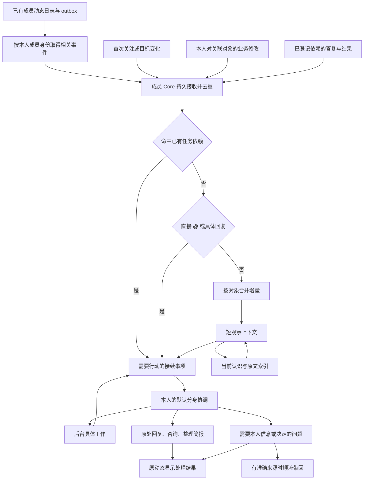

# 本机数字分身：从成员动态接手协作、维护关注与接续任务

更新日期：2026-10-24（Asia/Shanghai）。核对基线：`Meta`，`616ff795f6e7b2eec0e41b2943070e3f707db60c`。成员动态由 `34d1583` 引入；本轮核对的分身、成员动态及工作台核心实现与前版基线 `c7612db` 相同。

状态：用户已明确“@ 本人或本人关注的内容，默认直接交给分身”的方向。本版据此更新设计，并提出可分期采用的产品构思。下文现有能力表以 Meta 基线为准；独立 `codex/shadow-activity` 分支正在实施自动接手、协作与接续，实际进展和验证见[实施记录](2026-10-24-shadow-activity-implementation.md)，不将该分支未提交改动写成 Meta 已有能力。

当前事实以[成员动态](../sources/decisions/member-activity.md)、[本机分身](../sources/decisions/local-shadows.md)、[空间工作台](../sources/decisions/space-workbench.md)和[顺流感知](../sources/decisions/in-flow-awareness.md)契约为准。本文承接[分身初版设计](2026-10-21-local-shadow-design/README.md)，不会把设计目标写成当前已经验收的功能。

## 1. 默认体验与本次调整

默认体验是：**与我有关的协作动态先交给我的分身；分身能解决就处理，需要我补充信息或作决定时再把具体问题带给我。** 用户不需要在关注后再打开另一套“允许分身关注”，也不需要对每条 @ 再点一次“发送给分身”。

例如同事在讨论中 @ 我询问兼容方案：分身读取这条消息、回复父项及已有结论，能够依据资料回答就直接以分身身份回复；缺少事实时向相关同事或分身询问；确实涉及我的产品取舍时，带着方案、差异和证据来问我。答复到达后继续原事项，不要求再说“继续”。

本版的主要变化：

- 将“本人收到的提醒”和“分身需要同步的事实”分开：本人回答或更新已关注材料时不增加自己的未读，但让相关认识和任务同步到最新事实。
- 成员关注已经存在。沿用材料、讨论、协作会话的关注关系及静音规则，不再另建一份分身订阅清单。
- @、回复到具体回复、可提及成员目录、持久事件及准确来源已经存在。优先补消费者和行动能力，不重复建设这些基础。
- “推给分身”落实为持久接手和按需处理。普通动态按对象合并，@ 和待办答复优先，不把每条提醒都追加进共享主聊天。
- 公开 @ 也可以连接两位成员的分身：在原讨论中提问，对方按自己的默认路线接手，答案沿原回复关系回到发问任务。
- 调度先查明确关系。已知任务的答复直接接续，直接 @ 可在一次处理轮中理解并行动；普通关注更新再使用短观察，不要求每条事件先经过模型分类。
- 分身接手默认覆盖已有规则确定的本人相关事件，并保留“人已读”“分身已处理”“事情已完成”的区别。
- 日常回复、提问、咨询其他会话、记录进展与任务接续默认可以执行，不再反复请求许可。
- 在接手链路之上增加三种体验：按关注重点准备异步评审、一次回答接续多个相关任务，以及按明确区间回顾变化。它们使用同一套认识、问题和任务记录，不增加新的订阅入口。
- 将讨论里的明确约定和有依据的定向求证列为后续构思：前者利用本人业务变化和任务检查点，后者利用真实作者、已有回复和 @。首版先把问题接住、问清并做完。
- 补充讨论收敛和阻塞优先两项体验：把已有依据整理成可以继续工作的结论，并说明本人回答哪个问题能解除哪些等待；沿用现有问题和任务关系。
- 活跃任务单独保留所需来源的变化关系。普通关注取消后，明确任务仍可接收必要新事实；固定版本依据、持续变化来源和任务完成分别处理。
- 将进度接待、带背景的协作交接和重复委托复用纳入产品构思。进度接待随基本闭环交付；后两项基于已有来源、问题和任务记录逐步组合，不增加新的订阅或审批入口。

默认关注表示持续了解进展并参与必要沟通；明确提出的工作进入任务。只出现一个新材料版本时，分身先判断相关变化和影响，不凭“有更新”推断用户要求修改所有相关工程。收到明确指向本人的问题或任务时，按其实际要求推进。

产品中区分三个动作：**交给分身、分身行动、提醒本人**。与本人有关的合格信号默认交给分身；是否回复或安排工作取决于内容；需要本人补充信息、作选择或处理异常时，才形成面向本人的待办。普通进展可以更新认识后保持安静，不要求每次 @ 都回复“已收到”。

用户只需沿用已有动作表达意图，不增加一套自动化配置：

| 用户动作 | 分身理解的默认含义 |
| --- | --- |
| 同事 @ 本人或回复本人 | 优先看这条具体消息，处理问题，或接上原来的工作 |
| 本人关注材料、讨论或协作会话 | 持续了解这个对象；相关更新自动交给分身，必要时沟通和提示影响 |
| 本人说“等答案后继续”“帮我把这件事办完” | 保存目标、完成条件和等待关系，持续推进到目标完成 |
| 本人说“这条我来” | 把当前问题的回复交给本人，分身继续保留上下文；其他事项照常处理 |

关注的默认行为也覆盖现有规则产生的自动关注，例如本人发布材料或参与讨论。用户仍在原关注入口调整关注与静音；不再逐一配置哪些对象“允许 Agent 使用”。

三种能力各自负责一段工作：@ 和关注确定与本人有关的来源，分身维护认识并处理事情，顺流在本人已有工作的正常交互中带回相关结果或问题。分身由成员 Core 驱动，不依赖本人打开动态页或先与个人会话交互；顺流继续保持轻量，不承担后台任务调度。

## 2. Meta 已有能力与剩余缺口

| 领域 | `Meta` 已有实现 | 仍需补齐 |
| --- | --- | --- |
| 成员 @ | `mentions` 保存成员 ID、显示名及 UTF-16 正文范围，服务端核对；有效离线成员可选 | 分身作者发出的 @、默认接手、行动回传；无需重做成员选择器 |
| 回复关系 | 根讨论中平铺展示，`replyTo` 可指向根批注或具体回复；读取与定位保留父项 | 用已有父项关联待回答问题及任务，避免只靠文字猜测回复对象 |
| 成员关注 | 材料、讨论、协作会话三类；`following/direct_only/muted`，自动关注、层级覆盖和 revision | 让本人分身成为默认消费者，给已有关注叠加业务目标和当前认识 |
| 事件与持久化 | `ActivityEnvelope`、稳定事件 ID、空间单调 seq、源记录 outbox、个人收件原因 | Agent 专用顺序增量读取、接收确认、独立处理进度与恢复 |
| 来源 | 已有 `SpaceSourceRef`，包含材料版本、讨论/回复、会话/轮次/项、请求身份 | 为简报修订、分身消息和后台任务结果补足精确版本定位；沿用同一引用体系 |
| 个人工具 | `list_member_activity` 的 activity/follows/members，`set_member_follow`、`mark_member_activity_read` | Core 到本人分身的适配；当前运行时入口并不能读取成员个人动态 |
| 空间读取 | 简报、材料、讨论、请求和公开参与对象已有对应业务读取接口 | 将现有读取能力准确接入分身运行时；不重做空间读取工具集 |
| 公开讨论工具 | `add_annotation` 已有 mentions 和可选 requestId；`reply_to_annotation` 已有 mentions、replyTo 和幂等 requestId | 统一分身作者、任务与行动关联，以及适合模型调用的成员目录投影 |
| 界面 | “我的动态”、空间概览动态、关注管理、准确来源、共享已读、离线已读补交 | 在原位置增加分身处理状态、待我决定和任务接续入口 |
| 分身运行 | C1/S/W/J、后台任务、换段、准确原生运行记录 | 自动事件入口、目标与依赖、观察状态、接续轮、恢复和跨轮行动去重 |
| 分身任务工具 | 已有 start/status/update/cancel/resume，但非 main 轮次仍不能修改任务/话题 | 支持事件来源、结果轮和工作轮正常接续，区分本轮结束与任务完成 |
| 简报及顺流 | 简报有版本比较；顺流已有有界提示和会话路由 | 分身直接写简报；相关结果和问题回到准确工作会话 |

核对依据：[成员事件与收件匹配](../../../internal/collab/member_activity.go)、[动态 API](../../../internal/collab/member_activity_api.go)、[个人 MCP](../../../internal/mcp/member_activity.go)、[讨论工具](../../../internal/mcp/server.go)、[批注模型](../../../internal/collab/types.go)、[分身任务工具](../../../internal/shadow/tools.go)、[任务完成回调](../../../internal/shadow/native.go)。

当前成员动态契约明确：关注不自动启动分身、顺流或 Cloud 订阅。**本次要改变的是这条默认连接关系；现有 @ 和关注本身已经可以使用。** 已有实现与验证见[成员动态实现记录](2026-10-23-member-activity-implementation.md)。该记录的单 Mac 多 Core、浏览器与专用原生回合证据不等于本方案的分身自动接手已通过验证。

读取能力同样已有基础：公开材料、讨论、简报、请求和参与会话都有现成工具，分身也继承本机原生 MCP 配置。需要补的是不依赖个人安装差异的空间绑定、真实分身作者及事件驱动调用。当前分身额外注册的动态工具主要负责记忆、历史、话题和任务，不能由此推断继承的空间读取工具不可用；也不能因个人 MCP 可以查询动态，就认定分身已经自动收到本人的事件。接入时复用既有读取语义，按准确来源补必要的定向读取参数。

## 3. 基于现有能力的产品构思

优先把已有的关注、@、回复和任务连接成完整协作体验。下列构思按依赖关系分期，不要求首版同时实现。

### 3.1 优先形成的六种体验

| 体验 | 具体行为 | 复用的基础 | 最小新增部分 |
| --- | --- | --- | --- |
| 接住问题并把问题问完整 | 同事 @ 我问“新接口兼容吗”，分身查资料；缺客户端版本就原处补问，事实齐全后直接回答，剩下产品取舍才找我 | @、replyTo、成员目录、材料与讨论读取 | 默认接手、真实分身作者、提问与答复接续 |
| 知道谁在等谁 | 我问“现在谁在等我”，分身给出真正需要我回答的问题；我等待的结果到达后，分身继续原工作 | 明确回复关系、请求状态、后台任务 | 问题与任务依赖、检查点、双向等待视图 |
| 代答进度并核对交付 | 同事 @ 我问迁移进度，分身根据实际任务回答“实现已完成，恢复验证还在等结果”；会话结束后按原要求检查是否还有缺口 | 任务及请求读取、会话终态、固定来源 | 任务与原要求关联、完成条件核对、结果回传 |
| 解释变化对工作的影响 | 关注的接口材料更新后，分身指出“失败语义改变，影响当前任务的重试条件”，必要时修正自己先前的答复 | materialId 跨版本关注、固定材料版本、原回复 | 内容差异、证据到结论和任务的关联 |
| 带着准备来找本人 | 需要选择支持期限时，分身先查清事实和选项，在“待我处理”或准确关联的工作会话中提出一个可直接作答的问题 | 成员动态、任务来源、顺流短提示 | 待决问题、准确返回路线、回答后继续并撤下旧提示 |
| 随工作维护团队共识 | 讨论形成结论后整理简报，附依据、仍有分歧的地方和下一步；回来时可问“我离开后有什么变化” | 简报版本、讨论分组、来源、任务状态 | 简报写入、对象认识、有界回顾 |

建议首先交付“接住问题 → 必要时补问 → 收到答案继续 → 只把真实待决事项交回本人”。进度代答可以随之加入，必须以实际状态和证据作答，区分已发送、已接收、正在做和已完成。

### 3.2 公开提及连接分身之间的工作

这是一条值得优先验证的完整链路：

1. A 的分身处理迁移任务时，发现缺少旧接口的重试事实。
2. 它在原讨论中 @ B，明确问出缺少的条件，并把这条问题登记为原任务的依赖。
3. B 的 Core 按已有成员匹配，将 @ 交给 B 的默认分身。
4. B 的分身读取相关材料，能回答就原处回答；缺少 B 的信息时，先准备好具体问题再找 B。
5. 回复以准确 replyTo 回到 A 的问题；A 的任务取得答案后继续。B 本人直接回答也走同一路径。
6. 答案已经足够时，更新工作状态；只有新增事实、仍有缺口或任务结果需要交流时，才继续发言。

成员只需 @ 对方本人，无需选择对方原生会话、分身名或确认其在线状态。对方没有分身时，仍是一条正常成员提醒；分身离线时保留未处理状态。已送出 @ 不表示对方已接单，已经收到一条回复也不表示问题已解决。

同一问题保留一个主要讨论位置。已在原讨论发问，就不再通过 `send_space_shadow` 复制相同要求；已有分身聊天中的工作继续在该聊天处理，需要具体执行会话调查时使用 `send_space_request`。这些是已有入口的选择，无需另建分身私聊系统。

多人同时被 @ 时，按问题缺口和已有回答各自补充。可明确拆成“接口事实等 B、支持期限等 C”，保留各自依赖；仅被抄送的成员无需发回执。参与者关系来自实际讨论、明确责任和任务记录，不从显示名推断岗位。重复与往返终止见第 10.2 节。

### 3.3 关注带来可持续使用的认识

关注后，分身先形成一份有界工作备忘：当前进展、有效结论、未解决问题、来源和相关任务。用户可以直接问“现在到哪一步了”或补一句“重点看旧客户端兼容”，无需重新解释整个讨论，也无需再开一个 Agent 订阅。

材料、讨论和执行会话可以服务同一个任务。例如迁移任务引用接口材料的失败语义、讨论中的兼容期限和执行会话的验证结果；其中一个对象变化，只重读受影响的部分。已有几条讨论明确依赖同一产品选择时，可以只问本人一次，再分别接续各项工作。

关系先来自已登记问题、replyTo、请求父子关系、任务实际引用或用户明确关联。文字相似可以作为查找线索，不能据此把不同版本、不同条件的问题合为一项。用户改变选择时，相关任务重新核对适用条件。

关注表示持续了解和必要沟通；一次明确委托才产生对应的完成目标。普通会话终态可形成进展认识，交付回看按已经存在的要求核对，不凭一次关注替用户新增一整套验收工作。

### 3.4 在同一基础上继续扩展的构思

| 构思 | 具体体验 | 新增依赖与顺序 |
| --- | --- | --- |
| 复用仍有效的答案 | 相同问题再次出现时，核对版本和条件，给出简短答复及此前讨论链接 | 同一对象和明确引用范围内的答复索引，随认识与证据管理完善 |
| 核对矛盾而非只转发矛盾 | 一处说“可重试”，另一处说“不能重试”，先核对是否分别指请求未送达和服务端已执行，再定向补问缺失条件 | 结论适用条件、冲突记录及答复接续，随证据管理完善 |
| 对已经发出的答案持续负责 | 引用材料变更后，检查旧答复是否仍成立；确实受影响时在原处追加更正，接续相关任务 | 证据到答复/任务的索引；只覆盖仍关注或活跃任务引用的依据 |
| 按明确约定跟进交付 | “等小李给接口说明，周五还没有就提醒我”；说明先到就继续，到点仍缺才提醒 | 持久检查时间与完成条件，随等待任务实现 |
| 本人自然接回一项工作 | “这条我来回”使该问题未发出的代答停止，其他事项照常；本人回答后分身继续关联工作 | 问题级处理者、版本和依赖变化，随任务接续实现 |
| 随工作准备评审和交接 | 整理已完成内容、完成证据、剩余分歧及下一位参与者需要回答的问题 | 复用认识、任务检查点和简报；待基础闭环稳定后完善 |

“承诺跟进”先处理明确交给分身的要求。当前成员动态不会提醒本人自己的 human 发言，仅消费个人动态无法完整发现本人承诺。第 3.12 节进一步探索从已关注对象或活跃任务的本人发言中接住明确约定，依赖第 3.9 节的事实同步；无需为了此体验扫描本人所有发言。

跨空间个人总简报、自动匹配专家及全空间语义发现可以继续探索。当前分身 C1 对本空间共享，个人跨空间汇总应有单独的个人展示位置；这些能力不作为首版依赖。

### 3.5 首个可用版本的演示场景

首版围绕四条完整场景验收：

1. 同事 @ 本人询问已有事实，分身按准确来源读取并在原处回答，本人不确认发送。
2. 分身为一个明确任务向同事补问，对方本人或分身回答后，原任务继续；真正缺少本人选择时再形成一个待决问题，回答后自动撤下提示。
3. 本人关注的讨论连续更新，分身合批维护认识。用户询问进度时能准确回答；有影响当前工作的变化时给出变化、依据和下一步，普通进展保持安静。
4. 本人直接回答问题或完成已有任务要求的交付后，分身同步事实，撤下已经解决的待办；关联任务从最新检查点继续，不再代答同一个问题或催问已经提供的信息。

第一、二阶段共同交付这些场景。重点观察需要本人处理的事项是否减少、是否出现重复回复、答复后是否真正继续，以及每个已解决问题需要多少模型调用和原文读取。具体延迟、成本和批次参数通过回放确定，不在设计中假设收益数值。

### 3.6 按关注重点提前准备评审

用户关注接口材料后补充“以后更新时重点看旧客户端兼容”。这句话成为该关注对象的工作目标。材料发布新版本时，分身比较受影响的接口和既有兼容结论，必要时启动后台任务核对事实；发现缺口就在该版本的讨论中问清楚。本人进入评审时，可以直接看到变化、已有依据和仍需决定的地方。

没有额外目标的普通关注默认维护进展和相关影响；“关注接口材料”本身不意味着每次更新都要重跑全面测试。明确提出持续评审目标后，后续版本沿用目标，无需逐版本再次确认。目标改变时递增版本，旧评审结果作为资料保留，不能冒充新要求已完成。

复用材料固定版本、讨论、后台 J/W 和分身的本机工具。新增部分是关注目标到评审任务的关联、按变化选取上下文，以及将发现写回准确版本。已经公开且可访问的材料是默认依据；需要执行验证时，任务保留实际仓库和执行结果，不把材料中的描述当成已经跑过的验证。

### 3.7 让一次回答接续多项工作

三个任务都在等待“旧客户端支持到哪个版本”，且引用同一项产品决定时，分身向本人提出一个问题，并附上会受影响的任务及各自下一步。本人回答一次后，三个任务按各自条件继续：迁移任务调整兼容路径，验证任务补对应场景，文档任务更新说明。原问题的讨论记录保留回答来源，各任务保存自己使用的是哪一版答案。

优先复用已经登记的同一个问题，或指向同一决定和适用条件的明确关系。相似表述先作为候选关联；例如“支持到 v3”与“只在企业部署中支持到 v3”不能自动变成同一个决定。界面可以合并展示相关问题，各自是否获得充分答案仍独立核对。

这项能力复用问题、来源和任务依赖，不要求先建立通用审批或流程引擎。普通事实问题同样可以共享答案；只有事实确实缺失或需要本人选择时才打扰本人。回答一个问题会解除相应等待，不会把所有关联任务直接标记完成。本人之后改口时，保留新旧答案关系，让仍受影响的任务重新核对。

### 3.8 回来时直接接上工作

用户说“我回来了，这几件事有什么变化”，分身按已关注对象及活跃任务，给出三部分：哪些结论变了、哪些工作已经推进、哪些事项需要本人回答。每项附来源和可继续的动作；没有变化的对象可以合并说明，不逐条复述消息。用户也可以指定“从昨天下午以后”或“从上次回顾以后”。

回顾使用独立的时间区间或输出水位，不能拿人的未读数量推断用户知道什么，也不能用分身消费水位代替“上次给本人说明到哪里”。首次回顾提供当前状态及可确认的变化区间。生成回顾、向入口输出和本人已读分别记录；输出结果可按同一 ID 回读，出错不跳过尚未输出的范围。

同一任务如果有准确的个人会话返回路线，下一次正常交互可通过顺流附带相关变化；用户已在原讨论解决的问题不再作为待办出现。此处复用正常交互和明确的回顾请求，不需要推断用户是否离开电脑，也不需要为“回来”增加后台模型轮询。首版在单空间完成，跨空间回顾另设个人展示位置。

### 3.9 本人亲自推进后分身自然接上

本人已经在讨论中回答，或发布了关注材料的新版本，分身随后应能说清最新进展，撤下已经解决的问题，并继续关联工作。这可以避免本人刚做完一件事，分身却依据旧状态催问或重复处理。

Meta 的成员提醒会跳过本人自己的 human 内容；现有空间事件仍保留业务变化。因此自动接手不能只复制人的收件列表。Core 对已有关注对象和活跃任务引用的准确来源补充事实同步：只传变化身份和必要正文，更新同一份认识；不新增人的提醒，不将本人的每次发言解释成新委托。普通关注遵循静音与取消设置，明确任务的依赖按任务生命周期接续。

这一项属于默认接手的完整性要求。本人已经回答的情况随问题接续实现，本人更新材料或改变相关结论的情况随关注认识同步实现。

### 3.10 有了充分依据就结束无谓等待

分身问 B“旧客户端是否支持重试”，等待期间，已关联的接口材料发布了包含明确答案的新版本。分身核对客户端版本、失败阶段和来源后，可以采用该依据继续任务，在原问题下简短说明“已从新版说明确认，后续据此推进”，从等待清单中移除这项缺口。B 后来的回复仍可补充或纠正事实，无需重复启动已经完成的动作。

这里判断的是原问题的完成条件。如果任务明确要求 B 作出选择或给出验证结果，文档中的一般描述不能替代那项答案。保存采用的证据和适用条件；多任务共用问题时，各任务仍分别核对自己的条件。若晚到回答推翻原依据，只重新处理受影响的结论和工作。

这项构思建立在多来源关系和证据核对上，排在基本问答接续之后；复用任务依赖和原处回复，不增加新的聊天或审批流程。

### 3.11 继续工作前收到有用的变化

本人此前在某个准确关联的工作会话中安排了迁移任务。继续该会话时，顺流附带：“你使用的接口说明已更新：可重试条件变了；分身已核对，影响下一步的恢复逻辑。来源为 v2 的对应讨论。”工作 Agent 可以取得相关证据，再继续当前任务；需要本人选择时，同一入口带回已经准备好的问题。

分身在后台完成阅读和核对，顺流只负责在正常交互时递送有界结果。没有相关变化就不输出；同一变化已沿该任务路线递送后不反复附带。判断依据是任务实际引用的材料、问题及版本，不能从“最近打开的会话”推断关系，也不能假定一个会话代表本人的全部工作。

已有任务结果回传先实现；这种“尚未完成任务的新依据提示”作为下一步体验，复用相同路线、来源和投递记录。它不增加一套订阅开关，也不把整个关注列表放进工作会话。

### 3.12 接住讨论里的明确约定

本人在已关注讨论中说“我周五补一份旧客户端兼容说明”，分身可以将这项明确约定与原讨论、交付对象和日期关联，检查是否已有同一任务。已有任务就补入约定，没有就登记后续事项；随后整理现有结论、找齐缺失事实，让说明能按原约定完成。本人后来直接发布说明时，分身核对内容和完成条件，更新同一任务，不再继续提醒。

这里增加的是从自然协作中识别已明确的工作，不要求本人重新把同一句话复制给分身或批准一次任务创建。“我们可以考虑补说明”仍是建议；引用同事的话不变成本人的约定。已经说“这条我来”的问题沿用本人接回状态。确实缺少对象、日期含义或完成标准时，只问缺失信息。

记录至少包含原始发言、实际作者、交付内容、可核对的完成条件、可选检查时间及关联任务。相对日期结合发言时间和成员时区解释；来源更正、约定变更或明确撤销时更新版本。约定有明确检查时间才安排一次持久检查，完成事件先到就撤下检查；不使用持续模型轮询或反复催问。

这项构思依赖本人业务变化同步、准确任务关联和持久时间触发，放在第三阶段之后按需求采用。首期只识别已关注对象或活跃任务范围内的明确约定，沿用现有认识和等待视图，不新增个人待办系统。

### 3.13 根据已有参与线索定向求证

分身发现缺少“旧接口在超时后是否可能已经写入”的事实，可以先回读相关材料和讨论；仍没有答案时，依据材料作者、该结论的实际答复者、已明确的负责人或关联执行会话，向最相关的参与者提问。例如在原讨论中 @ 写过失败语义说明的 B，附上准确材料版本和尚未明确的失败阶段。

Meta 已有作者、成员 ID、回复关系和 @。新增工作是保留“为什么找这个人”的具体来源，将这次求证登记为原任务依赖。不能把最近活跃者、显示名或一条无关发言当作职责证明；没有足够线索时，在原讨论问一个明确的归属问题即可。无需先建立全团队专家排名或组织角色系统。

对方公开说明“这部分应由 C 确认”时，保留原问题及转交依据，向 C 补问同一缺口；A 的原任务继续等待这个问题，不创建层层互不相认的新任务。B、C 已提供的事实可以分别满足不同条件，足够后停止求证。沿链回到已问过的成员时先核对已有答案和缺口，避免分身之间循环转问。

明确 @ 已知参与者属于第二阶段的基本协作；根据已有证据选择参与者属于后续增强，先复用同一套讨论、问题和任务工具。跨空间自动找专家继续单独评估。

### 3.14 把讨论收敛为可以继续工作的结论

一个兼容方案讨论已经有几十条回复，分身可以整理成：“接口事实已经明确；现有争议来自两种客户端版本；还缺支持期限这一项选择。确认期限后，迁移和验证分别继续这些工作。”每个结论回到对应材料版本或具体回复，参与者能直接检查依据和补充遗漏。

这种整理在问题得到答案、结论发生变化或有人要求总结时发生。普通新回复仍合批维护认识，不每次都发总结。先在原讨论给出短结论，启用简报写入后再更新对应条目；结论没有变化就保留原总结。没有人反对不能被写成“大家已确认”，分身提出的方案仍标为建议。确实需要某位成员作选择时，保留那个具体问题。

下一步来自已有任务、实际回答和明确约定。分身可以接续自己的工作，也可以指出还缺谁的信息；已有发言没有形成承诺时，不替参与者宣布交付日期。复用来源、问题状态、原处回复及简报版本即可实现，放在第三阶段，不新增会议纪要或审批系统。

### 3.15 优先解决真正阻塞工作的问题

本人问“我现在先处理哪一件”，分身可以回答：“先确认旧客户端支持期限，迁移、验证和说明三项工作都在等它；另一个进度询问已有证据，我已经回复。”每项排序理由都能落到当前等待关系、明确截止时间或用户给出的优先级。

复用已经登记的依赖和完成条件，合并同一个待答问题的展示，并列出回答后能继续的工作。暂时没有关系证据的事项按普通处理顺序接手，不把消息量、同事头衔或模型猜测当成紧迫性，也不把局部任务关系宣称为整个团队的关键路径。此体验可以先做按需查询，随后用于“待我处理”的排序。

后台调度优先保证成员当前输入，随后结合直接问题、已到达的依赖答案、明确时间要求和等待时长安排工作。被较多任务引用是排序依据之一，不使较少被引用的事项永久等待。所有合格信号都先持久接收；调度优先级改变处理时机，不改变是否接收。此项与第四阶段的公平调度一起完善，不增加用户配置的优先级规则表。

### 3.16 建议采用次序

| 顺序 | 优先体验 | 相对 Meta 的关键增量 | 直接观察的收益 |
| --- | --- | --- | --- |
| 第一批 | @ 接手、原处代答、普通关注静默跟进 | 默认分身消费者、准确作者、有界认识 | 本人少做“读一遍再转发给分身”的搬运 |
| 第一批 | 缺事实就补问、答案到达自动继续、双向等待与原任务回传 | 问题与任务依赖、检查点、接续轮、准确返回路线 | 少问“现在等谁”“收到答案后怎么没继续” |
| 第一批 | @ 对方本人即可连接双方分身，对方本人也可直接接话 | 公开提及、准确 replyTo、双方默认分身、同一个问题的依赖关系 | 不用找对方的会话、复制背景或手动搬运答案 |
| 第一批 | 本人已经回答或交付，分身自然接上 | 本人事实同步、发送前核对、等待条件与任务状态更新 | 不再遇到“我刚做完，分身还在催问或重复做” |
| 第一批组合 | 同事问进度时，分身用真实状态直接回答 | 复用已有任务、请求、结果读取，接入问题的当前状态 | 本人少做“查一下，再告诉同事”的搬运 |
| 第二批 | 新版本影响分析、持续评审、旧答案更正 | 结论与来源版本关联、明确关注目标 | 少依据旧结论返工，评审前已有准备 |
| 第二批 | 一次回答接续多项工作、变化回顾 | 共用问题、各任务独立条件、回顾输出水位 | 本人少重复解释，回到原工作更快 |
| 第二批 | 讨论收敛为结论及剩余问题 | 已接受答案、来源版本、原处回复和简报条目 | 少重读整段讨论，能够直接继续下一步 |
| 第二批组合 | 给下一位接手者准备必要背景 | 原问题、已查事实、准确引用、待补缺口和返回位置 | 对方从问题缺口开始，不必重新阅读整段聊天 |
| 后续候选 | 同一交付复用已有工作，分别回应各提问处 | 任务多来源关系、各自完成条件与独立交付记录 | 相同调查少跑一次，各位提问者仍能得到自己的结果 |
| 后续候选 | 优先呈现真正阻塞工作的待答问题 | 当前依赖关系、明确时间要求、公平调度 | 本人知道先回答什么，以及哪些工作随后可以继续 |
| 后续候选 | 自然约定跟进、根据参与线索定向求证 | 本人事实同步、时间触发、带来源的参与关系 | 减少遗漏已说好的事和找人过程 |
| 后续候选 | 新依据满足事实等待、工作中收到相关变化 | 多来源条件核对、精确任务影响关系 | 减少无谓等待和继续使用过时依据 |

第一批共同构成最小可用闭环。后续构思按真实协作样本选择，不把所有头脑风暴项同时变成首版要求。评估应同时看本人需要回答的问题数、已解决问题是否真正接续、重复或纠正次数、处理延迟及模型/原文读取成本；减少人的未读数字本身不能证明分身有用。

第一批的产品入口仍是原来的 @、关注和讨论。先用第 3.5 节的四条场景判断是否值得持续使用，再扩展评审、回顾和主动求证；不要求用户先配置触发条件、收件规则或工具授权表。

### 3.17 用真实状态接待进度询问

同事在讨论中 @ 本人问“兼容验证现在怎么样”，分身读取相关 J、空间请求及已有结果，直接回答：“迁移实现已完成，验证还缺旧客户端的超时场景；当前正在等测试会话的结果。”本人不用先查进度，再复制给同事。

这是基本接手能力的一种组合，不需要另建进度机器人。Meta 已有任务状态、请求状态、共享分身聊天及执行结果的读取；本方案补的检查点、等待条件和准确来源让回答更完整。回答要说明最近确认的状态及依据：请求已投递不能称为对方已接单，原生本轮结束不能称为验证已通过，没有明确约定就不编造完成日期。状态暂时读不到时，保留最后核实时间及当前缺口。

一次进度询问只需回答现状。对方明确说“有结果在这里告诉我”时，将这个原问题挂到任务的交付关系；结果到达后回原处，不因为一句普通询问就让分身周期性催办或持续发送进度。跟进仍由实际事件驱动。

### 3.18 给接手者准备必要背景

分身需要请 B 核对兼容语义时，发出的内容应让 B 能直接开始：“当前方案要求超时后重试；v2 说明只定义了连接失败，尚未说明服务端已经写入的情况。请确认这个阶段是否可以重试，答案会用于迁移任务。”随问题附两处准确来源，而非转发整段讨论。

这份背景包含原问题、已核实事实、尚缺的信息、采用答案的条件和答复位置。它由当前认识及任务检查点按需组装，正文保持短小，细节通过 `SpaceSourceRef` 回读。对方已有相关认识时，只补新增事实和缺口；转交给下一位参与者时继续沿用原问题身份，保留每一步新增的依据。

普通成员收到的是可直接回答的问题；有默认分身的成员则可由分身接手。对方回答后，原任务更新认识并继续，必要时将结论带回原提问处。公开讨论使用 @ 和 `replyTo`，具体会话调查使用已有 `send_space_request`，已有分身聊天使用 `send_space_shadow`；一次交接选择合适的入口，不把相同问题同时复制到三处。

它可以先作为基本提问工具的内容要求，再随检查点和准确回传完善。无需新增“生成交接包”的必经按钮，也不要求用户为每次交接批准发言。

### 3.19 同一交付复用已有工作

两位同事在不同讨论里要求同一份“接口 v2 兼容性检查”，分身发现已有任务正在核对相同版本和相同交付条件，可以向第二处说明现有进展并关联该任务。调查继续执行一次，完成后按各处问题给出所需结论和来源。若已有结果仍满足当前条件，直接复用结果即可。

首期只处理明确指向同一任务，或已经核对为同一对象、版本和交付条件的请求。单纯文字相似不合并，例如“检查 v2”与“验证 v2 在旧客户端上的实际行为”可能需要不同证据。不同要求可以共用已核实事实，仍保留各自任务。已有任务的要求发生变化时，逐项检查哪些请求仍能由该任务满足，避免一次合并静默扩大所有人的工作范围。

这一构思比“一个答案解除多个等待”多一层关系：一项实际工作可能有多个请求来源。各来源保留原始要求、提问位置、完成条件和回传状态；共用工作不抹掉请求者身份，也不合并各请求的业务状态。一位请求者不再需要结果时，只解除对应关系；其他委托仍有效的工作继续。具体状态见第 8.5 节。

新增依赖是任务多来源和独立交付记录，放在基本闭环稳定后的候选阶段。先以同一分身、同一空间内的明确重复为范围，再评估跨分身重复劳动，避免把通用语义聚类变成首版前置工程。

## 4. 默认接手规则与整体结构

### 4.1 哪些事件进入本人分身

给人产生的动态优先复用业务保存时已经确定的个人收件原因。关注初始化、本人对已有关注对象的修改和活跃任务依赖属于补充业务信号，由明确对象关系匹配；不让模型扫描空间猜测“是不是与我有关”。

| 已有原因或输入 | 默认处理 |
| --- | --- |
| `mention` | 优先接手，读取被 @ 的原文和父项，处理实际问题；单纯抄送可更新认识而不发无意义回执 |
| `direct_reply` | 优先查找对应问题/任务，答复到达后接续；无任务关系时作为具体讨论增量处理 |
| `own_request_result`、`own_turn_result` | 与已知请求、轮次和任务关联，核对是否满足目标；无明确后续任务时生成有依据的结果摘要 |
| `follow_discussion`、`follow_material`、`follow_execution` | 按具体讨论、材料版本或会话终态合并观察，更新认识并判断是否需要行动 |
| 首次关注一个对象或为关注补充目标 | 在关注保存成功后，为该明确对象建立或修订一份有界认识；不把旧历史补成成员未读 |
| 用户直接安排分身工作 | 沿用 C1 入口，保存目标，必要时关联已有关注和任务 |
| 既有任务的依赖答复/后台结果 | 由任务依赖索引继续处理，不靠“仍未读”判断是否要接续 |
| 本人修改已关注对象或亲自回答关联问题 | 按准确来源同步认识、核对等待条件；不为本人增加提醒，不将自己的发言重复当作新请求 |

一个事件可以同时含 @、回复和多级关注原因，仍只进入本人分身一次，保留最高处理优先级及完整原因。原请求结果与公开回复目前若没有可核实同源身份，沿用各自事件；本方案新增业务行动关联后才可以合并，不能用相似文字或接近时间猜测重复。

`direct_only` 保留直接 @、回复和本人结果，停止普通关注增量；`muted` 沿用现有含父级覆盖的静音规则。已取消关注不被分身一次普通回复重新开启。偏好改变后，未开始的普通观察按当前意愿重新核对，历史提醒仍保留历史含义。静音、取消关注不等于取消已明确安排的独立任务。

还需处理分身发言带来的自动关注：当前实现可按有 MemberID 的作者自动关注讨论。新增 shadow 作者后，分身为任务临时咨询的其他讨论应登记任务依赖，不因每次自动回复持续增加本人的永久关注。用户明确说“关注这里”仍直接复用 `set_member_follow`；已有本人发布/参与产生的关注保留。这样一次 @ 经过分身回复后，也不会意外变成永久订阅。

本人的业务写入也按已有关联匹配：关注对象同步最新事实，活跃任务取得准确依赖变化，两路同时命中只接收一次。分身自己的已知写入直接登记动作结果和相应认识，后续事件只用于核对，不再触发一轮自问自答。

首次关注的初始化属于新的 Core 联动。保存关注后生成可恢复、按关注 revision 去重的初始化信号，读取对象当前状态及必要来源；随后按固定快照接续新事件。接入前已有的大量关注按首个相关事件或实际查询逐个初始化，不在启动时把所有历史送给模型。

### 4.2 投给哪一个分身

建立成员本机的路由：`spaceId + memberId → defaultShadowId`。选择本空间、属于本人的分身，不能将个人动态广播给空间里的全部分身。空间主机与运行分身的成员 Core 可以在不同 Mac。

首个自建分身自动成为该空间的默认分身，新增分身不抢占。已有多个分身而缺少默认值时，以最早创建的自建分身建立稳定默认值并在界面标出；成员可在原分身列表中改选一次。它是持续路由偏好，不是每个任务都要确认的授权步骤。

没有分身时，原动态照常保留并显示“尚无分身接手”，提供既有创建入口，不静默猜工作目录和模型创建原生会话。有默认分身但其暂停或离线时，持久记录待处理信号；恢复后补齐，不自动改投另一个分身。更换默认分身时保留消费者进度、在途任务和处理认识，旧任务明确交接或由原分身完成，不重复发起。

默认路线带 revision。改选后新信号归新分身，已运行任务保留原处理者及结果关系；尚未开始的观察批次在更新归属后再调度。显式转交任务时同时转移检查点和行动记录，旧处理者不能再以过时归属提交同一个动作。

首次接入固定切换快照：保存从哪个 seq 开始持续接收，并对已有未处理直接问题及未读动态做一次有界回顾。旧未读不等于旧问题仍未解决，须查原文及已有动作；首次回顾不把所有历史讨论重跑成新任务。切换快照之后的事件正常排队，不能在初始化中漏掉。

### 4.3 数据流

复用成员动态的匹配结果，再增加分身处理通道。图中的依赖匹配、直接消息和普通观察是三条可选路径：同一事件只选择一条主处理路径，不能因为同时命中 @ 和关注而并行派发两次。人的已读、分身接收/处理、Cloud ack、顺流投递和业务完成分别维护；共用来源身份不意味着共用一个水位。

### 4.4 接手后的默认反应

| 输入内容 | 分身默认行为 | 本人看到什么 |
| --- | --- | --- |
| @ 本人询问可查证的事实 | 读取来源，直接回答；缺事实时找相关参与者补问 | 原动态显示已处理及实际答复 |
| @ 本人要求尚未确定的业务选择 | 汇总事实、选项和影响，登记待决问题 | 一个带背景、可直接作答的问题 |
| @ 本人只是抄送进展 | 更新认识；没有实际问题则不发回执 | 可回顾的进展，不新增待办 |
| 关注对象出现普通更新 | 按对象合批，比较当前认识 | 无需本人介入时保持安静 |
| 已等待的问题收到答案 | 校验是否回答了问题，继续原任务或补问缺口 | 任务进度或完成结果 |
| 本人或同事已经解决问题 | 核对最新状态并关闭过时待办 | 待决提示撤下，保留处理依据 |

“待我决定”只收纳确实缺少本人信息或选择的事项，不把普通回复、咨询、整理简报改写成“是否允许分身执行”的审批问题。本人依然可以随时在原讨论中直接参与。

## 5. 工具清单：复用优先，收缩新增范围

### 5.1 已有工具继续使用

| 工具 | 在新方案中的用途与接入变化 |
| --- | --- |
| `list_member_activity` | 个人入口继续读取 activity/follows/members；不是给分身扫描全空间的轮询入口 |
| `set_member_follow` | 保留关注、取消、静音和 revision/requestId。用户说“关注这里”复用此关系，不再建平行订阅 |
| `mark_member_activity_read` | 保留人的阅读/明确清理语义；分身处理完成使用自己的状态，不调用它冒充人已读 |
| `add_annotation` / `reply_to_annotation` | 复用 mentions、replyTo、requestId，以分身真实身份发起或回复；任务问题仍落在这些公开讨论对象上 |
| `read_context` / `read_annotations`、`read_material` | 按 `SpaceSourceRef` 读取原文、父回复、固定材料版本；按需要补稳定增量边界 |
| `read_space_brief`、`list_space_requests` / `get_space_request` | 读取既有结论、请求和准确结果，避免重新调查已经有答案的问题 |
| `list_space_targets`、`list_space_shadows` / `read_space_shadow` | 找已关联执行会话与分身，读取共享聊天和任务；不把会话目录重新定义为成员目录 |
| `send_space_request`、`send_space_shadow`、`send_space_note` | 正常咨询、派工作和相关提示；补任务、行动及准确回传关联，取消逐次发送许可文案 |

当前运行时 MCP 会拒绝成员个人动态操作，因此“个人 MCP 已有工具”不能等同于“分身已经可直接调用”。拟议做法是由成员 Core 消费本人成员信号，并把本空间必要的公开原文和来源交给所属分身。可提及成员目录复用已有 `members` 业务查询，通过绑定分身运行时的公开目录投影提供，不把完整个人动态和偏好清单塞进共享聊天。

### 5.2 本轮真正需要的新能力

| 接口/能力 | 建议形态 | 具体用途 |
| --- | --- | --- |
| 简报写入 | 新工具 `update_space_brief` | `requestId + baseRevision + 条目修改 + 来源`，分身直接整理进展、结论和未决问题 |
| 业务关注认识 | 分身工具 `shadow_watch` | 对已有对象记录目标、认识、证据、未决事项和处理状态；支持 read/list/update/pause/resume/complete，start 复用既有关注关系 |
| 成员动态的分身消费与事实同步 | Core 内部接口 | 稳定 `afterSeq/throughSeq` 增量、接收确认、默认分身路由、本人相关业务变化及独立处理状态；活跃任务按准确来源接收变化，不依赖普通关注仍开启 |
| 任务接续 | 扩展 `shadow_task` | 事件来源、父子任务、依赖、ask/checkpoint/wait/finish、结果驱动接续；登记任务所需认识及来源，ask 同时登记实际发问与等待关系 |
| 认识与证据回读 | 扩展 `shadow_recall` / `shadow_history` / `shadow_topics` | 按具体任务或关注读取有界状态和原文入口，接续轮能更新进展 |

`shadow_watch` 中的“关注”是对事项的持续理解和跟进，不再代表另一份通知订阅。普通关注在首次相关事件到达时即可按需生成认识记录，不要求用户再写一句“请让分身也关注”。明确说“重点关注兼容性、结论出来告诉我”时，在同一关系上补目标。

成员关注仍只接受现有材料、讨论、协作会话三类对象；问题、请求、分身任务结果通过任务关系补充来源和依赖，不伪造成第四种成员关注。F 中可以保留这些关联证据及发现原因，读取和接续使用各自准确业务 ID。

本版撤回原方案将 `post_space_message` / `read_space_messages` 作为首期必需工具的安排。已有整体批注、回复、@ 和准确来源足以承载大部分问答；有原讨论就原处回复，没有讨论就创建普通空间讨论。以后若独立聊天有明确产品需求再讨论，避免为了让分身行动先重建一套聊天历史。

持续评审、共用答案和变化回顾优先组合上述工具：评审使用已有任务，答案复用使用问题依赖，回顾使用认识和历史读取。首版不为每一种产品体验新增一个专用工具。回顾输出范围由 Core 保存，模型提交本次实际覆盖的来源和区间，不能自行把范围设成最新事件后跳过中间内容。

### 5.3 简报与来源

简报继续使用版本比较；为 `BriefItem` 补稳定 `itemId` 和按条目修改，保留 topic/decisions/questions，按需增加简短 progress。分身可直接记录事实、进展、建议和待决事项，无必经人工草稿确认。事实表述仍区分“已有结论”“分身建议”“尚有争议”。

冲突返回最新版本和冲突条目，分身重读并合并；只有真实业务分歧需要讨论，不把 CAS 冲突变成用户审批弹窗。

`SpaceSourceRef` 已经存在，直接扩展缺少的简报修订/条目、分身消息、任务结果版本，不再定义同名的第二种引用。工作台已有材料引用可适配到它；每类来源都有能打开的读取入口。空间来源不自动包含本机私有工具日志或未分享文件。

## 6. 作者、触发来源与回传位置

在现有 `SpaceActor` 上增加 `kind: shadow`、`shadowId` 和实际所属 `memberId`。批注和回复已经有 typed Actor，分身聊天也有自己的 Actor；两条路径统一映射，主段换段和工作会话不改变分身身份。界面显示分身实际发言，不显示为本人刚刚输入。

一次自动处理同时保留三种关系：谁写了原事件、为什么需要这个成员的分身处理、哪项任务据此推进。Core 保存 `triggerEventId + sourceRef + recipientMemberId + shadowId + jobId`，不能为兼容旧 `SourceID` 而伪造一条“本人亲自要求”的消息。

私人的关注清单、收件原因和人的已读留在成员数据层。分身取得本空间的相关原文和必要工作目标；共享 C1 不逐条发布“主人刚关注了什么”的内部记录，也不混入其他空间内容。内部观察结果保存为处理状态，不能沿当前 main/result 的通用完成逻辑全部追加成共享回复。公开回复、提问和任务进展仍对全空间可读。

MCP 委托时，从当前调用来源保存准确回传关系，Provider/原生会话定位留在发起 Core，共享记录只引用不透明路线。WebGUI 或普通 @ 没有原工作会话路线时，结果回原讨论及成员动态，不猜“最近打开的会话”。

向本人的工作会话返回原任务结果不需要再次确认。创建委托时保存返回路线，该任务的结果、必要问题及其后续变化自动沿此路线回传，无需再为同一任务开启一个订阅。接收方拿到任务身份、变化摘要及准确来源，便能接回原上下文；不能只给一条脱离任务的“有新动态”。

这是新增的任务返回能力：当前 `send_space_note` 仍只面向已开启顺流的目标，实现时需补内部任务返回类型及独立投递状态，不能仅删去工具文案就宣称已接通。普通空间顺流沿用现有会话关系，任务专属返回不把该会话变成全空间动态接收者；明确静音仍生效。用户从任何关联入口回答后，未投递的旧问题失效，其他入口展示已答状态。

## 7. 如何维护关注上下文

### 7.1 关系、认识、任务分别保存

| 层 | 保存内容 | 生命周期 |
| --- | --- | --- |
| 成员关注关系 | 已有 subject、mode、origin、revision | 决定今后的相关动态，由成员现有关注操作维护 |
| 处理认识 F | 当前目标、结论、分歧、未决问题、来源、逐对象处理位置、已做动作 | 随相关事件演进；可有业务目标，也可默认了解进展 |
| 工作任务 J | 明确要完成的工作、依赖、完成条件、结果与行动 | 一次工作闭环，不等同于一直关注这个对象 |

材料关注会覆盖其新版本和讨论，会话关注会覆盖其终态和讨论。认识按具体讨论/问题维护，材料或会话层只保留汇总及子项索引；不能把一个材料下所有讨论长期塞进同一巨型上下文。

一个直接 @ 即使没有关注关系也可以生成一次认识和任务；它不会悄悄改变已有“被 @ 不自动关注”的规则。任务主动发出的提问通过依赖继续接收答复，不必依赖自动关注副作用。任务完成后继续关注与否仍由已有成员偏好决定。

F 至少保存稳定 focusId、空间/成员/对象、可选业务目标及版本、当前认识、有效来源、未决问题、已处理事件/对象位置、相关任务与动作、上次提醒依据。业务目标的 active/waiting/completed 与本批处理的 idle/queued/observing/error 分开记录。暂停分析保留认识和未处理范围，恢复后补齐；完成一次明确目标只结束该目标，已有成员关注仍可带来新的变化，但不会重复执行已完成的工作。

问题记录保存“问的是什么、还缺什么、等谁或哪个结果、答复判定条件、可继续的工作”，并关联原提问与已接受答复。每条重要结论关联其依据及引用它的回复/任务；新证据到达时先定位受影响的部分，无需重算整个讨论。问题级处理者记录本人临时接回的事项，独立于分身的整体暂停状态。

结论还要保留适用条件，例如客户端版本、失败阶段及材料修订。新答复与旧结论不同时，先核对条件是否相同，再决定修订结论或记录争议。按同一对象和明确任务引用建立答复索引，使分身能复用已经解释清楚的内容；没有通过当前来源核对的旧答复只作为线索。

第一阶段就保存最小认识：对象、当前问题、来源、处理范围、已做动作和等待项。后续再丰富目标管理和影响分析，避免先让所有动态进入主聊天，再另行迁移成有界上下文。

### 7.2 先用元数据定位，再读取必要正文

空间日志已经完成成员匹配。Core 将合格信号持久接收，按对象和现有任务索引分发；不需要先调用模型给全空间每条更新打分。既未命中本人收件原因，也未命中已关注对象的本人写入或活跃任务依赖的事件，不进入该分身观察批次。

直接 @、直接答复及已有任务依赖优先处理；普通关注变化使用短合并窗口和最大等待时间，避免每条消息一次调用，也避免持续更新导致永远不处理。所有背景观察与 W 共用可见的资源预算，优先保证成员新输入和重要接续；不新设一个固定廉价模型或另一条直连模型通道。

| 可由现有身份确定的输入 | 进入哪个上下文 | 是否另跑观察模型 |
| --- | --- | --- |
| 命中已登记问题、请求或子任务的答复 | 原任务的接续包，带检查点及新增答复 | 不需要先分类；在接续轮判断答复是否充分 |
| 尚未关联任务的直接 @ 或具体回复 | 当前分身的有界处理包，带原文、父项及该对象的认识 | 可直接理解并回复、登记等待或保持安静，不强制先观察再行动 |
| 普通关注对象的连续更新 | 该对象的短观察上下文 | 合批观察，有实际后续工作再交给协调轮 |

依赖索引、sourceRef 和收件原因负责定位，模型负责理解问题及答案。直接处理轮同样提交认识、已做动作和实际处理位置；其内部完成文本不自动发布到共享聊天。模型调用次数由需要的工作决定，不按事件固定安排“分类、观察、协调”三个回合。

现有动态组只展开最近二十项，Preview 也只是短摘录，不能将它们当作“全部待处理内容”。消费通道需拿到范围内全部事件 ID，随后按精确来源、父项和必要材料读正文；超过上下文预算就分页处理。

### 7.3 每批上下文

一批包含：

1. 原始工作目标或默认关注目标，以及当前版本。
2. 此前有效认识、未决问题和证据锚点。
3. 本批事件原文及准确作者、版本、replyTo 父项；已存在父链按实际数据读取。
4. 需要比较的材料固定版本、相关旧结论或已有任务结果。
5. 已执行动作、已提问题、等待依赖和本人/同事已作出的答复。
6. 本批输入上界和实际处理范围。

不包含完整主聊天、其他关注的全部认识、所有材料正文或全空间动态。认识本身也有预算：已解决细节移入可回读记录，主状态保留有效结论和仍未解决的事项；矛盾或来源失效时回读原文纠正，不在旧摘要上无限追加。

观察可用短原生上下文完成，保存后释放，不靠一个永久增长的 thread 记住所有内容。只有需要协调或执行时才向主分身交付接续包；“没有值得行动的变化”只更新处理状态，不发一条共享聊天。

### 7.4 水位、版本与接续提交

空间扫描位置说明信号已被发现，成员 Core 接收确认说明信号已持久到达，逐对象处理位置说明模型实际分析过什么；三者不同。批次开始固定上界，处理中到达的新事件留在下一批。解析失败或原文不足不推进处理水位，不能只读最后 N 条就跳到最新。

一次原子提交包含认识、证据、已处理事件/对象版本和待接续事项。改变目标、取消待办、来源撤回时重新核对旧批次。仅新增后续回复时可以提交已完成前缀，但发送动作前需读取能影响该动作的最新回复，尤其检查本人是否已亲自回答。

现有评论/回复按稳定 ID 产生事件，不能仅因存在日志就宣称支持正文编辑的所有版本变化。后续增加编辑能力时需同时加入修订版本及失效事件；材料新版本和撤回则复用已有事件。简报要回读准确修订时也需补对应版本，而非将最新正文冒充历史状态。

### 7.5 一次具体运行

本人关注材料 M 的登录方案，讨论 D 已明确两种方案，还缺旧客户端期限。

- 其他空间或既没有直接 @/回复、也未命中关注与任务关系的讨论新增 100 条消息：该关注无观察调用。
- D 的三条回复同时到达，其中一条 @ 本人：合并为一次优先输入，保留 @ 原文、三条增量和必要父项。
- 分身发现技术事实已有答案，直接回复对应消息；无需再问“可以替你回复吗”。
- 另一条需要用户决定支持期限：分身保存问题和当前调查，显示“待我决定”，原任务等待。
- 用户回答后，分身更新简报并继续任务；本人关注关系仍存在。
- 随后 M 发布 v2：分身对比相关变化，只有确实影响结论或任务时再行动，不因版本号改变就重做全部调查。

### 7.6 一份认识记录的具体样子

| 内容 | 登录方案讨论的示例 |
| --- | --- |
| 关注目标 | 重点跟进旧客户端兼容；收到支持期限后继续迁移方案 |
| 当前认识 | 已确定新接口采用方案 A；旧客户端支持期限尚未确定 |
| 有效依据 | M 的 v1、讨论 D 的两条结论回复；每条结论保留准确引用 |
| 未决问题 | Q1：旧客户端支持到哪个版本或日期；正在等本人回答 |
| 已做动作 | 已向接口参与者补问兼容事实，已回答原讨论中的重试问题 |
| 处理位置 | 已分析到事件 128；本批固定上界 135，只读取 129–135 中属于该对象的事件及必要父项 |
| 接续关系 | Q1 解决后继续 J1；J1 的结果回讨论 D，有准确路线时回到发起工作会话 |

下一次运行带上这份有界认识、相关新增原文和必要旧依据。空间其他讨论的几百条消息不进入这一批；旧结论若有冲突就按引用回读。分身依赖持久工作记录恢复理解，不要求同一原生会话永久保存全部历史。

### 7.7 多个关注对象如何服务同一个任务

材料、讨论和会话各自保存认识，同一任务可以引用其中少量相关结论。例如迁移任务 J1 引用接口材料 M 的失败语义、讨论 D 的兼容期限，以及执行 E 的验证结果；J1 保存完成条件和下一步，不复制三个对象的完整历史。

M 更新时，Core 先按已登记的来源关系定位引用它的认识和任务，再读取变化影响的结论及必要原文。D 或 E 与本次变化无关时，不把其全部内容一起交给模型。一个任务完成后移出活跃依赖索引，原关注仍可继续积累新认识。

初期关系来自用户明确关联、任务实际引用和已经发出的提问。模型发现潜在关联时记录具体依据，只有落实为某个任务的依赖后才形成后续自动接续路径。这可以复用现有 ID 和引用实现，不要求先建设通用知识图谱或向量检索。

多个任务共享同一问题时，问题正文和答案只保存一份，各任务保存自己的引用、适用条件和下一步。接续时取得答案及该任务检查点，不拼接所有关联任务的历史。关联的目的在于少问一次、准确继续，不让一个小问题的上下文随任务数无限增长。

### 7.8 活跃任务怎样持续接收依据变化

成员关注决定普通进展怎样进入分身；明确任务还需要持续取得完成目标所依赖的新事实。例如本人安排“按最新接口说明完成迁移”，随后取消材料 M 的普通关注，迁移任务仍需知道 M 发布了新版本。若要求是“分析 M 的 v1”，v1 就是固定依据，新版发布不自动改变这项工作的范围。工具按任务原意保存这两种关系，不再向用户追加一轮订阅确认。

| 任务保存的关系 | 用途 |
| --- | --- |
| 准确对象、来源范围和关联理由 | 说明这项任务为什么需要此材料、讨论或会话；一次无关检索不产生长期关联 |
| 固定版本依据或持续变化来源 | 由任务目标确定是否需要接收后续版本，固定证据仍可回读 |
| 已持久接收的变化边界及待处理事件 | 原始变化到达后可以恢复，重复事件沿用稳定 ID 去重 |
| 当前认识及其依据版本 | 说明来源目前支持哪些结论、哪些问题仍未解决 |
| 任务已经采用的认识版本及检查点 | 区分“来源已经更新”与“任务已经按新事实调整” |
| 任务生命周期 | 完成或取消后结束任务专属接收；暂停保留位置，恢复时补齐必要变化 |

Core 按这些准确关系取得有界的来源变更，正文仍按需读取。注册关系时固定基线并补齐登记窗口内的变化；恢复时继续同一位置。这里只读取有关对象的事件元数据和必要原文，不让模型扫描全空间。若保留边界导致历史不完整，明确记录缺口并核对当前对象状态，不把中间历史写成已经分析。

原始变更到达后，先更新该对象的认识和依据，再让受影响任务取得“新事实加原检查点”。新答案也写回这份认识，后续提问和查询能复用它。只推进了读取位置、事实内容没有改变时，无需让所有引用任务重跑；事实确有变化时，各任务按自己的完成条件判断影响，已经完成的动作仍保留去重记录。

普通动态与任务来源可能接收到同一个事件，统一按空间和事件身份去重；一次事实更新可以供多个任务使用，各任务的处理结果单独保存。任务处于等待或执行中都能保存新变化，提交完成前核对已到达且与完成条件有关的变化；持续到达的新消息按固定处理上界分批，不让活跃讨论永久阻止交付。

取消关注或静音后，独立任务仍维护这些必要事实，其进展保存在任务记录中，不另造普通关注提醒。明确结束、取消或接回该任务时按任务状态处理；目标绑定的持续评审暂停后也保持暂停。任务结束就移出活跃来源索引，已有普通关注按原设置继续。这些差异由同一份关系和状态记录解释，无需新增关注列表或授权面板。

## 8. 任务如何自行接续

### 8.1 扩展现有 J/W

保留 J 的版本、准确 W 身份和结果事件，增加 coordination/work 类型、父/根任务、触发来源、完成条件、依赖和行动记录。协调任务不必常驻 W；具体长工作由 W 执行。

任务入口可以来自真实成员消息，也可以来自明确的 @ 问题、直接答复或关注中发现的后续工作。保存原事件和目标，不把系统事件改写成人的假消息。普通“知道了”不必创建任务；需要调查、等待或多阶段行动时再建 J。

### 8.2 结构化检查点、等待与结束

`shadow_task` 保留 start/status/update/cancel/resume，新增：

| 操作 | 语义 |
| --- | --- |
| ask | 在原讨论发出带 @ 或准确回复关系的问题，并将实际提问绑定到任务依赖；保留所缺事实、预期回答条件和接收者 |
| checkpoint | 保存进展、证据、未决项和下一步，工作仍未完成 |
| wait | 保存问题/子任务/请求依赖与检查点，结束当前轮并释放工作槽 |
| finish | 提交结构化结果、来源和完成条件核对，Core 按当前版本及依赖提交状态 |

`ask` 封装现有 `add_annotation` / `reply_to_annotation`，避免模型先发消息、再凭记忆登记一个不相符的问题。发出前在本机同次保存 actionId、questionId、任务和发送意图；取得业务回执后补入实际 annotationId/replyId、正文及接收者。跨 Core 网络调用不假设有单次事务：回执丢失时查询同一动作，尚未核实已发送就显示“送达待核对”，不显示“正在等对方回答”。直接使用已有讨论工具发问时，也应由运行时记录动作并提供可绑定的准确来源。

提问同时区分“发到哪里”“为哪些原问题补齐信息”和“依据哪些材料”。建议用 `respondsTo` 保存准确原问题关系；新开讨论时仍能接回原事项，回复已有消息时保留真实 `replyTo`。一个处理轮涉及多个原问题时，由模型依据实际任务明确关联，不能把所有当前问题自动绑上；这属于工具参数补齐，不向用户新增确认。发送意图与这些关系同次保存，后续重试沿用原关系。各任务单独保存答案充分的条件与下一步，不能因为共用问题而共用完成状态。

问题保存答案来源和判定条件，例如“需要客户端版本及重试发生阶段”，而不是仅保存“等 B 回复”。回复到达后由原任务判断是否充分，缺少一半信息就保留未解决部分。共用答案时，一个 questionId 可供多个任务引用；不是给每个任务再向同一个人发一遍问题。

结果区分 completed/needs_input/needs_followup/failed。W 原生一轮结束不等于整项任务结束：已提交 wait 的任务继续等待，不能被当前完成回调覆盖成 completed。父任务也不能因为一个子任务有最终文本就自动结案。

答复可能先于 wait 登记到达，登记依赖时必须同时核对对象现状；已有未处理回答就直接接续，不能只监听未来通知。等待期间不运行模型轮询。指定检查时间保存为持久定时事件，到时接续一次，不扫描整个空间。

本人在原讨论中的回答不会给本人生成成员提醒。依赖索引因此还要监听对应业务对象的持久变化，直接接收准确 question/reply/request 的结果，覆盖本人回答、同事回答和分身工作结果。该路径只订阅已登记依赖的对象；不把人的整个动态列表或全空间事件重新交给模型。登记与恢复时核对当前答案，解决“答复先到”和断线期间答复两种情况。

### 8.3 接续上下文与调度

新增 attention/continuation 运行类型；现有 result 可并入统一接续。包内包含原目标和版本、进展、触发原文、必要证据、已完成动作和仍在等待的依赖。工作任务默认回准确 W 继续；需要协调的结果回 C1 当前主段。一个触发选一条推进路径，避免 S/W 同时发同一个问题。

去掉工具的统一 main 检查，并修改当前依赖 `Role=user` 消息的来源解析。结果轮、接续轮和 W 都能在原任务内更新任务/话题、继续安排工作和正常沟通。个人长期记忆仍按实际作者与原意维护，不将一批临时动态变成长久偏好。

主段串行，成员直接输入优先，对等待很久的接续保留公平调度。同任务的多个结果可合并；不同任务不混淆来源。W 使用相关任务和证据的上下文，避免当前直接附加完整 conversation state 把无关事项带入。

修改要求递增目标版本，停止旧的未执行安排；旧结果可作资料，不能完成新要求。换段交接任务、认识和依赖索引，准确原生记录继续恢复，不因换段重派整个任务。取消区分“已请求停止”和“已停止”，不声称撤回已经发送的协作消息。

### 8.4 部分答复与本人接回

一个任务可能同时等接口事实和产品选择。分别登记依赖及其完成条件：接口事实先到时，能独立完成的分析先继续；必须等产品选择的动作保持等待。收到消息、请求进入 completed 和问题获得充分答复是不同事实，不能仅凭状态名称关闭所有依赖。

本人明确说“这条我来”时，按当前讨论/问题保存交接与版本，取消尚未提交的代答或追问，继续维护认识。已经发送的消息保留原记录；已进行中的具体工作按交接要求收尾。本人一条普通发言只更新相关事实，不被推断为接管整个议题。

本人回答后，通过对应业务对象的依赖路径核对是否解决问题，更新双向等待清单和待决项，再继续不依赖本人发言的后续工作。本人明确说“交回给你”时，分身按最新检查点接续；这个交接是协作状态变化，不增加发送审批。

### 8.5 工作复用与各处交付

第 3.19 节启用后，在 J 上保存多个请求来源的关联；它是原任务来源关系的扩展，不另建第二套任务。每项关联保存来源 ID、实际请求者、原始要求、目标版本、完成条件、原讨论或准确返回路线，以及该来源的交付状态。模型负责判断结果是否满足要求，Core 负责稳定身份、幂等保存和状态提交。

实际工作完成后，按各来源分别核对条件并生成答复动作。A 只问是否兼容，B 需要验证依据，两处答复可以不同；B 缺少证据时继续等待或安排必要的后续工作，不能因 A 已收到结论就一并结案。发送不明按原动作 ID 核对，一处回传失败不重跑已经完成的调查，也不重发另一处已经送达的答案。

新增请求关联到正在完成的任务时，需要同时读取该任务当前版本和已保存结果，避免只等待一个已经发生的完成事件。已经发布的结果保留原版本；新要求改变验证范围时，登记明确的后续工作或独立任务，不将旧结果标成满足新要求。

## 9. 让本人看到处理结果，而不只收到更多通知

既有动态仍是人的入口，在同一分组附加“分身已接收 / 正在处理 / 已处理 / 等待同事 / 待我决定 / 处理异常”。具体状态以真实记录为准；保存了事件仅能显示已接收，不能显示已理解。

“待我决定”是一项带上下文的问题：已确认的事实、缺失的信息或取舍、相关来源，以及可以直接回答的位置。用户可以从原讨论、分身聊天或准确关联的工作会话回复，Core 通过 sourceRef/question 关系接回原任务。

例如显示“旧客户端支持到哪个版本？接口兼容事实已核对；支持到 v3 需要保留旧适配层，支持到 v4 可直接移除。你的选择将接续迁移任务和原讨论。”用户补充版本即可继续，不再额外出现“是否允许回复同事”的确认。

同一入口提供简洁的等待视图：“别人等我”“我等别人”。前者展示确实需要本人回答的事项，后者展示分身已发出的问题和仍缺的结果，均附最后进展与原文入口。成员可以直接说“这条我来”“继续跟进”或回答问题，无需操作一组任务状态按钮。列表由持久状态生成，打开页面不触发新一轮全量分析。

在分身已有“记忆与任务”入口展示提问详情：原始问题、实际发出的问题、关联任务、每个任务等待的条件和下一步。一个答案可以使某项工作继续、另一项仍待补充，界面应能解释这个差异。查看这些处理记录和证据不会代替本人确认原动态已读；同一问题不再复制为第二份待办。

人已读、分身已处理和业务完成独立。分身不能为了降低角标而自动调用 `mark_member_activity_read`。为减少负担，在原列表增加“待我处理”筛选，将分身已处理的普通事项收起；原未读计数保持原义。单条新答复可重新打开曾处理的问题，避免“上次已处理”遮掉这次变化。

顺流增加本人的分身结果和待答问题，但只进入有准确任务路线的个人会话。当前有界提示机制继续沿用：最多 3 条、4 KiB，装不下的保留待投递；完整依据按来源回读。问题已回答时撤下旧的待答提示，不重复叫用户决定。

没有准确个人会话路线时，原讨论和“我的动态”足以接收结果；不自动把同一问题广播给所有关联会话。顺流在正常交互中附带信息，分身后台由 Core 主动推进；两者各司其职，不承诺闲置的个人会话被自动唤醒。

## 10. 持久化、跨 Core 和恢复

### 10.1 复用现有日志，增加独立消费者

不重新建立第二套全空间业务事件日志。复用源记录 outbox、`ActivityLog.Events/Seq/Seen` 和准确收件原因；业务保存与日志补交已存在，补交提醒不重放业务正文。

新增 Core 消费接口，按经过核对的成员读取与自己有关的原始事件序列，提供固定 throughSeq、可恢复 afterSeq 和实际扫描边界。个人提醒使用已有 Recipients；本人对已关注对象的写入由空间主机结合作者和当时有效关注生成独立的分身接收原因，不改写人的 Recipients。两者复用已有事件 ID，并在成员 Core 按同一身份去重。活跃任务继续由成员 Core 按已登记的准确来源核对依赖，登记和恢复时读取对象现状，不要求将完整私人任务记录复制给空间主机。它不使用 UI 的“仅未读”列表或按阅读修订失效的分页游标；用户清空未读、修改筛选、另一台客户端打开消息都不能导致分身漏消费。

成员 Core 将事件和默认分身路由原子保存到待处理记录后确认接收。处理调度不依赖浏览器页面打开。信号重复送达按成员、空间、事件 ID 去重；一个事件匹配多种原因也只处理一次。跨 Core 断线恢复补交信号，绝不靠重新发送原始评论制造事件。

| 保存位置 | 内容 |
| --- | --- |
| 空间主机 | 现有事件/outbox、个人偏好/收件原因/已读、公共业务对象；新增独立消费者接收位置 |
| 成员 Core | 默认分身路线、已接收待处理事件、认识、批次、动作、接续、回顾输出范围与本地原生路线 |
| 分身运行记录 | J/W、真实触发来源、原生轮次及检查点；共享投影只保留可共享业务状态 |

已有 90 天压缩规则关注人的未读及 outbox。接入 Agent 后必须纳入消费者尚未持久接收的范围，或者先将必要信号可靠移交成员 Core；不能因为人已读就清掉分身还未拿到的事件。仍沿用有界存储和明确的容量错误，不承诺无限保留。游标失效需明确 resync_required 并按当前状态重建，保留已执行动作，不能声称缺失历史已完整审阅。

### 10.2 行动去重与版本

每个外部动作保存稳定 actionId、目标、输入摘要、所依据任务/来源版本和状态。同一动作跨工具重试和接续轮保持 ID；同 ID 不同输入返回冲突。现有 threadId+callId 的工具缓存继续处理单次重入，不能替代跨轮业务行动记录。

计划、发送、回执和原生执行分别记录。回执丢失先按 ID 查询；确定未提交且任务仍有效时可同 ID 恢复，无需用户批准普通重试。原生轮次是否接受未知时，按准确 thread/turn/运行标记核对，不另开一轮赌结果。

事件、问题、请求和分身回复保留 causationId/rootJobId。自己的已知写入直接更新相应认识，不再次生成同一个行动；其他人的后续回答仍正常处理。现有提醒接收者匹配跳过本人 human 作者，但业务事件仍保存；新增 shadow 作者时尤其要验证不会出现“我分身发言 → 我关注 → 我分身又回复自己”。

多个分身面对同一问题时，发送前查已有回答和各自已做的事，不仅按事件 ID 去重；同一事件各成员均收到是正确现象，不能全空间只准一个成员处理。问题保存具体缺口、参与者、已采纳答案和结果版本，某一成员补齐事实后，其他成员仍可补充不同条件或完成各自工作。

同一 `questionId + questionRevision + recipientMemberId + answerRevision` 的处理记录用于避免同一分身重复回应同一问题下的相同答案版本；问题条件改变时推进问题版本，旧答案需重新核对。新消息先检查它是否带来了新事实、尚未解决的具体问题或新的工作要求；单纯致谢、引用自身答复或重复转述只更新认识，不再自动 @ 回去。问题解决后释放等待，后续确有新条件时再打开对应问题。业务动作保留因果关系，传输去重不能替代这项讨论状态判断。

发送前重读只能减少重复，两个分身仍可能同时读到“尚无人回答”。首版保留真实回复并合并后续处理，不承诺跨分身恰好一次发言；后续若重复显著，可按问题缺口增加短时认领，失败或离线后可接替。它只协调同一缺口的重复劳动，不限制其他成员提供新事实，也不新增沟通审批。

### 10.3 关键故障与竞争

| 情况 | 处理 |
| --- | --- |
| 已入队但模型未运行即重启 | 恢复同一待处理信号，保留人的已读 |
| 观察失败或原文暂不可读 | 不推进已处理位置，保存错误；有证据时再继续 |
| 观察成功但主段尚未处理 | 认识与接续事项同次提交，从持久队列恢复 |
| 动作成功但回执丢失 | 查询原 ID，不生成第二条回复或第二项工作 |
| 本人先回答/同事已解决 | 发送前核对最新父项和任务，取消过时提问或改为补充新事实 |
| 本人临时接回一个问题 | 按问题及版本停下未发送的代答，其他事项继续；本人答复仍更新准确依赖 |
| 多项依赖只到了一部分答案 | 仅解除已满足的等待，能独立完成的工作继续，剩余问题保持原归属 |
| 旧目标的结果晚到 | 保留资料，不覆盖新目标状态 |
| 用户取消关注或静音 | 重新核对尚未开始的普通注意事项；已有独立任务保持自己的生命周期 |
| 默认分身离线或改选 | 保留信号与处理进度，明确在途任务归属；不广播，不重复派发 |
| 材料撤回或成员离开 | 停止失效来源的新读取/动作，记录原因，不无限唤醒重试 |
| A 等 B、B 又等 A | 检测依赖环，协调者拆解真实缺口或提出具体问题，不增殖等待任务 |
| 长期没有新信息 | 保持等待；有明确检查时间才再次检查，不自动反复催问 |

## 11. 日常协作限制的具体调整

| 当前实现位置 | 拟议调整 |
| --- | --- |
| [成员动态契约](../sources/decisions/member-activity.md)明确关注不启用分身 | 改为有默认分身时自动接手本人相关信号；不要求关注后再次开启分身订阅 |
| [动态 API](../../../internal/collab/member_activity_api.go)运行时不能访问成员个人动态 | 增加成员 Core 到所属分身的专用消费与来源投影，复用真实归属；普通运行时不因此获得其他人的完整动态 |
| [工作台](../../../internal/collab/workbench.go)简报只接受 human 作者 | 支持分身直接更新，有来源、有版本，无必经人工草稿确认 |
| [工作台 MCP](../../../internal/collab/workbench_mcp.go)及作者归一化 | 识别分身及 S/W/O，保留准确作者、任务和返回路线 |
| [发送工具文案](../../../internal/mcp/workbench.go)要求用户逐次明确授权对象/原文 | 以当前任务及相关协作需求为依据，分身自行组织问题和选择相关参与者 |
| [任务工具](../../../internal/shadow/tools.go)仅 main 可写，且必须匹配 user 消息 | 接受真实事件来源和任务关系，结果/接续/工作轮均可正常推进 |
| [工作提示](../../../internal/shadow/context.go)禁止联系其他会话或创建工作，统一只读默认 | 改为继承任务目标、正常协作、保存进展及真实结果；行为取决于具体任务 |
| 顺流仅为参考资料、没有本轮新增的任务回传关系 | 保留来源身份并补原任务关系，正常推进已知工作，不另加“看到后先申请回复许可” |

拟议角色说明：

> 你是这位成员在本空间的数字分身。接手与成员有关的提及、回复、关注进展和工作结果，围绕实际问题持续推进。必要时自行读取证据、参与讨论、咨询相关参与者、整理记录和安排后续工作。能够处理的事项直接处理；缺少信息或需要成员作选择时，带着背景提出具体问题。保留目标、作者和来源，不重复已经完成的动作，等待时保存检查点。

取消的是 Team Cross 在普通协作中附加的确认步骤。原生配置仍完整继承，真实原生审批由实际运行环境处理；成员管理、共同执行输入归属等既有业务事实不需要改造成日常回复前的流程。人的“已读”是事实字段，不是需要分身去申请清空的工作许可。

产品不新增“每类工具是否允许自动用”的配置矩阵。用户通过已有关注、静音、任务要求和“这条我来”表达工作意图；分身需要追问的是对象不明确、事实缺失或真实业务选择。去重、版本冲突和准确身份由系统处理，不转化为日常协作审批。

## 12. 界面变化

复用“我的动态”和空间概览动态，不新增一套分身收件箱侧栏。分组内展示分身处理状态，点击可看到实际回复、任务、证据或待决问题；内部观察过程不逐条占聊天。

已有关注管理保留三类对象和偏好。在详情中可以自然补充“替我重点看什么”，无需填写必填目标表；本空间默认分身作为原分身列表的一项持续设置展示。暂停分身自动接手是一个可见的整体偏好，不是每个对象再要求勾选授权。

对本人显示“待我处理”与“分身已处理”的视图，公开讨论显示真实分身作者和业务结果。本人阅读、分身接收/处理和任务结束分别更新，减少同一条消息在多个入口反复叫人操作。

保持中英界面、浅/深主题与现有视觉规范。模型只显示实际选定和运行确认的配置，不因消费成员动态新增套餐、模型或推理强度的配置步骤。

## 13. 实施顺序与代码落点

### 13.1 第一阶段：把已有动态交给分身

完成本人默认分身路线、独立原始事件增量/确认、成员 Core 持久接收、直接处理和 attention 运行入口、最小认识和精确来源读取。优先 @、直接回复，普通关注按对象合并；首次关注可建立有界基线，本人对已关注对象的写入同步认识而不增加人的提醒。先能理解并原处回复明确问题，同步补分身作者和现有回复工具接入，去掉对应逐次确认文案。直接 @ 不强制经历一次独立观察后才能回复。

交付判断：不打开动态页面也能接手；关注不再需要第二次启用；同一事件不会因多种原因或重复传输触发多次；不修改人的已读，不将所有提醒贴入主聊天。

### 13.2 第二阶段：让问题和任务闭环

扩展 J、结构化 ask/checkpoint/wait/finish、真实事件来源、依赖与行动记录；解除结果轮和工作轮的笼统限制。实现“问人 → 收答复 → 继续 → 返回结果”，补“待我决定”与准确顺流回传。依赖变化独立于人的提醒，用户在原讨论的答复也能直接接回任务；已亲自解决的问题不再被重复询问。

从同一问题/依赖状态派生双向等待清单，处理部分答复及本人临时接回。首期先覆盖有明确来源的问题，不尝试从所有聊天推断完整个人待办。

同时接通第 7.8 节的任务来源变化：持续引用的材料、讨论和会话在普通关注取消后仍能提供任务所需事实；答复写回认识，关联任务从自己的检查点采用新版本。任务完成后停止这条接收路径，固定版本任务保持原范围。

验证公开 @ 形成的分身协作：A 在原讨论问 B，B 的默认分身接手并回复，A 从准确父项继续原任务。对方本人直接回答同样有效，不要求双方都在分身聊天界面里操作。

将已关注会话的终态和本人请求结果接到同一完成条件核对：形成可查证的进展，发现缺口时继续已安排的工作，不能以原生最终回复替代任务交付。进度查询也读取这些真实状态，回答完成了什么、还缺什么及下一步；任务专属顺流返回在本阶段接通，不要求重复开启。

第 3.17 节的进度接待作为这一闭环的直接应用；第 3.18 节的背景组织先落实在提问内容中，不增加用户操作或专用工具。

### 13.3 第三阶段：让持续关注形成认识并减少返工

在最小认识上补 F 的目标管理、证据修订和 shadow_watch；完善材料变化对比及任务影响关联。实现分身直接更新简报、讨论结论维护和离开后接续摘要。先支持明确对象和来源关系，跨全空间语义发现后续另评估。

记录证据到具体结论、已发答复和任务的关系，支持材料变化后的针对性更正；只有影响已给出的结论时才补充原讨论。

在同一对象及明确引用范围内复用有效答复，核对互相矛盾的结论。认识保存适用条件，事实冲突沿原讨论向相关参与者求证；已有答案足够时直接引用，不重复发起调查。

实现第 3.14 节的讨论收敛：答案或结论发生实质变化时，整理已明确事实、剩余问题及已有任务的下一步，原处回复并维护简报。总结保留来源和真实确认状态，不根据沉默补出团队共识。

同一任务可以关联多个对象的认识，并从这些准确关系中生成评审与交接内容；仍以有界读取和原处接续为基础。按用户已有关注目标触发具体版本的异步评审；先支持同一个问题明确关联多个任务，再扩展有依据的相同决定关联。变化回顾保存独立输出区间，支持“从上次回顾以后”，与人的已读和 Agent 消费位置分开。

进一步完善第 3.18 节的带背景交接：从认识和检查点按需选出已核实事实、缺口与条件，接手者直接回读必要来源。第 3.19 节的工作复用保留为后续候选，采用时补齐第 8.5 节的多来源和独立交付，不能只去重模型调用而丢掉某位请求者的答复。

在基本接续和准确回传稳定后，组合第 3.10、3.11 节的体验：新的可靠依据可以满足事实型等待条件，影响未完成工作的变化可以沿原任务路线送达。这两项作为后续候选，不阻塞首个可用闭环；不另建模型工具、通知入口或配置矩阵。

第 3.12、3.13 节同样作为后续候选：先用本人事实同步和任务检查点接住明确约定，再按有依据的参与关系定向求证。只有纳入某项明确约定的检查时间才创建定时触发；不会因为关注对象暂时安静就不断唤醒分身。具体采用次序见第 3.16 节。

### 13.4 第四阶段：协作效率与可靠性完善

完善多分身避免重复回答、交接/评审整理、长时间离线恢复、保留策略和复杂并发。依据真实回放调整批次间隔、预算和队列公平性，不把未经测试的参数当作性能承诺。

在已经准确保存的任务依赖上完善第 3.15 节的阻塞优先：解释待答事项会影响哪些工作，结合明确时间要求和等待时长排序。先验证来源和答案充分性，再调整优先级；较低优先级事件仍有确定的处理机会。

| 代码区域 | 主要改动 |
| --- | --- |
| [成员事件](../../../internal/collab/member_activity.go)、[API](../../../internal/collab/member_activity_api.go)、[同步](../../../internal/collab/member_activity_sync.go) | 复用现有日志，增加消费者增量/确认、保留边界和不依赖 UI 的处理路线 |
| [个人工具](../../../internal/mcp/member_activity.go)、[公开讨论工具](../../../internal/mcp/server.go) | 复用成员与关注接口，接入分身目录投影、真实作者及行动关联 |
| [批注](../../../internal/collab/annotation.go)、[批注读取](../../../internal/collab/agent_annotations.go) | 回复父项、@、来源版本和稳定增量，复用已有功能 |
| [空间分身桥](../../../internal/collab/shadows.go)、[工作台路由](../../../internal/collab/workbench_mcp.go) | 默认分身、作者、来源、跨 Core 与精确结果返回 |
| [分身类型](../../../internal/shadow/types.go)、[存储](../../../internal/shadow/store.go)、[调度](../../../internal/shadow/engine.go) | 认识、批次、任务依赖、自动接手和持久接续 |
| [工具](../../../internal/shadow/tools.go)、[上下文](../../../internal/shadow/context.go)、[原生回调](../../../internal/shadow/native.go) | 事件来源、任务能力、上下文筛选、观察输出与共享回复分开、任务/轮次状态区分 |
| [简报](../../../internal/collab/workbench.go)、[顺流](../../../internal/collab/inflow.go)、[顺流传输](../../../internal/collab/inflow_transport.go) | 简报写入、待决问题与原任务结果回传 |
| [成员动态界面](../../../packages/web/src/components/MemberActivity.tsx)、[分身界面](../../../packages/web/src/components/SpaceShadows.tsx) | 原位置处理状态、待我处理、默认分身和已有关注的目标补充 |

持久 schema 升级保留当前 Meta 的关注、人的已读、事件、C1、任务和原生运行账本。缺少旧回传关系时标为无准确路线，不猜补，不重建用户会话。实施时同步更新成员动态、分身、工作台、顺流及[协议](../sources/protocol.md)的当前契约；本轮不提前修改它们为“已支持”。

## 14. 验收要求

下列为新增方案的验收目标，不是本轮已经运行的检查。

| 场景 | 应验证的结果 |
| --- | --- |
| 默认接手 | 已有本人分身时，@ 和关注变化无需额外开启或逐条确认即可进入处理 |
| 实际输入范围 | @、直接回复、本人请求/轮次结果、三类关注都可按真实原因匹配；同事件多原因仅一次 |
| 无额外模型扫描 | 100 条未命中本人收件、关注事实同步或任务依赖的空间更新，不触发该分身观察；与本人有关的连续变化合批 |
| 按关系直接接续 | 已知问题的答复直接回原任务；单次 @ 不被强制拆成分类、观察、协调三轮；同事件的直接关系与关注不重复派发 |
| 关注层级 | direct_only、muted、父级静音、显式取消及本人自动关注沿用规则；分身临时回复既不覆盖取消，也不隐式扩大永久关注 |
| 正确路线 | 仅投给本空间本人的默认分身；无分身、暂停、离线、多个分身或改选均有确定结果 |
| 不依赖未读/UI | 本人已读或另一客户端清空提醒，不影响未消费的 Agent 事件；关闭页面后仍能处理 |
| 初次关注 | 新关注形成有界认识且不补旧未读；初始化期间的新事件不丢失，已有大量关注不同时全量扫描 |
| 精确正文 | 不以 240 字预览或每组二十项当作完整历史；replyTo、版本和原文读取正确 |
| 认识连续 | 长讨论分批、换段、重启仍保留目标与证据，未分析区间不跳过 |
| 状态真实性 | 分身已接收、已处理、待我决定与人的已读、业务完成互不冒充 |
| 正常协作 | 分身能直接回复、@、咨询其他参与者和整理简报，不重复询问普通发送许可 |
| 完整接续 | wait 后释放工作槽；答复到达继续；答复早于 wait 也不会丢失 |
| 提问绑定 | ask 的依赖绑定实际已发问题、接收者和回答条件；回执丢失不会另发一遍，也不会把未发出的问题显示成等同事 |
| 原问题关系 | 新讨论能接回明确关联的原问题；replyTo 保持真实父项；重试不改绑到后来处理的事项，多任务各自展示条件和下一步 |
| 公开分身协作 | A 分身 @ B 后，B 分身或 B 本人的答复沿原问题回到 A 的任务；不另发同一问题，不把投递当成接单 |
| 本人回答 | 本人在原讨论的答复即使不生成本人提醒，也能唤醒准确依赖；相关多个任务保留各自目标继续 |
| 本人事实同步 | 本人更新已关注材料或参与关联讨论时，分身同步相关认识；不增加自己的未读，不重复创建任务，已完成动作不因自身事件再执行 |
| 双向等待 | @ 抄送不生成欠答事项；清单来自准确问题/依赖，问题解决后自动更新 |
| 部分答复与接回 | 部分依赖满足时独立工作可继续；“这条我来”只影响该问题，晚到旧动作不能抢回发言 |
| 少打扰本人 | 抄送和普通进展更新认识但不强行回复；待决问题附背景，回答后撤下过时提示 |
| 本轮与任务 | 原生 final 不覆盖 waiting；子任务完成不直接完成父目标 |
| 竞争答复 | 本人先回答、同事先解决、多人补充相反事实时，不发过时问题，必要时重新打开事项 |
| 循环与重复 | 自身动作、致谢和相同答案版本不触发重复回应；多人各自补充缺口，问题解决后停止往返，新条件仍可重新打开 |
| 进度代答 | 依据当前任务/请求及来源回答，不将已提交当成接单，不将原生轮次结束当成交付完成 |
| 带背景交接 | 提问包含准确原问题、已核实事实、待补缺口和答复条件；不转发完整聊天，不重复投递多个入口，答案仍回到原任务 |
| 工作复用（后续候选） | 同一交付可复用进行中的任务或有效结果；不同版本和完成条件不误合并，各来源独立核对和交付，一处回传失败不重跑工作或重发其他答复 |
| 故障恢复 | 入队/观察/发送/回执各断点恢复不漏信号、不重复动作；未知原生输入先核对 |
| 来源变化 | 材料新版本或撤回改变依据；不把当前未支持的编辑路径误报为已检测 |
| 结论更正 | 仅对实际失效的已发答复或任务追加更正/接续；材料纯排版更新不引发成批回复 |
| 答复复用 | 同一问题及版本可引用已有结论；条件不同或依据失效时重新核对，不机械复制旧答复 |
| 矛盾求证 | 区分真实冲突与不同适用条件，定向补问具体缺口；解决后关闭争议，不反复转发双方原话 |
| 交付回看 | 按原目标核对会话/请求结果，缺失证据保持未确认；普通会话关注不隐式生成新的验收目标 |
| 关联关注 | 一个任务引用多个对象时，变化仅重读受影响结论及必要依据；评审内容能区分已验证结果、未决事项和原生本轮结束 |
| 活跃任务来源 | 取消普通关注后，明确任务仍收到已关联来源的必要变化；固定版本任务不自动扩大范围，完成/取消后停止任务专属接收，暂停后恢复不丢变化 |
| 认识与任务进度 | 原始事件接收、对象认识更新和各任务采用新事实分别持久化；重复通道只写一份事实，无实质变化不令全部任务重跑，待处理变化不被误标为已采用 |
| 持续评审 | 同一关注目标在新材料版本上继续生效；按实际变化和目标安排工作，普通关注不自动扩张成全面验证，旧目标结果不完成新目标 |
| 一次回答多处接续 | 同一问题的答案供相关任务按各自条件使用；适用条件不同的事项不误合并，修改答案会重新核对受影响工作，不直接把所有任务结案 |
| 变化回顾 | 从指定时间或上次输出上界形成有来源的回顾；只覆盖相关对象，不修改人的已读，输出失败不跳过待回顾范围 |
| 充分依据结束等待（后续候选） | 已关联来源满足原事实条件时可继续，明确要求特定成员选择或验证的依赖仍等待；晚到相反证据只重开受影响工作 |
| 工作中变化提示（后续候选） | 仅相关任务的准确路线收到版本变化及影响；未关联会话不收到，重复递送不引发重复动作，静默期间不自动唤醒会话 |
| 明确约定跟进（后续候选） | 只在已关注或活跃任务范围识别实际作者的明确约定，建议和引用不误建任务；本人交付后关闭对应等待，变更约定不沿旧时间催问 |
| 定向求证（后续候选） | 联系对象有实际参与依据；转交后保留原问题与任务，已有答案不重复询问，参与关系成环时不无限转问 |
| 讨论收敛 | 结论和待决项有准确依据；建议、已确认选择与仍有分歧各自明确，普通新回复不重复发总结，不从沉默推断同意 |
| 阻塞优先（后续候选） | 排序能说明实际等待关系和明确期限；无关系证据不猜测重要性，低优先级事件不被漏接或永久饿死 |
| 保留与容量 | 人已读且 Agent 尚未接收的事件不会无声丢失；失效游标明确要求重建 |
| 回传 | 结果回原讨论/个人动态；任务创建时保存的准确路线自动接收结果和必要问题，不重复开启订阅；预算外项不丢失，已回答的待投递旧问题失效 |

工程门槛按[验证契约](../sources/validation/test-gates.md)：Go test/vet、相关调度/持久化/通信 race test，Web check/test/build，更新两套嵌入资源；主要界面交付进行真实浏览器和截图检查。

真实模型仅使用专门测试会话/仓库中的 `gpt-5.6-luna`。优先完成确定性路由、去重、故障注入，再验证模型是否准确理解来源、实际调用协作工具和自行接续。单 Mac 多 Core 不称为两台 Mac 验收；新能力的宿主和网络范围以[证据入口](../sources/validation/evidence-map.md)记录为准。

## 15. 本次更新与文档验证

本版以现有 @、关注、replyTo、成员目录、SpaceSourceRef 和持久日志为基础，默认接手本人相关动态。首版优先形成问题代答、双向等待和答复后接续；后续通过同一套认识和任务关系支持变化影响、持续评审、一次回答接续多项工作及有界变化回顾。公开 @ 可以连接两位成员的分身，顺流把相关结果和待决事项带回准确工作会话。新增 ask 设计将发问和依赖绑定，避免“消息已经发出、任务却不知道在等什么”。

本人业务写入参与事实同步；充分依据结束等待、工作中变化提示、明确约定跟进和有依据的定向求证作为后续组合体验。新增讨论收敛与阻塞优先两项构思，第 3.16 节给出采用次序与观察指标。第 7.8 节明确活跃任务如何持续接收来源变化，以及固定证据、最新认识和任务已经采用的事实之间的区别。提问分别记录原问题、实际发送位置和材料依据，详情按各任务解释等待条件及下一步。

本轮将进度接待、带背景交接和工作复用展开为具体场景，并同步补充采用次序、任务关系和验收目标。进度接待主要组合已有读取与本方案的接续状态，交接复用问题及来源，工作复用所需的多来源交付放在后续候选阶段。

本设计在独立实施分支保留相同产品范围。当前实现与验证由实施记录维护，不将分支中的新增能力写成 Meta 已有能力。文档检查覆盖相对链接、代码路径、入口可达性、Markdown 围栏及空白。
