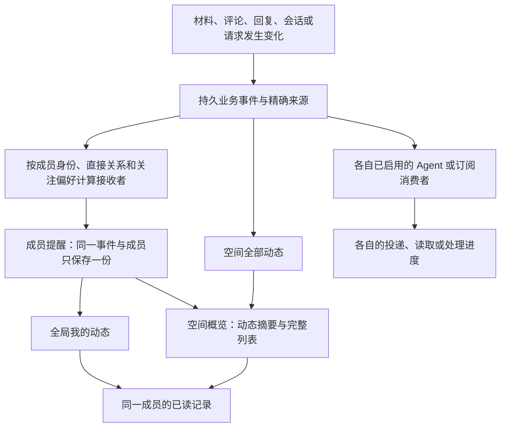

# 成员关注、@、回复提醒与统一动态设计

整理日期：2026-10-23（Asia/Shanghai）。核对基线：`codex/reading-experience`，`8bc8397702bdc7ef6911678a2c6b9e726ad173dc`；工作树另有阅读体验及分身设计的未提交修改。最初仅整理设计；随后按用户授权实施，保留其他在途改动。

**状态：已按修正后的布局进入实现与验证。** 本文保留原始完整设计及验收清单；当前已实现规则见[成员动态契约](../sources/decisions/member-activity.md)，实际执行与限制见[实现记录](2026-10-23-member-activity-implementation.md)。空间内动态明确位于“空间概览”页面正文，视觉沿用已有界面风格。

设计中的拟议字段不替代当前[协议](../sources/protocol.md#成员动态接口)；后续分身持续关注、Cloud 宿主接收与跨设备身份不因此被视为本次已实现或验收。

## 1. 目标与范围

成员需要在一个地方知道：谁在找我、谁回应了我的内容、我关心的材料或会话发生了什么，并能直接回到准确原文继续交流。

本设计包含：

1. 对材料、讨论和协作会话建立或取消成员关注，支持自动关注的明确默认规则。
2. 在空间评论和回复中结构化 @ 成员，明确“回复哪一条”，包括回复某条回复。
3. 从同一套业务变化生成空间动态及各成员的个人提醒，按原因去重和按讨论合并展示。
4. 全局“我的动态”与空间概览页内的“最近动态”共用内容和已读状态，概览内支持从摘要展开完整动态列表。
5. 跨页面、窗口及同一成员身份的客户端同步已读；断线、重连、撤回和成员撤销有明确语义。
6. 为既有顺流感知、Cloud 事件及拟议分身持续关注提供可复用的来源身份，同时保留各自的接收与处理状态。

首版使用界面内列表、角标及定位反馈。系统推送、邮件、声音、`@所有人`、私人消息、跨空间 @、任意私人原生会话关注、全新账号及跨设备身份迁移不属于本次范围。普通材料发布、收藏、阅读或 @ 不启动模型轮次，也不改变共同执行的输入权。

## 2. 设计整理时的基础与需要补齐的部分

| 当前基础 | 可以复用的部分 | 本设计新增的部分 |
| --- | --- | --- |
| 空间成员及 `selfId` | 空间内稳定成员 ID、访问校验、独立凭据 | 成员自己的关注偏好、提醒投影和已读记录 |
| 材料及固定版本 | `materialId/version`、发布者、原文定位与撤回状态 | 面向材料身份的关注及版本变化提醒 |
| 批注和单层回复 | 原批注、回复 ID、作者、时间及原文锚点 | 结构化 `mentions`、明确的 `replyTo` 和稳定作者类型 |
| 协作会话 | `spaceId/executionId`、原生轮次及终态观察 | 每轮真实发起来源、持久终态事件及会话关注 |
| 概览“最近动态” | 现有空间外壳、阅读器和评论定位 | 将当前以协作请求为主的区域扩为动态摘要 |
| 顺流感知 | 精确会话关联、附带更新、独立投递记录 | 可引用统一业务来源；不把人的关注自动转换为 Agent 接收配置 |
| Cloud 事件订阅 | 讨论／请求定位、订阅生命周期 | 本地成员关注不依赖 Cloud；已有快照不直接充当精确业务日志 |
| 资源库收藏 | 原有收藏、最近使用及选择状态 | 关注单独保存；收藏不自动关注，取消收藏也不取消关注 |

依据：[成员实现](../../../internal/collab/members.go)、[批注类型](../../../internal/collab/types.go)、[批注回复](../../../internal/collab/annotation.go)、[材料类型](../../../internal/collab/material_types.go)、[原生状态观察](../../../internal/collab/rpc.go)、[概览](../../../packages/web/src/components/SpaceOverview.tsx)、[资源库契约](../sources/decisions/resource-library.md)。

设计整理时，[顺流感知契约](../sources/decisions/in-flow-awareness.md)不建立面向人的材料／讨论关注关系；[空间事件契约](../sources/decisions/space-events.md)中的 Cloud 宿主接收尚未完成真实验收。分身主动协作与持续关注也是独立的待实施设计；现有能力以[本机分身契约](../sources/decisions/local-shadows.md)为准，不能作为当前产品已有成员关注能力的依据。

## 3. 统一对象与职责



- **业务事件**说明发生了什么，记录准确来源和作者；产生事件不等于所有成员都收到提醒。
- **空间全部动态**是成员可以访问的空间变化列表；不把输入流、工具执行日志和在线心跳逐条展示成动态。
- **成员提醒**说明某条变化为什么与某个成员有关；同一事件可以有多个原因，但每位接收者只有一份。
- **动态分组**是界面投影；连续回复可以合为一行，底层事件与回复身份仍然保留。
- **已读记录**只表示该成员查看或明确清除了哪些提醒；不表示已回复、已接受、任务完成或 Agent 已处理。

“我的动态”跨本机已发起／加入且仍有访问权的空间汇总；空间概览页内的动态固定在当前空间。空间内全部成员可以读取公共讨论，但彼此的关注清单、个人提醒原因及已读状态不进入公共空间视图。空间主机负责保存这些状态，不因此向其他成员公开“谁已读”。

## 4. 成员关注

### 4.1 三类关注对象

| 对象 | 关注身份及范围 | 入口 | 默认收到的后续变化 |
| --- | --- | --- | --- |
| 材料 | 当前空间的 `materialId`，覆盖该材料全部已发布版本 | 材料标题旁“关注”，资源库材料操作中同入口 | 新版本、针对任一版本的新评论与回复，以及可公开的撤回状态变化 |
| 讨论 | 根 `annotationId`，保留其空间及可选 `executionId` | 原批注及讨论头部的“关注讨论” | 这条根讨论中的后续回复；具备编辑功能的对象还包含有效修订 |
| 协作会话 | 当前空间的 `executionId` | 会话标题／会话卡片的“关注” | 后续轮次的最终答复或失败／中断终态，以及属于本会话的评论和回复 |

材料关注跟随材料演进，点击通知仍打开事件发生时的固定版本。读 v1 时关注材料，之后 v2 发布和 v1 上的新评论都可提醒。首版不增加“只关注某一个版本”的独立设置；只需要跟进旧版本某处问题时，关注那条讨论即可。

讨论属于一个主要对象：材料、协作会话或空间本身。评论正文附带了其他材料引用，不会把该讨论传播成所有被引用材料的新评论。归属由 Core 根据根讨论确认，客户端不能任意指定父对象扩大提醒范围。

这里的“协作会话”特指可操作的共同执行对象；“参与会话”中的私人接收目标和本机分身聊天是其他对象。成员对私人会话没有因此获得历史读取权。分身跟进讨论另见第 11 节。

### 4.2 自动关注与基线

| 行为 | 默认结果 |
| --- | --- |
| 成功发布一份新材料 | 发布成员自动关注该材料；发布自己的内容不提醒自己 |
| 成功发表评论或回复 | 作者对应成员自动关注这条根讨论，不扩大到整份材料或整个会话 |
| 创建、浏览或加入协作会话 | 不自动关注所有后续轮次；自己的轮次结果按直接关系提醒 |
| 被 @、被引用、阅读、收藏、展开讨论或收到提醒 | 不自动建立关注 |
| 手动关注 | 从此次关注成功后的变化开始；既有历史可读，但不批量变成未读 |
| 取消后重新关注 | 以重新关注时的状态建立新基线，不补发中间取消期间的变化 |

自动关注要在成功回执附近有简短说明，例如“已关注这条讨论”，并提供取消入口。取消或静音属于显式偏好，后续再次发表回复、发布新版本或换客户端时不能被自动关注覆盖。自动规则只能初始化尚无显式偏好的对象。

首次启用时不反查全部历史并批量建立自动关注。已有材料、讨论和会话可以手动关注；之后新发表的评论或回复适用上述自动规则，已有的显式取消仍然有效。

关注设置与内容提交以主机确认顺序为准。关注之前已提交但尚未分发的事件，不因稍后消费而误算成新关注事件；关注成功后提交的事件也不能被建立基线时跳过。实现方法见第 9 节。

### 4.3 取消关注、层级覆盖与静音

对象偏好统一为三种模式：

| 模式 | 关注产生的普通更新 | @、直接回复及准确归属的本人结果 |
| --- | --- | --- |
| `following`／已关注 | 接收 | 接收 |
| `direct_only`／未关注 | 不接收 | 接收 |
| `muted`／已静音 | 不接收 | 不新增界面提醒 |

取消关注写入显式 `direct_only`，而不是删除记录。静音在更多菜单中提供，并说明“停止此对象范围内的提醒，包括 @ 和直接回复”；不会拒绝协作请求、停止 Agent 工作或替代原生审批。

普通关注的匹配先看讨论自身已保存的偏好，包括有效的自动关注，再看材料／会话的设置，没有设置则为 `direct_only`。因此，关注整份材料后，可以对某条高频讨论单独取消关注；其他讨论仍继续提醒。取消材料／会话关注不会取消其下独立保存的讨论关注；这些讨论继续按各自偏好接收。界面在取消回执中提示仍有单独关注的讨论，并提供查看入口。

**静音父对象覆盖其子讨论的提醒。** 例如材料已静音时，原来关注的讨论关系仍保留，但显示“已关注 · 材料已静音”；不能让一个旧子关系悄悄突破静音。解除静音恢复该对象静音前的模式，之后按保存的子对象设置继续接收，不重放静音期间的变化。

取消关注和静音都只影响之后提交的事件。已产生、已进入发布队列或已展示的提醒保留原身份及已读状态；界面提供独立的“标为已读”，不把静音伪装成已经阅读。关注或静音动作本身不产生公共动态，也不通知对象作者。

## 5. @ 与回复关系

### 5.1 结构化提及

评论及回复输入框输入 `@` 后列出本空间的有效成员，包括发起者和离线但未撤销的成员。候选展示名称及可辨别的成员信息；同名成员使用稳定 ID 区分。首版 @ 的接收对象是成员，发送者无需知道其原生会话 ID。

保存正文时同时保存结构化提及，例如 `mentions: [{memberId, startOffset, endOffset, label}]`。偏移沿用现有正文定位的 UTF-16 单位；服务器校验范围、标签和成员资格，最多 20 个不同成员；同一成员出现多次只生成一个提及原因。显示名只用于显示，改名不改变历史收件人。

只有通过成员选择或显式结构化 API 提交的提及才参与提醒。普通粘贴的 `@姓名`、邮箱、代码、引用块以及发布材料中原有的历史文字不会被后台全文扫描后发送提醒。消息中引用另一条带 @ 的内容，也不会再次 @ 原成员。

提交时成员已离开或被撤销，返回明确校验错误并保留草稿，让发送者移除失效提及后重试；不静默换成同名的新成员。消息的可见范围仍是原空间／讨论的范围，@ 不扩大访问权限。

普通 @ 成员只产生成员提醒。未来若增加 @ 参与会话或 @ 分身，必须明确区分候选类型及行为，沿已有请求／分身工具处理；不能把匹配到一个名字直接等同于模型执行授权。

### 5.2 回复评论与回复某条回复

保留根批注及平铺回复展示，在每条回复上增加“回复”入口：

```text
根批注 A：小林提出意见
  回复 R1：你回复 A
  回复 R2：阿宁回复 R1
  回复 R3：小林回复 A
```

所有回复仍属于 A。R2 明确保存 `replyTo = {kind: reply, id: R1}`，界面显示“回复你”及可点击的短引文；R3 指向 A。直接被回复的人由 `replyTo` 决定，不按上一条发言、最后一个参与者或根批注作者猜测。

回复创建必须携带准确根讨论及 `replyTo`。服务器核对父项属于同一根讨论、同一空间和同一会话范围，父项已存在且可访问；新回复只能指向已有项，不允许循环。旧单层回复读取时明确显示为回复根批注，不能为旧数据补造未知的父子关系。

原回复不可访问时保留“回复对象已不可用”的状态；不能自动改成回复根作者。点击通知仍优先定位新回复及当前可用上下文。现有原文锚点保持在根批注，不随回复目标改变。

### 5.3 作者身份与自身操作

沿用并扩展稳定作者结构，区分 `human/session/shadow`，保存可核对的所属成员、协作会话或分身身份。批注的 `Author/AuthorID`、工作台 `SpaceActor` 和分身消息作者需要统一映射，不能只改显示名称。

人自己发表的评论、回复或材料变化不提醒本人；手动 @ 自己也不产生提醒。Agent／分身的答复不因归属同一成员而被当成本人刚刚输入，仍可按直接回复或任务结果关系提醒。界面应显示“你的分身收到回复”等准确作者关系。

Agent 内容只有在已有明确所属成员或原任务发起成员时，才能把回复映射给相应成员；未知归属保留未知，只向明确提及者及有效关注者分发。回复 Agent 的内容不会自动作为原生新输入，任务接续仍遵循其业务关系。

## 6. 哪些变化提醒谁

下表先确定候选接收者，再应用有效成员、访问范围、静音及自身操作排除。材料作者默认提醒通过发布时建立的自动关注实现，可取消，不另设无法关闭的“作者永远接收”规则。

| 业务变化 | 直接关系 | 关注关系 | 动态来源 |
| --- | --- | --- | --- |
| 新评论 | 正文明确 @ 的成员 | 对应材料／会话的关注者；空间整体评论没有隐式全空间关注者 | 新根批注及固定原文 |
| 新回复 | `replyTo` 对应作者成员，以及明确 @ 的成员 | 根讨论及其材料／会话的有效关注者 | 精确到新回复 ID |
| 材料新版本 | 无自动直接接收者 | 材料关注者 | 新版本，不改写旧提醒引用 |
| 协作会话最终答复 | 此轮准确记录的发起成员 | 该协作会话关注者 | 轮次及最终答复条目 |
| 协作会话失败／中断 | 此轮准确记录的发起成员 | 该协作会话关注者 | 轮次终态；不称为“新答复” |
| 空间请求完成／失败 | 请求记录中的原发起成员 | 不因引用某份材料就广播给该材料关注者 | 原请求及结果版本 |
| 材料撤回／来源失效 | 不新增正文提醒 | 仍有权查看该对象失效元数据的关注者可见简短状态 | 失效标记，不保留正文兜底 |
| 材料发布、简报更新等一般变化 | 除既有明确请求关系外不直接通知每个人 | 不新增本设计之外的“关注整个空间” | 可进入空间全部动态 |

成员的直接提醒原因使用 `mention/direct_reply/own_turn_result/own_request_result`；关注原因使用 `follow_discussion/follow_material/follow_execution`，材料作者自动关注可另外呈现“你发布的材料”这一说明。原因是可解释的结构化数据，不用模型决定某条变化是否值得提醒。

### 6.1 协作会话结果的发起者

在输入被接受时持久化真实成员、输入动作 ID、会话 ID 和后续对应的原生 turn ID。直接 TUI/Desktop、个人 MCP/CLI、工作台请求都必须接到同一条归属链；完成时不能读取“当前输入者”代替原发起者。输入已交给别人，也不改变已开始轮次的结果接收者。

用户补充输入关联到同一轮次时，按实际接受的成员关系保存，重复补充不重复增加提醒。同一轮有多个成员明确贡献输入时，其结果接收集合取已记录成员的去重集合。无法核对的原生外部续写不猜测发起者，只保留会话关注提醒及来源说明。

只在轮次终态确认后产生一条结果事件；多个最终条目作为同一结果的来源集合。过程发言、token 流、工具日志、心跳不产生独立个人提醒。若终态没有最终答复，展示“轮次已结束”或准确失败状态，不从任意过程文本伪造答案。

### 6.2 修改、撤回与旧内容

本设计不额外要求新增所有对象的编辑／删除界面，但事件模型须携带对象版本，能接住已存在或随后实现的修订与撤回。若内容支持编辑，新加入的结构化提及才新增 @ 原因；已有提及不会因普通改字反复触发。关注者可收到真实内容修订，提醒中的展示内容必须按当前权限及有效版本重新解析。

删除提及或撤回正文不删除他人的既有已读记录，也不能保证已展示内容被召回；后续界面不再展示无权读取的旧预览。初始化此功能时只建立当前业务基线，不把历史材料中的 @、全部旧评论、旧会话完成状态批量转成未读。已有来源仍可按原入口读取。

## 7. 去重、合并与计数

### 7.1 一条业务变化、一份成员提醒

同一事件对同一成员只保存一份提醒，唯一键为 `(spaceId, eventId, recipientKey)`，合并所有命中原因。例如阿宁回复你的回复，又在正文 @ 你，同时你关注了材料和讨论，最终只有一份提醒，包含四种原因。

展示主原因优先为 @、直接回复、本人结果、关注更新，其他原因可展开查看。改变主文案不创建新提醒。不能只按正文相同或时间接近去重；同样一句话发在不同讨论中是不同业务事件。

原生结果、请求完成及 Agent 发表的公开回复若确属同一个结果，由持久 `causationId/resultId` 关联为一个展示组，保留全部可读来源。无法证明同源时保留为不同事件，避免把真正的新回复吞掉。不得假定“请求完成”已经等同于“回复了原批注”。

### 7.2 分组合并

- 同一根讨论的连续更新合并成一行，例如“阿宁等 2 人新增 3 条回复”，显示最近摘要，并突出存在的未读 @ 或直接回复。
- 材料版本更新按材料分组；材料下不同根讨论保持独立，不能整份材料只留最后一条评论。
- 会话结果按该会话分组，可展开各轮次；会话下不同评论线程仍按根讨论分组。
- 分组稳定键包含空间及准确对象身份，不跨空间、跨会话或跨材料版本来源混淆。
- 新事件推进分组最近位置。只读状态变化不重排正在阅读的列表，滚动期间到达的新条目可先提示“有新动态”。

角标统一统计**含未读提醒的分组数**，不是正文条数或全部空间事件数量。全局与空间概览使用同一计算：一个讨论有三条未读回复，角标计 1，行内显示 3 条。分类可以重叠，因此不能把 @、回复、关注筛选下的数量相加当总数。

筛选先选中符合条件的底层提醒，再生成分组，预览也来自符合该筛选的事件；不能在“@我”下展示一条与 @ 无关的最新回复作为唯一定位目标。

### 7.3 分类规则

| 筛选 | 包含的个人提醒 |
| --- | --- |
| 全部 | 当前成员收到的全部有效提醒 |
| @我 | 含 `mention` 原因 |
| 回复 | 含 `direct_reply`、`own_turn_result` 或 `own_request_result` 原因；以及通过有效关注收到的、针对本人发布材料的评论／回复 |
| 关注 | 含任一 `follow_*` 原因 |

“你发布的材料收到评论”由事件中经核对的发布者关系识别，取消其关注后不会因这个分类另行补发。新版本发布属于关注更新，不称为收到回复。同一提醒可以同时出现在 @、回复和关注筛选中，但只保留一个事件与一份已读记录；筛选归属不会创建第二次提醒。

## 8. 界面与主要交互

### 8.1 全局“我的动态”

全局主导航增加“我的动态”与未读角标，汇总本机已关联空间中当前成员的提醒。支持“全部／@我／回复／关注”、仅未读及空间筛选。全局页面不把空间全部公共更新混入个人提醒。

每行显示作者、动作、空间、材料／会话／讨论来源、时间、提醒原因及未读状态；默认只给短预览。可查看原处、标为已读、调整相应对象的关注方式。跨空间总数是各空间个人未读分组数之和，离线空间的陈旧计数单独标识。

页面提供“管理关注”，按空间及材料／讨论／协作会话查看本人关注和静音的对象，包括尚未产生动态的对象；显示自动或手动来源、实际生效模式及来源可达性，可取消、静音或重新关注。“关注”筛选用于阅读动态，“管理关注”用于维护对象清单。

### 8.2 空间概览页内的动态区域

空间内的动态放在“空间概览”页面的内容区，复用并扩展现有“最近动态”模块。侧栏继续通过既有“空间概览”进入，不新增“空间动态”导航项。模块标题旁的角标只统计当前空间与本人有关的未读分组。

模块默认显示“与你有关”；另一个页签为“空间全部”。前者复用全局提醒的分类和状态，后者展示本空间可访问的公共变化。空间全部中的一般更新不因为被列出来就增加个人未读；若某事件同时属于本人的提醒，应使用同一事件和同一已读状态。

“仅未读”属于个人提醒筛选，不为全部公共变化额外制造一套未读状态。模块内也可打开限定当前空间的“管理关注”。

模块提供前往全局“我的动态”的入口，方便查看其他空间的提醒。

### 8.3 概览内的摘要与完整列表

将当前主要展示协作请求的区域扩展为统一动态摘要，并前移至首屏。默认显示最近 3 条分组，可根据空间布局显示至多 5 条。“查看全部动态”在空间概览页内展开完整列表，支持分类、分页和收起；展开与收起保留“与你有关／空间全部”的选择、筛选和阅读位置。

摘要和完整列表是同一个模块的两种展示状态，共用当前空间的数据与未读数。无个人提醒时显示“暂时没有与你有关的新动态”，并保留查看空间全部的入口；没有任何空间事件时再显示空间空状态。

```text
空间概览
  最近动态  3                         查看全部动态
  [与你有关] [空间全部]
    小林在评论中 @了你
    阿宁回复了你的回复
    小林评论了你发布的材料
  本次协作、最近材料、成员与会话……
```

### 8.4 原处定位与输入体验

点击动态使用准确来源打开空间、固定材料版本或协作会话，展开正确的讨论并突出目标回复。保持现有阅读器和评论栏；窄屏使用现有抽屉／返回路径。跨页定位按来源 ID 继续读取，不把“打开空间首页”当作已定位成功。

关注按钮放在材料／会话标题附近，讨论关注位于讨论头部；同时显示自动关注、显式取消或父对象静音带来的实际状态。回复每条回复时，输入框显示“回复某某”及可取消的父项引用；@ 候选支持键盘、中文输入法、同名和离线成员。

来源暂不可达时保留动态入口与未读，显示重试原因。材料撤回、成员访问失效或原文已变更时展示准确状态，不跳到最新版本或相似文本。正文尚未加载或目标回复未定位到时，不自动宣布已读。

浅色为主要设计基准，支持系统／深色；菜单栏 WebView、浏览器和插件遵循本机共享语言偏好。中文采用简体中文，用户正文和协议 ID 不翻译。系统推送及原生菜单栏新增入口另行设计，首版不以它们作为完成条件。

## 9. 数据与持久化设计

### 9.1 空间身份与共同来源

接收者使用 `recipientKey = spaceId + memberId + membershipGeneration`。`membershipGeneration` 表示经现有成员凭据确认的一次有效资格，防止离开后重新加入的身份继承旧提醒。发起者使用空间内稳定的 owner 身份；不同空间的 owner 不能被当成同一全局接收者。

具体字段应复用现有成员资格的唯一身份；若已有不可复用的成员 ID 已足够表达资格代次，则无需另造重复字段。显示名、设备名、Provider、当前目录和最近打开的会话都不能用于合并身份。首版不引入全球账号或自动关联不同 Mac 上的“同一个人”。

来源采用 `SpaceSourceRef` 的方向，为后续分身协作保留统一的引用格式，避免分别发明不兼容的来源格式。本设计至少需要：

| 来源类型 | 必须保留的身份 |
| --- | --- |
| 材料版本／原文 | `spaceId/materialId/version`，按需带 turn、item 及原文范围 |
| 讨论／回复 | `spaceId/annotationId`，会话讨论另带 `executionId`，具体回复另带 `replyId` |
| 协作会话结果 | `spaceId/executionId/turnId` 及可用的最终条目 ID 集合 |
| 空间请求结果 | `spaceId/requestId/resultRevision` |
| 拟议空间消息或分身结果 | 各自稳定消息／任务结果 ID，待相应业务实现后接入 |

关注对象的 `subjectRef` 指向稳定对象；事件的 `sourceRef` 指向具体版本与条目。二者不能混用。Core 从实际对象解析父关系及可见性，不接受客户端伪造归属。新增来源类型必须同时有授权读取与界面定位能力。

### 9.2 最小持久对象

| 对象 | 核心字段 | 约束 |
| --- | --- | --- |
| `MemberFollowPreference` | 接收者、对象引用、`mode`、`origin`、静音前模式、`revision`、创建／更新时间 | 每成员每对象一条；`origin` 区分手动、发布自动、参与自动；显式取消保留 |
| `ActivityOutboxItem` | `eventId`、来源变更键、业务版本、作者、发生时间、父关系、候选成员及合并原因、偏好版本 | 与产生它的业务变更同一次持久提交；不含重复的完整正文 |
| `ActivityEvent` | `eventId`、空间内 `eventSeq`、`kind`、`sourceRef`、作者、`causationId`、发生／登记时间 | 稳定唯一；重试和重新连接不产生新 ID |
| `ActivityRecipient` | `eventId`、接收者、`reasons[]`、可解释的关注来源 | 同一事件和接收者唯一；不是一个可跨成员公开读取的列表 |
| `MemberActivityReadState` | 空间全已读水位、逐事件已读记录、`revision` | 单调推进，供所有界面共用；与业务完成状态无关 |
| `ActivitySyncState` | 已同步事件位置、收件投影版本、已读版本、来源可达性、最后成功同步时间 | 属于传输／缓存状态，不能冒充已读状态 |

分组通过事件及成员投影计算，可保存可重建的索引；全局与空间概览复用同一计数逻辑。计数响应与列表使用相同投影版本，避免列表已读而角标仍使用另一份快照。

outbox 即使与空间业务记录保存在同一文件，也属于内部持久数据。候选接收者、个人提醒原因、关注偏好及已读记录不得随公共空间响应、材料发布包、资源导出或普通讨论历史序列化给其他成员；传输只提供调用成员获准读取的投影。

### 9.3 业务保存与事件发布

推荐使用持久 outbox 衔接现有按空间／会话保存的业务记录：

1. 在空间级同步边界内校验操作、作者、成员资格和对象版本，确认正文、提及、回复父项及此次应接收的成员。关注偏好修改与此处读取必须串行确定先后关系。
2. 生成稳定事件 ID，并将最小 outbox 项与这次业务变更写入同一个原子保存单位。材料发布以正式版本提交成功为界，上传暂存不产生事件。
3. 空间事件存储消费 outbox，幂等写入事件及全部收件记录，并分配持久递增的 `eventSeq`。整个批次提交成功后再确认 outbox 已消费。
4. 消费失败重试同一事件；不重新提交原评论、重复发布材料或重放原生输入。主机重启可继续未确认 outbox，事件 ID 去重使重复消费只有一次效果。

空间记录和 execution 记录当前分开保存，不能声称两次 `save` 是一个事务。outbox 必须放在实际完成该次业务提交的持久记录中；先保存业务、再无记录地广播，或者先广播再保存业务，都不满足本设计。

候选收件人和命中原因在业务提交时固定，消费时重新检查资格与来源访问，不重新使用“当前关注清单”做历史匹配。因此延迟消费不会把关注前的事件送给刚关注的人，也不会因稍后取消关注而吞掉已经产生的提醒。材料／讨论关注开始的基线是这条提交边界，不能仅用消费者稍后分配的序号判断。

`eventSeq` 表示空间事件登记顺序，供分页、快照和已读边界使用；保留业务发生时间，不把它宣传成跨主机的严格因果时间。不同来源 outbox 可延迟登记，晚登记的旧业务变化仍有准确来源，且不会落入此前“全部已读”的快照。跨空间排序使用稳定的时间及 ID 次序，并承认主机时钟可能有偏差。

### 9.4 原生会话及恢复

现有原生事件缓存及运行期 `sequence` 不能作为持久动态日志。新增轮次发起关系、终态观察点和已登记结果键，按 `(executionId, turnId, terminalRevision)` 去重；原生分页读到相同答复也不能重复通知。

Core 对已经保存的原生历史按稳定轮次位置补核对，补齐上次未完成登记的结果。补核对仅进行只读观察，不为读取提醒而恢复可写运行时或发新输入。当前 Provider／接入路径不能可靠回读时，明确显示同步缺口，不把没有回调等同于没有新答复。

成员关注在原生断线期间发生变化时，不能用恢复时的偏好反推历史收件人。此类设置先进入待确认状态；接入适配器确认当前终态历史边界后，才宣布关注成功。该边界以前的未知结果不按新关注补发。已接受输入的发起关系可以独立恢复本人结果；无法确定的归属保持未知。

需要持续保存但暂不可回读的 Provider 结果，必须依赖其已持久接收记录；如果两种来源都不完整，报告缺口。验收不能只依赖“正常在线时收到了一个完成回调”。

## 10. 已读同步与并发

### 10.1 什么动作算已读

- 打开全局列表、空间概览、展开概览内的完整动态列表或看到角标，不自动将所有条目标为已读。
- 点击动态并成功加载、定位目标内容后，只确认本次实际展示到的事件；后台预取、折叠内容、离屏渲染和失败定位不确认。
- 在原材料／讨论里直接读到同一条回复，也可以确认对应提醒，条件是可见且已加载。发送一条新回复不等于读完线程全部历史。
- 提供逐条／逐组“标为已读”及“本空间全部已读”；全局提供“所有空间全部已读”。这是明确的清除提醒动作，不要求再打开每段正文。
- 第一版只实现单调已读，不增加“标为未读”的反向覆盖；若后续需要，再单独设计与并发读取的冲突规则。

长讨论中有多条未读时，打开最后一条不能顺便清除尚未加载的前面几条；行内显示剩余未读数量，并允许明确将该组截至当前快照的提醒全部标为已读。

### 10.2 已读记录的写入

普通阅读提交实际展示的 `eventIds`，服务端核对它们属于当前成员及当前可访问的来源；不接受客户端传入别人的成员 ID。逐组已读携带该组返回的快照边界，作用于这组截至边界的提醒。

空间全部已读提交服务端返回的 `throughSeq` 及快照标识，推进该成员此空间的全已读水位。不能使用客户端当前时间，也不能在服务器处理时改成最新序号。逐事件已读集合与空间水位共同决定是否未读；被水位覆盖的逐事件记录可压缩。

例如列表快照上界为 120，点击全部已读的同时产生事件 121：只确认 120 及以前，121 保持未读。迟到的 outbox 在此后登记为 122，即使业务发生时间更早，也不被这次动作清除。

一条个人提醒的未读条件为：当前仍可访问，存在本成员收件记录，`eventSeq` 大于全已读水位，且没有逐事件已读确认。分组有任一这样的事件即计为一个未读组。

### 10.3 多入口与跨空间

主机保存成员已读状态，成员本机 Core 缓存并提供所有本机页面的统一读写入口。状态变化带递增版本通知／刷新全局动态、空间概览中的动态模块及对应浏览器和插件界面；纯组件本地状态或 `localStorage` 不能承担权威已读记录。

并发确认采用集合并集与最大已读水位合并，不能用较旧客户端的整份快照覆盖较新状态。相同确认重复提交安全；成功写入后再发布新计数。

全局全部已读是各空间快照边界的集合，例如 `{spaceA: 120, spaceB: 73}`，逐空间确认。部分主机离线时返回各空间结果，显示“已同步 N 个空间，M 个空间待同步”，不能因一个请求成功而清空全部角标。用户执行时未取得快照的空间不纳入此次动作。

客户端可暂存用户已完成的读确认，显示“已读，待同步”，重连后重试同一事件集合或快照边界；这是可幂等合并的阅读状态同步，不是业务输入重放。访问已撤销则丢弃待同步确认并清除相应正文缓存，不能换到重新加入的新身份提交旧确认。

同步范围依赖真实成员身份。相同本机 Core 的多个窗口应天然一致；不同 Core 只有在现有机制确认为同一成员资格时才共享状态，不能按名称或设备判断“同一个人”。该设计不自动增加跨设备登录或凭据复制能力。

## 11. 与既有接收及分身设计的关系

| 机制 | 谁在接收 | 状态表达 | 与本设计的连接 |
| --- | --- | --- | --- |
| 成员关注与动态 | 人，按空间成员身份 | 未读／已读、关注偏好 | 本文定义 |
| 顺流感知 | 已明确关联并开启的准确原生会话 | 待附带／已投递 | 可引用同一事件和来源；成员阅读不消费其投递水位 |
| Cloud 事件订阅 | 独立授权的云端宿主订阅 | 投递、读取、处理回执 | 可适配同一变化源；不以成员关注代替 Cloud 订阅 |
| `shadow_watch` | 具备目标与任务关系的分身观察流程 | 已观察水位、当前认识、待接续任务 | 共用对象身份和精确增量；不与成员关注合并成一条记录 |

用户说“关注这个讨论”，在成员界面建立接收后续动态的关系；说“让分身替我跟进并处理”，才进入分身关注业务。两者可以同时存在，彼此取消、读完或暂停不隐式改变另一者。

普通 @ 先成为对应成员的动态。有准确且已开启的顺流接收路径时，可以将同一业务来源附带给该路径；没有路径时仍可在界面阅读，不寻找最近会话或向成员所有会话广播。分身自己发出的普通沟通遵循其已确认任务范围，本设计不额外要求逐条批准，也不扩大该任务范围。

Agent 读取了一条提醒不意味着人已读。现有 Cloud `read/finish`、顺流 `delivered`、分身处理水位和成员已读分别保存；它们可共享 `eventId/sourceRef`，不能复用同一个游标。通知与任务接续同时消费某个结果，也只记录一次原业务完成。

分身待实施方案中的 `post_space_message.mentions/replyTo`、共同 `SpaceSourceRef` 和稳定作者应与本文统一实现。新消息类型尚未落地时，先完整覆盖已有批注及回复；不能把成员关注交付推迟到分身全部能力完成之后。分身观察上下文在接入回复到回复后，按真实 `replyTo` 读取，不继续假定所有回复都直接回复根批注。

## 12. 接口与组件建议

本节路径及工具名称为拟议接口，实施时与现有路由命名协调；目前尚不存在这些完整能力。

| 接口或入口 | 输入与输出重点 |
| --- | --- |
| 本机 `GET /api/activity` | 汇总各空间本成员的动态；返回分组、精确来源、原因、未读数、分页快照、各空间可达性及同步版本 |
| `GET /api/collaborations/{spaceId}/activity` | `view=mine|space`、分类、仅未读和不透明游标；个人模式仅返回调用成员的收件记录 |
| `GET /api/collaborations/{spaceId}/follows` | 分页列出本人三类对象的实际模式、覆盖关系、来源状态及偏好版本 |
| `PUT /api/collaborations/{spaceId}/follow-preferences` | 对象引用、期望版本、模式、`requestId`；返回持久偏好及有效模式，首次设置也走并发检查 |
| `POST /api/collaborations/{spaceId}/activity/read` | 逐事件集合，或明确的组／空间快照边界；返回确认结果、已读版本及同版本计数 |
| 既有批注／回复写入 | 增加结构化 `mentions` 和 `replyTo`；幂等内容比较包含这两个字段，不能只比较正文 |
| 既有空间成员目录 | 返回可 @ 的稳定成员身份；与分身方案中成员目录扩展共用，不重复维护另一份昵称名单 |

读取接口的默认页大小建议 50，最大 100，并受响应字节预算约束；每项仅含短预览和来源，不携带完整原生历史或工具输出。游标固定查询范围、成员资格及快照上界，分页期间新增变化通过后续刷新获取，不改变已有页的边界。

成员的关注写入以调用身份为准，不允许代填他人 `memberId`。对象失效、偏好版本冲突和成员撤销返回可区分的错误，界面保留待提交选择。关注写入结果不明时查询同一 `requestId`；重复相同操作返回原结果，换内容必须使用新 ID。

可为个人 MCP 提供 `list_member_activity`、`set_member_follow` 和 `mark_member_activity_read`，绑定当前本机成员及明确空间。读取默认只读；只有用户要求清除提醒或标已读时才执行已读操作。绑定协作运行时默认只取得该空间公共动态及已有讨论能力，不因此获得 host 全部个人提醒或代改输入成员偏好的能力。

前端采用一个动态数据层供全局页面、空间概览内的动态模块和原文阅读确认复用；复用现有 `Annotations/Reading/PublicationReader/Context` 进行定位。插件内外使用相同业务接口，宿主桥只负责已支持的导航能力，不充当新的提醒存储。

### 12.1 建议实现入口

| 改动范围 | 当前入口 |
| --- | --- |
| 作者、提及、回复父项与幂等 | [types.go](../../../internal/collab/types.go)、[annotation.go](../../../internal/collab/annotation.go)、[agent_annotations.go](../../../internal/collab/agent_annotations.go)、[runtime_annotations.go](../../../internal/collab/runtime_annotations.go) |
| 材料变化与固定版本 | [materials.go](../../../internal/collab/materials.go)、[material_types.go](../../../internal/collab/material_types.go) |
| 会话轮次归属与终态 | [rpc.go](../../../internal/collab/rpc.go)、[executions.go](../../../internal/collab/executions.go) |
| 请求结果及精确来源 | [workbench.go](../../../internal/collab/workbench.go)、[space_events.go](../../../internal/collab/space_events.go) |
| 成员及传输权限 | [members.go](../../../internal/collab/members.go)、[network.go](../../../internal/collab/network.go)、[sharing](../../../internal/sharing/) |
| 新增关注／事件／收件／已读存储 | 由 `internal/collab/` 统一业务层协调；可独立模块，不能直接复用运行期事件缓冲当持久库 |
| 全局与空间入口 | [App.tsx](../../../packages/web/src/App.tsx)、[SpaceWorkbench.tsx](../../../packages/web/src/components/SpaceWorkbench.tsx)、[SpaceOverview.tsx](../../../packages/web/src/components/SpaceOverview.tsx) |
| 评论及原文交互 | [Annotations.tsx](../../../packages/web/src/components/Annotations.tsx)、[Reading.tsx](../../../packages/web/src/components/Reading.tsx)、[PublicationReader.tsx](../../../packages/web/src/components/PublicationReader.tsx)、[Context.tsx](../../../packages/web/src/components/Context.tsx) |
| 接收消费者适配 | [inflow.go](../../../internal/collab/inflow.go)、[inflow_transport.go](../../../internal/collab/inflow_transport.go)、[mcpevents](../../../internal/mcpevents/) |

## 13. 生命周期、故障与容量

### 13.1 访问与身份变化

- 材料撤回、成员撤销、空间关闭后，每次读列表、正文、定位和写状态都重新检查访问；动态缓存不能继续提供失效正文。
- 来源已确认不可访问的个人提醒保留必要失效状态，不计入可处理未读；这与标为已读不同。不得因临时网络失败就认定来源已撤回并清零。
- 成员离线不自动取消关注；有效资格重连后按稳定游标补齐。离开、被移除或共享结束使相应资格失效，停止该资格的新分发。
- 现有契约中主机 Core 退出／重启可能结束远端成员资格。本设计不把重新邀请、重新加入称作同一身份自动恢复；不按同名迁移旧关注和已读。发起者的本地记录及合法仍有效的状态按各自规则保留。
- 会话暂停或结束共同执行不删除关注；在空间仍可读时，其既有讨论继续可读并可按关注产生评论提醒。恢复沿用同一 `executionId`，不把旧轮次重发为新答复。
- 新加入成员可以查看当前允许的空间公共动态，但不会继承其他人的提醒、关注或未读，也不会将其加入前的全部公开变化自动通知一遍。

### 13.2 断线和部分可用

成员 Core 通过现有 LAN／Tailcat 协作通道同步本成员的事件与已读变化，不需要 Cloud 网关。页面不直接持有新的远端管理凭据。获取列表不会启动原生会话，业务写入仍遵守既有输入与发布规则。

主机不可达时显示最后同步时间及“暂未同步”；全局其他可达空间继续工作。缓存可保留最小计数与定位元数据，正文遵循既有访问与缓存边界，不扩为离线全文资料库。未知更新数量不能显示成已经确认的 0。

事件恢复仅重试事件持久化、分发和已读合并，不重放评论、回复、材料发布、空间请求或原生输入。某次业务提交结果不明时，仍按原业务 requestId 查询，不能为了修复一个缺失提醒再次发送正文。

### 13.3 有界存储

建议首版保留最近 90 天的已读／普通空间动态元数据；仍被未读提醒引用的事件、未确认 outbox 和必要幂等键不能按这个期限静默删除。正文不另存全量副本，展示时按有效来源读取。

必须为事件、outbox、关注偏好和本机缓存设置数量及字节上限并有可见告警。达到容量上限时，受控业务写入应在原子提交前报告无法完成提醒持久化，不能返回业务成功却无记录地漏提醒；原生终态等外部已发生事实保留恢复检查点并报告同步异常，不伪造处理完成。

过期分页游标返回明确的历史保留边界，客户端重新建立当前快照；不把整个历史重新标未读。已读元数据压缩必须保留去重、全已读边界及尚未确认事件的意义。首版具体存储阈值在实现中按现有空间限额确定并写入协议，必须通过容量回归后才能发布。

## 14. 实施顺序与文档落点

这些是同一范围内的实施批次，全部必要批次完成才可称为本设计已落地。

1. **身份与关系**：统一作者、来源引用、@ 成员和 `replyTo`；补幂等校验及所有读写投影。先证明能够准确判断“谁回复了谁”。
2. **持久变化与结果归属**：业务 outbox、事件日志、材料／讨论变化及原生轮次发起与终态；证明断线重试不重复业务动作、不丢失已确认事件。
3. **成员关注与收件投影**：三类对象、自动默认、显式取消、静音层级、原因合并、初始化基线；不依赖分身观察模型。
4. **已读与同步**：个人收件、分组计数、逐条／逐组／全空间快照确认、多窗口及跨 Core 合并、离线与访问失效。
5. **全局与概览内动态**：全局“我的动态”、空间概览内的摘要与完整列表，关注按钮、@ 输入、回复到回复、准确定位与源页面阅读确认；更新两套嵌入资源。
6. **消费者衔接及完整验证**：保持顺流／Cloud 状态独立；与分身待实施方案对齐共同字段，按实际接入范围验证并记录限制。

涉及长期事实时，在同一实施提交更新主要维护位置：

| 事实 | 维护位置 |
| --- | --- |
| 成员关注、直接提醒、分组及同步语义 | 新增当前领域来源，例如 `sources/decisions/member-activity.md`，实施时创建 |
| 空间对象、作者及关注与执行的边界 | [核心词汇](../sources/product-core-and-glossary.md)、[空间契约](../sources/decisions/collaboration-spaces.md)，只维护各自负责的语义 |
| 全局与空间概览内的动态、关注、回复与已读动作 | [产品流程](../sources/product-flows.md) |
| 新字段、限额、路由、游标与错误 | [协议](../sources/protocol.md) |
| 与 Agent 接收的独立性 | [顺流感知](../sources/decisions/in-flow-awareness.md)、[空间事件](../sources/decisions/space-events.md)，实施后替换“没有材料／讨论关注关系”等已失效描述 |
| 验证方法与已执行证据 | [验证门槛](../sources/validation/test-gates.md)、[证据入口](../sources/validation/evidence-map.md) |

新能力成为当前来源后再调整 [Wiki 索引](../wiki/index.md)及必要概念页。本文保留设计与实施接续记录，不复制完整协议到多处，也不提前把拟议能力写成现有已支持功能。

## 15. 完成条件与验证矩阵

### 15.1 行为验收

至少覆盖发起者 A、成员 B 和成员 C，使用两个空间、两份材料、同一材料两个版本、两个协作会话和不同根讨论。三人成员各有独立凭据与未读状态。

| 场景 | 必须观察到的结果 |
| --- | --- |
| B 回复 A 的回复，同时 @ A，A 又关注材料及讨论 | A 只有一份事件提醒、一个未读讨论组，保留所有原因；C 不因同在空间就收到 |
| B 回复 A 根批注下的 C 回复 | 直接回复原因属于 C；A 只在其讨论关注有效时收到后续更新 |
| 重名、改名、成员离线／撤销后提交 | 稳定身份不串人；离线有效成员可被 @，撤销成员校验失败且草稿保留 |
| 普通文本、代码、引用和导入材料含 `@姓名` | 不自动产生提及或历史提醒 |
| 材料关注后发布 v2、同时有人评论 v1 | 两类变化都可提醒，分别定位 v2 和 v1；取消收藏不影响关注 |
| 关注材料但取消其中一个讨论，另一个讨论有回复 | 显式取消的讨论仅直接关系提醒，另一个继续接收；再次回复不覆盖取消设置 |
| 自动关注讨论后取消其材料关注；首次启用时已有大量历史内容 | 独立讨论关注继续生效且界面解释；历史对象不被批量关注或灌入未读 |
| 静音材料，其子讨论仍保存已关注 | 父静音有效；解除后只接收之后的变化，不补发静音期间事件 |
| 关注／取消与内容提交并发，消费 outbox 延迟 | 按业务提交时的有效偏好确定收件人；不能使用消费时偏好错投或漏投 |
| 同一 requestId 重试；正文相同但 mentions／replyTo 不同 | 相同内容只有一个业务事件；改变结构化内容拒绝当作同一请求成功 |
| A 发起轮次后输入交给 B，再产生最终答复 | 结果直接提醒 A；B 仅按已记录参与关系／关注接收，不依据完成时 writer 猜测 |
| 工具流、过程发言、重复完成回调、历史分页重读 | 不造成提醒风暴，终态结果只有一份；无最终答案不伪装成答复 |
| 请求完成与公开回复确有同一结果关联 | 可合并展示并保留两个来源；无关联的真实新回复不能被误去重 |
| 概览摘要、概览内完整列表、全局页分别在多个窗口打开 | 读取同一回复后各处一致减计数；其他成员的未读不变 |
| 进入空间概览并展开／收起全部动态 | 动态位于概览内容区，侧栏无新增动态导航项；筛选、阅读位置与未读状态一致 |
| 本人材料收到评论，同时命中 @、回复和关注分类 | 每个分类能定位匹配事件；总角标只计一个组，已读后所有分类同步更新 |
| 分组含三条未读，只加载最后一条 | 只确认实际已展示事件，未读组及剩余数保持正确 |
| 快照 120 全部已读，同时新增 121 | 121 仍未读；迟到登记的 outbox 也不被旧快照清除 |
| 旧窗口回传旧快照、并发多次读确认 | 已读状态不回退、计数不重复，较新状态不会被整份旧缓存覆盖 |
| 全局全部已读时一个空间离线 | 显示各空间结果，只确认已取得快照的范围，未确认空间保留待同步状态 |
| 撤回、撤销、空间关闭与点击动态／重试并发 | 不返回失效正文，不把缓存当读取后门，成员恢复必须按真实资格核对 |
| 读取公共空间、普通讨论历史或导出材料 | 不包含其他成员的关注清单、候选收件人、提醒原因及已读记录 |
| Agent 读取、顺流投递、Cloud 处理或分身观察完成 | 不自动清除成员未读，也不相互推进其他消费者的水位 |
| 崩溃发生在业务提交后、事件提交后、outbox 确认前 | 重启能够幂等恢复；不重复业务写入，不丢失已提交事件及收件记录 |
| 初始化、历史保留到期、容量上限、原生回读缺口 | 不灌入旧历史、不静默清除未读或伪造同步成功，限制可见 |

### 15.2 工程、界面与真实环境

- 按[产品代码门槛](../sources/validation/test-gates.md)运行 Go test/vet、相关 race，以及 Web check/test/build；前端变化后更新 `internal/webassets/dist` 和 `internal/mcpassets/dist`。
- 关注匹配、原因去重、outbox、已读并发和权限用确定性的状态及故障回放测试，避免只检查结构体字段存在。
- 实际浏览器覆盖 1440、1024、768 CSS 像素，补用户评审使用的约 843 像素宽度；检查中英、深浅主题、长标题、@ 候选、键盘与输入法、跨页定位、草稿、滚动和焦点。查看真实截图确认全局入口、概览内容区的动态模块及其展开状态符合设计。
- 同一成员在浏览器与插件／同源 WebView 的同步，和 A/B/C 三个 Core 的成员隔离分别验证。单 Mac 多 Core 结果不能写成两台 Mac 验收；真实 LAN／Tailcat 环境单独记录。
- 轮次发起归属覆盖已接入的直接 TUI/Desktop 及辅助 MCP 路径；需要真实模型时仅使用专门会话、专门仓库和 `gpt-5.6-luna`。实验性 Claude 分别记录实现、实际接入及被测范围。
- 当前 Cloud 的本地协议证据不能替代真实云端接收；本次成员关注无需 Cloud 可用才成立。分身持续关注的未完成部分也不能算作本设计已测能力。
- 完成后仅关闭本次启动的测试 Core、浏览器页面及精确 PID 对应的辅助进程，保留用户已有会话、原目录和 worktree。

## 16. 交付与接续

初次设计交付只检查文档与当前结构，没有启动模型或实现产品。用户随后确认按修正后的方案开始实现，并补充视觉应与已有风格一致。

本次新增成员偏好、结构化 @ 与回复父项、持久事件/outbox、个人提醒、主机已读、离线已读补交、全局及概览内界面；准确范围、工程与真实环境证据在[实现记录](2026-10-23-member-activity-implementation.md)。本设计的全部验收表仍是目标清单，不表示每一种客户端、网络或后续分身场景均已实测。
