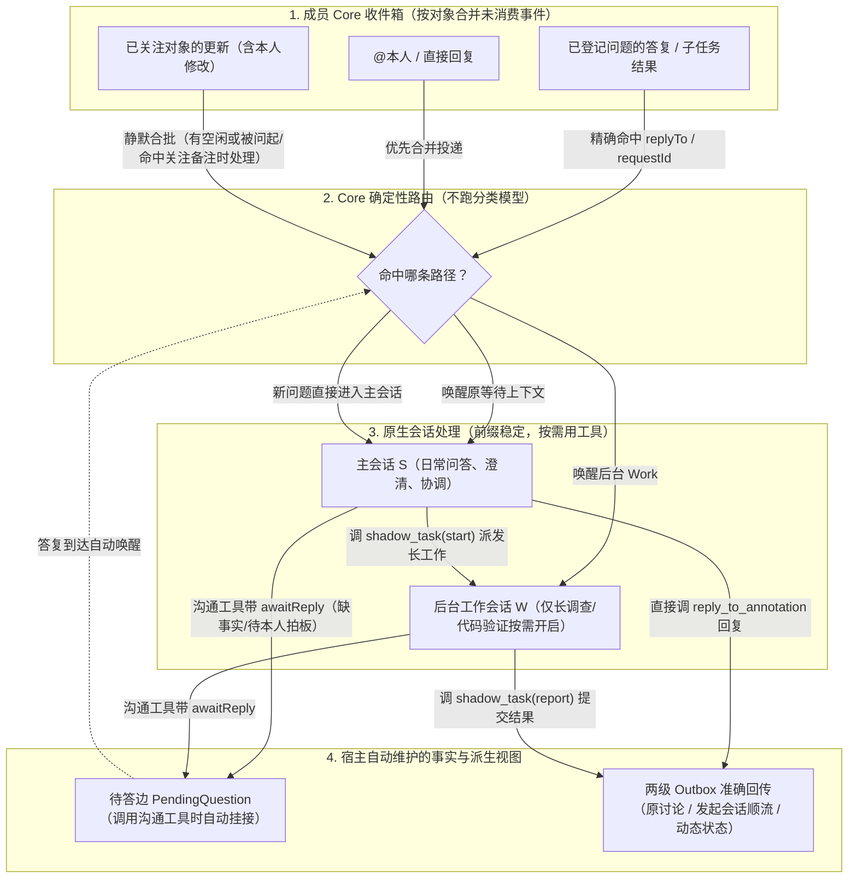
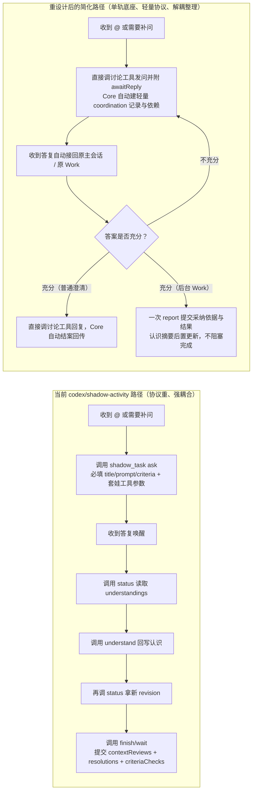
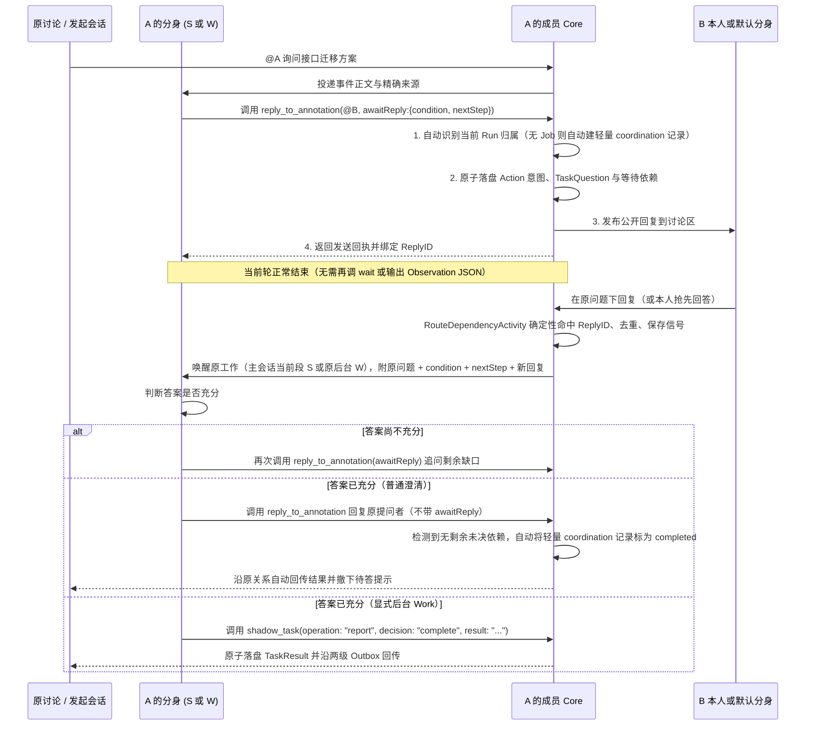

# 本机数字分身功能增强：架构评估、探讨方案复盘与参考 DeepSeek-Bot 的收敛重设计

- 日期：2026-10-25（Asia/Shanghai）
- 评估范围：
  1. `codex/shadow-activity` 分支（基于 `Meta` `616ff79`，截至提交 `71f9394` 及工作区未提交的待答问题回传实现）当前推进的分身功能增强方案与代码实现；
  2. 此前围绕“是否存在过度设计、如何收敛简化”所进行的五轮探讨方案；
  3. 精读 [Fei2411/DeepSeek-Bot](https://github.com/Fei2411/DeepSeek-Bot/tree/1bebe826f74e9a72cabafd3b80602b05af867b38/docs/plans)（固定版本 `1bebe826f74e9a72cabafd3b80602b05af867b38`）`docs/plans/` 下全套设计文档与 `ds-bot/src/host/` 源码后的架构对比，以及结合 Team Cross 当前项目边界后的完整重设计方案。
- 关联文档：
  - 原设计方案：[《本机数字分身：从成员动态接手协作、维护关注与接续任务》](2026-10-22-shadow-collaboration-and-watches.md)
  - 分身初版设计：[《本机数字分身：自然交流、分段、记忆与 Harness 设计》](2026-10-21-local-shadow-design/README.md)
  - 当前契约：[本机分身](../sources/decisions/local-shadows.md)、[成员动态](../sources/decisions/member-activity.md)、[空间工作台](../sources/decisions/space-workbench.md)、[顺流感知](../sources/decisions/in-flow-awareness.md)
- 状态：本文完整记录架构评估与收敛重设计方案，作为 `codex/shadow-activity` 后续收尾与重构的依据；本文提出的新增简化尚未修改产品源码，不将待实施的重构写成当前已验收能力。

---

## 总体判断

1. **对 `codex/shadow-activity` 现有增强方案与实现的评估**：
   **主线方向正确、可靠性底座扎实，但存在明显的阶段倒置与协议层过度设计。** 相较 `Meta` 基线（`616ff79`），分支已新增约 **1.21 万行产品代码与 1.09 万行测试**。其中跨 Core 持久接收、发送前落盘防重、人的已读与分身消费解耦、准确回传路线是**必要复杂度**；但将二/三期的“持续关注目标控制（`shadow_watch`）”“多认识联动（`relatedFocuses` + `contextReviews`）”“强制先回写认识再允许等待/完成（`understand`）”硬编码进一期核心路径，导致**模型操作协议过重、简单澄清被迫走完整任务生命周期、业务完成被内部整理步骤阻塞**。
2. **对既有探讨中所形成简化方案的评估**：
   **既有对话历经五轮演进，最终收敛出的方向非常精准，尤其是第五轮结合代码事实的自我修正至关重要。** 它既吸收了 DeepSeek-Bot“提问/派活自带关系、答复沿关系自动唤醒、界面状态从事实派生”的优点，又及时刹住了第三、四轮“脱离 `Job` 另建一套轻量等待机制”可能导致的**双轨任务系统风险**。
3. **对参考 `DeepSeek-Bot/docs/plans` 全套文档后进一步重设计的判断**：
   既有探讨当时仅读取了 DeepSeek-Bot 的 `2026-10-16-bot-handoffs.md` 和 `2026-10-10-bot-runtime.md`，仍保留了“模型显式调用 `shadow_task` 发起提问和管理状态”的框架。在完整通读 `DeepSeek-Bot/docs/plans/` 全部文档（尤其是《群聊》《上下文与记忆》《旁路问答 btw》《DSH 让步总账》和《README》）后，我们可以更进一步——将架构收束为**“一个收件箱合并、一条隐式等待边、两档工作深度、零认识锁”**，在不推翻现有可靠存储与路由底座的前提下，将暴露给模型的工具协议表面积缩减 70% 以上。

---

## 一、`codex/shadow-activity` 现有增强方案与实现的深度评估

### 1.1 哪些设计是“必要复杂度”（应当完整保留）

在分布式多 Core（空间主机与运行分身的成员 Core 可位于不同 Mac）与异步 Agent 协作场景下，以下机制解决了真实的一致性、防重放与用户体验问题，不能简单压平为一个 `done` 状态：

| 机制 | 代码落点（`codex/shadow-activity`） | 为什么必须保留 |
| --- | --- | --- |
| **人的已读与分身消费水位隔离** | [member_activity.go](../../../internal/collab/member_activity.go)、`internal/shadow/attention_store.go` | 避免用户在 UI 点开讨论或清空未读后，分身漏掉尚未处理的 `@` 或答复；同时避免分身后台处理悄悄清掉人的未读角标。 |
| **发送前落盘意图与回执核对** | `internal/shadow/task_questions.go`、`internal/collab/shadow_return_outbox.go` | 跨 Core 网络调用不是本地单次事务。先写 `Questions`/`Actions` 意图再发请求，断线或回执丢失时按 `requestId` 只读核对，才能保证重启后不发重复提问、不重复执行。 |
| **三项核心状态解耦** | [native.go](../../../internal/shadow/native.go)、`internal/shadow/task_results.go` | **原生回合结束（`final`）≠ 收到回答（`answer_received`）≠ 业务任务完成（`completed`）**。防止模型一轮回复结束就把仍在等同事确认的任务误标为已完成。 |
| **发起会话准确回传（两级 Outbox）** | `internal/collab/shadow_returns.go`、`internal/shadow/question_returns.go` | 委托分身时固定发起会话路线，结果与待答问题沿原路线经 Hook/MCP 顺流带回，且回答后自动使未投递的旧提示失效。 |

### 1.2 现有方案的四大过度设计病灶（代码实证）

#### 病灶 1：实施阶段倒置，二/三期能力提前成为一期闭环的必经门槛

[原设计方案](2026-10-22-shadow-collaboration-and-watches.md)第 3.16 节明确将体验分为“第一批（最小可用闭环）”“第二批”和“后续候选”。然而在当前分支中：
- 第二批的 `shadow_watch` 完整生命周期（`watch.go`）、关注目标控制任务与重规划（`task_follows.go` 的 `replan`）、任务关联多份认识（`task_contexts.go` 的 `relatedFocuses` + `contextReviews`）、`live/snapshot` 独立来源轮询（`task_sources.go`）、简报条目级 CAS 合并均已深度实现；
- 反观第一批最核心的**“默认接手 → 公开 `@` 问答 → 自动接续 → 准确结果与待答问题回传”端到端多 Core 产品闭环**，在实施记录的“后续必须完成”清单中仍作为剩余项推进。
- **结论**：当前维护的协议表面积和状态交叉检查，已经远超经过完整产品场景验证的范围。

#### 病灶 2：`shadow_task` 协议过载，让模型充当“状态机记账员”

在 [internal/shadow/tools.go](../../../internal/shadow/tools.go) 与 `internal/shadow/task_lifecycle.go` 中，单个 `shadow_task` 工具同时塞入了 10 余种操作（`status / start / update / cancel / resume / checkpoint / wait / finish / ask / questions / handling / handoff / understand / replan`）与 23 个顶层字段，`operation` 甚至没有按动作拆分独立 Schema，全靠一段超长 Prompt 说明书和运行时报错约束：

```go
// internal/shadow/tools.go:31
tool("shadow_task", "Maintain durable work. handling reads the exact discussion source response owner; handoff changes only that question to handler owner or shadow, using source/requestId/baseRevision from handling. Only the actual owner request can hand off their response; it is a work assignment, never a routine send confirmation. ask records a real outgoing question and its task dependency before sending: question contains tool (reply_to_annotation/add_annotation), its exact arguments including stable requestId, and condition; include a checkpoint with the next step after the answer. For an existing task supply id/baseVersion/baseRevision; otherwise provide title/prompt/completionCriteria to create a waiting coordination task (or kind work)...When status returns understandings, reconcile those answer or source-change inputs into current facts with operation understand before wait or completed/needs_input...", taskToolProperties(), "operation")
```

模型为了完成一次日常接续，不仅要思考业务问题，还必须手动搬运和对齐：
- 任务的 `baseVersion`（目标版本）与 `baseRevision`（进展修订号）；
- 认识对象的 `baseRevision`（`understandings` 中的各自版本）；
- 待解除依赖的 `signalIds` 与 `resolutions`；
- 关联认识的 `contextReviews`（必须逐个核对当前 revision 与说明）；
- 完成条件的逐条 `criteriaChecks`；
- 在 `ask` 中还必须套娃拼装另一个工具（`add_annotation` / `reply_to_annotation`）的完整 JSON 参数。

#### 病灶 3：“认识维护”硬阻塞任务的等待、完成与直接回复

在 `internal/shadow/task_lifecycle.go` 中，代码将“把答复写回共享认识（`understand`）”和“核对关联认识变化（`contextReviews`）”设为了任务 `wait` 或 `finish` 的硬性前置条件：

```go
// internal/shadow/task_lifecycle.go:240-254
if (in.Operation == "wait" || in.Operation == "finish" && (in.Outcome == "completed" || in.Outcome == "needs_input")) && len(e.taskUnderstandingTargetsLocked(job)) > 0 {
	return Job{}, fmt.Errorf("答复尚未写回相关认识，请读取任务 understandings 并调用 understand 后继续或等待")
}
if in.Operation == "replan" {
	return e.replanTaskLocked(run, job, in)
}
if job.Follow != nil && job.Follow.NeedsReplan {
	return Job{}, fmt.Errorf("关注目标已变化，请先保存 replan 和当前完成条件")
}
if _, changed := e.refreshedTaskContextsLocked(job); changed {
	return Job{}, fmt.Errorf("关联认识已更新，任务同步后请读取当前版本再核对")
}
if err := e.reviewTaskContextsLocked(&job, in); err != nil {
	return Job{}, err
}
```

这导致一次原本简单的“收到同事回复 → 完成任务”被迫拉长为：
> **读 `status` → 调 `understand` 回写认识 → 再读 `status` 拿新 revision → 核对 `contextReviews` → 解除依赖 `resolutions` → 提交 `finish`**。

同样，在 `internal/shadow/attention_continuations.go` 中，直接处理轮（`direct`）即便已经成功调用回复工具发出了公开答复，只要回合末尾输出的内部认识 JSON 校验失败，整条接续就会被标为 `failed`：

```go
// internal/shadow/attention_continuations.go:247-263
if c.State == "processed" {
	var understanding Observation
	err := json.Unmarshal([]byte(output), &understanding)
	if err != nil {
		err = fmt.Errorf("%w: 直接处理结果不是认识记录", errInvalidObservation)
	} else if understanding.Outcome == "continue" && !work.OpenWork || understanding.Outcome == "needs_owner" && !work.OwnerQuestion {
		err = fmt.Errorf("%w: 后续工作或本人待答问题尚未实际登记", errInvalidObservation)
	} else {
		err = finishObservation(&next, batch.ID, understanding, false)
	}
	if err != nil {
		if !errors.Is(err, errInvalidObservation) {
			return err
		}
		c.State, c.Error = "failed", "直接处理尚未保存有效认识；保留已执行动作，请核对原生结果"
		resetBatch(&next, batch, "failed", c.Error, time.Time{})
```

业务动作（已成功回复同事）与内部整理（更新认识摘要）被绑死在了一起，导致辅助步骤格式出错时影响了用户对业务处理结果的判断。

#### 病灶 4：普通补问澄清被强制要求完整任务建模

在 `internal/shadow/task_questions.go` 中，当分身在没有现成 `Job` 的情况下仅需向同事或本人追问一个缺失条件（例如“请确认旧客户端版本号”）时，必须先编写一整套任务规格（`title`、`prompt`、`completionCriteria`）：

```go
// internal/shadow/task_questions.go:182-192
} else {
	if id != "" || strings.TrimSpace(in.Title) == "" || len(in.Title) > 320 || strings.TrimSpace(in.Prompt) == "" || len(in.Prompt) > 24<<10 || len(in.CompletionCriteria) == 0 || len(in.CompletionCriteria) > 16 {
		e.mu.Unlock()
		return nil, fmt.Errorf("新提问需要后续任务的 title、prompt 和 completionCriteria")
	}
	for _, c := range in.CompletionCriteria {
		if strings.TrimSpace(c) == "" || len(c) > 2400 {
			e.mu.Unlock()
			return nil, fmt.Errorf("完成条件无效")
		}
	}
```

这迫使一次日常的“问一句、等回复、再答一句”也必须走完任务建模、版本维护、完成核对与结果协调的整套重流程。

---

## 二、对既有对话中所探讨“简化方案”的逐层评估

既有对话中的探讨经历了三个明显的认知跃升阶段，逐层评估如下：

| 演进阶段 | 核心主张 | 优点与贡献 | 局限或潜在风险 |
| --- | --- | --- | --- |
| **第一阶段（第 1–2 轮）：**<br>收敛交付范围 + 合并操作 | 1. 冻结 `shadow_watch`、多认识联动、自动简报等二期扩展；<br>2. 将 `shadow_task` 收敛为 8 个动作，用 `commit` 合并 `checkpoint / wait / finish / understand`；<br>3. 认识摘要整理移到任务成功提交之后；<br>4. 界面分离展示：`任务：已完成 · 回传：待送达 · 认识：待整理`。 | 精准切中了“认识更新阻塞业务完成”的痛点；明确了业务完成、跨主机送达、认识整理三态分离与独立恢复。 | 仅合并操作名还不够；如果模型在日常普通问答和澄清中仍要显式走完整任务创建和验收，协议负担依然偏重。 |
| **第二阶段（第 3–4 轮）：**<br>引入 DeepSeek-Bot 派活思路 | 1. 提出“派活即带关系的消息、结果沿原关系自动返回、等待状态从事实推导”；<br>2. 强调**“每个事实只有一个主要维护位置”**；<br>3. 主张把工作分为三类（直接回答 / 补问后继续 / 后台 Work），让第二种“普通补问”完全脱离 `Job` 独立成立。 | 抓住了核心设计哲学：系统负责维护关系与路由，模型只负责提问内容与判断答案；让 `shadow_task` 退出普通问答路径。 | **过度简化的隐患**：低估了现有代码对 `Job` 的依赖。若给“无 `Job` 的轻量等待”再单独补齐持久化、路由、去重、本人接回和恢复，会演化出**第二套平行任务系统**。 |
| **第三阶段（第 5 轮）：**<br>结合代码事实的修正版 | 1. 核对代码指出：普通 `ask` 默认创建的 `coordination` 任务本就在当前主会话接续，并不会另开后台 `W`；<br>2. 指出等待列表（`WaitingItems`）和动态状态（`ActivityStatuses`）本就是派生视图；<br>3. 调整实施顺序：**先砍必经协议负担（解绑认识更新、减少普通澄清必填字段），底层继续复用现有接收、去重与接续底座**。 | **最务实、工程性价比最高**。既消除了模型的协议负担与状态耦合，又避免了推倒重来或形成双轨制。 | 实施时需严格守住边界，防止只把多个操作改名为 `report` / `commit`，却原封不动保留了旧的复杂参数。 |

### 2.1 既有简化方案中最值得肯定的三项核心洞察

1. **将“采纳答案的业务依据”与“跨任务认识摘要（`Focus`）”解耦（收益最明确的一刀）**
   - **必须与本次业务提交同次落盘的**：本次工作采纳了哪个回答（`signalIds`）、为什么满足条件、实际产出了什么结果、待回传给谁。
   - **可以随后异步更新/重建的**：跨任务摘要、关注对象的认识（`Focus.Summary`）、展示用归纳。
   - 例如 B 回答“使用 v2 接口”，A 据此完成修改：“采用了 B 的回答及其来源”随任务结果原子保存；“把接口相关认识整理成最新摘要”后置处理。即便整理失败，已完成的业务结果与已发出的回复依然有效，状态绝不退回未完成。
2. **借鉴 DeepSeek-Bot 的“关系驱动”，但守住 Team Cross 的“显式验收”底线**
   - DeepSeek-Bot 的 `handoffs.js` 中，`work` 本质是“谁在等谁的回复”，当子工作全部返回后即可把当前回合文本自动交回上游。
   - 探讨中准确区分了两者差异：**Team Cross 可以借鉴其“提问自动绑定等待关系、答复自动路由回原上下文、结果自动沿原路线回传”，但对“完成代码修改并验证”这类明确后台任务，仍需保留显式的业务结果提交与完成条件核对。**
   - 必须保留三个独立事实：**本轮运行结束（`turn/completed`）→ 收到了回答（`answer_received`）→ 任务完成（`completed`）**。同时，受托方向委托方（或分身向本人）反向补问澄清在 Team Cross 中是正常协作，不能被防环逻辑一刀切禁止。
3. **第五轮对“轻量等待”落地方式的修正，避免了架构返工**
   - 核对代码可知，`internal/shadow/attention_dispatch.go` 的 `RouteDependencyActivity`、`internal/shadow/waiting.go` 的 `WaitingItems` 以及 `internal/shadow/question_returns.go`，**全部以 `Job` 及其 `Dependencies` 作为唯一路由与投影枢纽**。
   - **保持底层单轨、协议层分流**是最优解：底层依然可使用 `kind: "coordination"` 记录，但对普通澄清免除 `title / prompt / completionCriteria` 必填项与完成核对，不另建第二套执行与恢复机制。

### 2.2 为什么还可以比既有简化方案更进一步？

我对既有设计（原 `2026-10-22` 方案与对话中的简化方案）的进一步评价是：
- **原 `2026-10-22` 方案**把第 3 节发散出的 **19 个中远期产品构思**全部折算成了底层数据结构，并做成了强制模型逐步履行的状态机协议，试图用宿主侧严苛的 Schema 与版本号校验去替代模型自身的上下文理解能力。
- **对话中的简化方案**找准了止血点，但因为当时只读了 `DeepSeek-Bot` 的 `2026-10-16-bot-handoffs.md` 和 `2026-10-10-bot-runtime.md`，还没有通读 `DeepSeek-Bot/docs/plans/` 下的整套文档，所以仍保留了“模型显式感知并调用任务工具来管理提问”的痕迹。如果完整吸收 `DeepSeek-Bot/docs/plans/` 的设计哲学，我们可以做到**“沟通即建边、宿主隐式挂树、前缀逐字节稳定”**。

---

## 三、精读 `DeepSeek-Bot/docs/plans` 全套文档后的 6 条核心架构启示

完整核对 `Fei2411/DeepSeek-Bot`（`1bebe826f74e9a72cabafd3b80602b05af867b38`）`docs/plans/` 目录下的全部 14 份文档（含《DSH 让步总账》《角色与权限》《群聊》《浏览器、搜索、密钥和连接器》《上下文与记忆》《Bot 运行配置》《长消息》《桌面应用》《Bot 之间派活》《Bot 视图》《旁路问答 btw》《消息布局和宽度》《README》及《愿景》）与 `ds-bot/src/host/` 源码后，最值得 Team Cross 吸收的是贯穿其全套文档的 **6 条架构法则**：

### 3.1 六篇核心 Plan 文档的深度对照

| DS Bot 设计文档与源码 | DS Bot 的核心设计取舍 | 对照 Team Cross 当前实现的问题 |
| --- | --- | --- |
| **1. 《Bot 之间派活：状态、合并和派活树》**<br>[`2026-10-16-bot-handoffs.md`](https://github.com/Fei2411/DeepSeek-Bot/blob/1bebe826f74e9a72cabafd3b80602b05af867b38/docs/plans/2026-10-16-bot-handoffs.md)<br>`handoffs.js`、`turns.js`、`tools.js` | **关系由宿主隐式捕获，不做看板式任务对象。**<br>B 在回答 A 这件活的回合里调用 `message_bot` 找 C，宿主直接从当前执行上下文（`worksOf(exec)`）自动调用 `openWork(exchangeId, { from, to, parent: work })` 挂上父子关系；B 回合结束时若 `waitsWork(work)` 为真，宿主自动 `holdWork` 暂存回复并进入“在等别的 Bot”状态；C 交回结果时宿主自动唤醒 B。**模型从头到尾不知道 `workId` 的存在。** | Team Cross 让模型显式调用 `shadow_task ask`，手动传入 `id / baseVersion / baseRevision / title / prompt / completionCriteria / respondsTo`，并在 `question.arguments` 里套娃另一个工具（`add_annotation` / `reply_to_annotation`）的参数。 |
| **2. 《Bot 之间派活》之「没读的消息合成一条」**<br>[`2026-10-16-bot-handoffs.md`](https://github.com/Fei2411/DeepSeek-Bot/blob/1bebe826f74e9a72cabafd3b80602b05af867b38/docs/plans/2026-10-16-bot-handoffs.md)<br>`tools.js:185-196` | **在收件箱入口合并增量，消灭积压与上限。**<br>X 发给 Y 的消息，Y 还没读时 X 又发一条（且属于同一件活或都不属于哪件活），直接在收件箱里把两条合成一条（旧的在前、新的在后，复用同一 `exchangeId`），Y 一次回合读完答完，因此得以砍掉“10 条未读上限、6 跳上限、全团队 40 条上限”。 | Team Cross 为普通关注发明了独立的 `ObservationBatch` → 启动短观察模型调用 → 产出结构化 `Observation` → 再建 `Continuation` 队列 → 再唤醒主会话的多级模型流水线。 |
| **3. 《上下文与记忆：对话分段、上下文管家、记忆》**<br>[`2026-10-09-context-and-memory.md`](https://github.com/Fei2411/DeepSeek-Bot/blob/1bebe826f74e9a72cabafd3b80602b05af867b38/docs/plans/2026-10-09-context-and-memory.md)<br>`steward.js`、`parts.js`、`memory.js` | **只有“会话段 + 长期记忆”两层，且死守 Prompt Cache 前缀逐字节稳定。**<br>上下文管家的唯一职责是在过线（0.8 × U）后回一行 `{"action":"switch"\|"compact"}`；记忆在每个 Session 首次渲染时**冻结**下来，段内提示词保持逐字节不变以命中提供方前缀缓存；状态绝不写进系统提示（`prompt.js`）；需要细节调 `read_own_chat`（SQLite FTS5）检索。**绝不在会话和记忆之间再造第三层“认识状态机”。** | Team Cross 在会话（`S`）、任务（`J`）和记忆（`M`）之外，又造了第四套状态机 `Focus`（认识 `F`）和 `shadow_watch`，还强制任务完成前必须先调 `understand` 把答案同步进 `Focus`、再核对 `contextReviews`。 |
| **4. 《群聊》**<br>[`2026-10-07-group-chat.md`](https://github.com/Fei2411/DeepSeek-Bot/blob/1bebe826f74e9a72cabafd3b80602b05af867b38/docs/plans/2026-10-07-group-chat.md)<br>`groups.js`、`turns.js` | **一件活只有一个地点；短活当场答，长活 15 秒转后台。**<br>群里的活只留在群里，同一回合不允许既在群里点名又私聊派同一件活；成员接到任务正常调用工具，超过 15 秒仍在干活则本轮放行、后台做完再报回群里。模型正常说话，不要求回合末尾输出内部状态 JSON。 | Team Cross 的直接处理轮（`direct`）明明已经在原讨论调用 `reply_to_annotation` 发出了回复，回合结束却还要强制模型输出一段符合 `observationSchema()` 的内部 JSON，否则将整轮判为 `failed`。 |
| **5. 《旁路问答（btw）》**<br>[`2026-10-21-btw.md`](https://github.com/Fei2411/DeepSeek-Bot/blob/1bebe826f74e9a72cabafd3b80602b05af867b38/docs/plans/2026-10-21-btw.md)<br>`btw.js` | **“顺便问一句 / 查进展”走同构无副作用旁路。**<br>用户顺带问进展时，取当前会话已平衡工具调用的快照，用同路由、同思考强度、同工具声明（复用缓存前缀）做一次不执行工具的单轮回答，不打断正在跑的回合、不写入主对话历史。 | Team Cross 把“代答进度”“离开后变化回顾”也设计成了需要维护独立回顾输出水位、认识版本和任务关系的重型流程。 |
| **6. 《plans/README》与《DSH 让步总账》**<br>[`README.md`](https://github.com/Fei2411/DeepSeek-Bot/blob/1bebe826f74e9a72cabafd3b80602b05af867b38/docs/plans/README.md)、[`2026-10-13-dsh-concessions.md`](https://github.com/Fei2411/DeepSeek-Bot/blob/1bebe826f74e9a72cabafd3b80602b05af867b38/docs/plans/2026-10-13-dsh-concessions.md) | **每篇设计必写「为什么」「已定的行为」「不做什么」「已知限制」。**<br>明确原则：“状态是事实，交给 Bot 自己判断；系统只在结构上不可能正确的地方拦”，不为兼容低概率极端情况给 99% 的正常交互无限增加复杂度。 | `2026-10-22` 方案试图在第一版用强校验规则堵住所有潜在的竞争、改口、部分回答、多任务共用问题，导致主干被分支淹没。 |

### 3.2 关键边界区分：为什么 Team Cross 不能直接照搬 DS Bot 的三处细节

在吸收 DS Bot 极简模式的同时，必须结合 Team Cross 的产品边界做三处明确区分：

1. **自动回传可以采用，但“自动验收”不能照搬**
   - DS Bot 在 `turns.js:589-601`（`finish` 函数）中规定：只要当前 work 没有未返回的下游子 work（`!rt.waitsWork(work)`），当前回合结束时的文本就自动调用 `closeWork` 交回上游并删除该 `work` 记录。这非常适合纯消息往来。
   - 但在 Team Cross 中，分身除了日常问答，还会承担“修改代码并跑通测试”等明确后台任务（`Work`）。子结果全部到达只代表可以继续判断，一条原生 `final` 也可能只是“我还缺一个参数”。因此：**普通问答/补问可以由宿主在回复后自动结案；但显式创建的后台 `Work` 仍需模型通过 `report` 明确提交完成结果与依据。**
2. **向委托者（或本人）反向补问必须允许**
   - DS Bot 在 `tools.js:175` 中通过 `if (rt.upstreamOf(works).has(target.id))` 拒绝向正在等待本工作结果的任何上游 Bot 发消息，理由是“结果会自动交回，发消息是在绕圈”。
   - 在 Team Cross 中，同事 `@` 我或我委托分身做一件事，分身调查到一半向原提问者或我本人追问一个缺失条件（如“支持到 v3 还是 v4？”），是最核心的协作场景。这属于**对原工作的澄清（Pending Question）**，不是反向派发新任务。系统只需拦截真正形成闭环的任务间依赖（`Job A` 等 `Job B` 且 `Job B` 等 `Job A`），绝不能禁止向上游提问。
3. **跨 Core 传输与 app-server 对接状态必须保留在适配层**
   - DS Bot 运行在单机同进程内，可以直接操作内存 `live` Map 和 `agent.inbox`。
   - Team Cross 跨越空间主机 Core、成员本机 Core 与独立 `codex app-server` 进程。因此精确的 `threadId / turnId` 账本、发送前落盘意图、回执丢失后的只读核对、以及两级返回 Outbox 必须完整保留，但**应当全部封装在 Core 与运行时适配层内部，对模型工具参数完全透明**。

---

## 四、如果是我在当前项目基础上设计：完整重设计方案

结合 **DeepSeek-Bot 的关系驱动模式** 与 **Team Cross 的跨 Core 可靠底座**，我将分身增强方案重新设计为：**“一个收件箱合并、一条隐式等待边、两档工作深度、零认识锁”**。

### 4.1 架构全景与交互链路对比

#### 1. 目标架构全景图



#### 2. 收敛前后的模型交互链路对比



### 4.2 主事实收敛（Single Source of Truth）：将 7 类状态收拢为 3 个主记录

遵循**“每个事实只有一个主要维护位置”**的工程原则，在存储层做明确收敛，**彻底移除 `Focus` 作为任务前置锁的地位**：

1. **保留并强化的 3 个主事实记录**：
   - **主记录 1：合并收件箱（`ActivityInbox`）**
     - 保留现有的跨 Core `afterSeq/throughSeq` 持久接收与人的已读隔离。
     - 引入 **DS Bot 式的“未读原地合并”**：同一个讨论或材料在分身尚未开始处理前到达的多条事件，在收件箱内自动合并为同一个待处理批次（旧的在前、新的在后）；若批次中含 `@` 或 `direct_reply` 则提权为优先处理，纯普通关注更新保持静默合批。
   - **主记录 2：出站动作与待答边（`CollaborationAction` & `TaskQuestion`）**
     - 保留发送前落盘意图、稳定 `requestId` 与回执核对。
     - 每当分身发出一个需要回答的问题，记录：`准备发送的正文与命令 ID`、`是否已确认保存及实际位置（SourceRef）`、`期待答复满足什么条件（condition）`、`拿到答案后的下一步（nextStep）`、`答案应唤醒哪个目标（当前分身主会话或指定 Work ID）`。
   - **主记录 3：单轨工作项（`Job`：隐式 `coordination` + 显式 `work`）**
     - **底层继续使用同一张 `Job` 表**（从而 100% 复用现有的 `RouteDependencyActivity`、`WaitingItems`、`ActivityStatuses` 和 `QuestionReturn` 派生逻辑，不造第二套等待系统），但在协议层严格分流两档深度：
       - **隐式轻量挂起（`kind: "coordination"`）**：当模型在主会话处理日常问答、调用沟通工具发起追问时，由 **Core 在内部自动创建、自动绑定依赖并在最终回复后自动结案**，对模型完全透明！
       - **显式后台工作（`kind: "work"`）**：只有需要开启独立后台原生会话 `W` 执行长调查、代码修改或测试验证时，才由模型显式通过 `shadow_task` 创建和报告结果。

2. **砍掉或降级为纯后台投影的 4 套机制**：
   - **砍掉 `shadow_task` 中的 `understand` 操作与 `TaskUnderstandingTarget` 前置拦截**：模型不需要为了结束或挂起一个任务而去手动给另一个关注对象写摘要。
   - **砍掉 `relatedFocuses`、`contextReviews` 与 `replan` 的硬性拦截**：任务引用了哪些材料或讨论，直接从该任务回合实际调用过的读取工具（`ReadSources`）和待答边自然记录即可，无需模型手动维护最多 8 个 `Focus` 的版本号。
   - **将 `shadow_watch` 降级为关注关系上的自然语言备注**：用户说“关注这个材料，重点看旧客户端兼容”，只需把这句要求作为既有成员关注记录（`FollowSetting`）或对应对象上的一条**关注备注（Follow Note）**存下来；当该对象有更新进入分身时，Core 自动把这句备注带入提示词即可，无需维护一套带 `start/update/pause/resume/complete` 和 `goalVersion` 的独立工具。
   - **废除 `direct` 回合末尾强制输出 `Observation` JSON Schema 的规定**：主会话处理 `@` 时，该调工具回复就调工具回复，回复完正常结束回合；Core 根据本轮实际执行的 `CollaborationAction` 与待答边自动将动态标为“分身已回复”或“等待答复”。

### 4.3 模型工具接口的极简重设计

#### 1. 公开讨论工具直接承载“提问并等待”（消除 `shadow_task ask` 套娃）

分身在讨论里回答或提问，统一使用已有的公开讨论工具 `reply_to_annotation` 和 `add_annotation`。在其参数 Schema 上增加一个可选的 **`awaitReply`** 对象：

```json
{
  "annotationId": "ann_123",
  "replyTo": { "kind": "reply", "id": "rep_456" },
  "text": "@Bob 请问 v2 接口在网关超时后，服务端是否可能已经完成写入？",
  "mentions": [{ "memberId": "mem_bob", "name": "Bob" }],
  "requestId": "req_stable_01",
  "awaitReply": {
    "condition": "需要明确网关超时后服务端是否已写入，以及重试是否需要幂等键",
    "nextStep": "根据 Bob 的结论完成迁移方案的失败重试逻辑并回复原讨论",
    "needsOwner": false,
    "respondsTo": []
  }
}
```

**完整运行语义与时序**：



- **如果不带 `awaitReply`**：就是一次普通回复（如直接代答同事的问题）。发出后本轮结束，动态状态直接派生为“分身已回复”。
- **如果带了 `awaitReply`**：
  - Core 从当前正在运行的 `Run` 自动识别上下文（借鉴 DS Bot `worksOf(exec)`）：
    - 若当前在后台 `Work (W)` 中调用，Core 自动将该问题挂载为该 `Work` 的未决依赖；
    - 若当前在主会话处理普通 `@` 时调用，Core **在内部自动创建一条 `kind: "coordination"` 的轻量记录**，自动填入原触发事件、`condition` 和 `nextStep`，**模型无需填写 `title`、`prompt`、`completionCriteria`**。
  - 当同一处理轮涉及多个原问题且新开根讨论（`add_annotation`）存在归属歧义时，才需通过可选的 `awaitReply.respondsTo` 指定原问题来源；直接回复已有讨论（`reply_to_annotation`）时自动继承父项关联。

#### 2. `shadow_task` 仅管理真正的后台长任务（`Work`），收敛为 4 类操作

当且仅当分身需要开启独立后台会话 `W` 执行耗时调查、跑测试或跨多步交付时，才调用 `shadow_task`：

| 操作 (`operation`) | 模型必填参数 | Core 自动完成的事 |
| --- | --- | --- |
| **`start`** | `title`、`prompt`、可选 `completionCriteria` | 自动从当前 `Run` 绑定触发来源（`Trigger`）与发起会话回传路线，创建独立后台 `W` 并派发。 |
| **`report`**<br>（合并原 `checkpoint / wait / finish / understand`） | `decision`（`"continue"` \| `"wait"` \| `"complete"` \| `"fail"`）、`summary`、`nextStep`（`wait/continue` 时）、`result`（`complete/fail` 时）、可选 `answers` / `checks` | **免除模型手动搬运 `baseVersion` / `baseRevision`**（Core 直接核对当前 `Run` 启动时的任务快照版本，防止目标变更后的过期提交）；本机同次落盘任务状态、采纳依据、固定 `TaskResult` 与回传 Outbox；认识摘要后置异步更新。 |
| **`status` / `update` / `cancel` / `resume`** | `id`（在 `W` 内部可省略，默认当前绑定任务） | 按需查看详情、修改目标、停止或恢复任务，不再作为每轮必调的前置步骤。 |
| **`handoff`** | `source`、`handler`（`"owner"` \| `"shadow"`） | 用户说“这条我来”或“交回分身”时，切换单个讨论问题的回复归属（不停止整个 `Work` 的其他独立调查）。 |

**`report` 提交示例（收到答复并完成后台任务时）**：

```json
{
  "operation": "report",
  "id": "job_01",
  "requestId": "cmd_stable_02",
  "decision": "complete",
  "summary": "已根据 Bob 对网关超时写入语义的答复完成兼容性核对与验证",
  "answers": [
    {
      "dependencyId": "question:q_01",
      "signalIds": ["sig_reply_789"],
      "satisfied": true,
      "explanation": "Bob 已确认超时后服务端可能已写入，重试需携带幂等键"
    }
  ],
  "result": "v2 接口在网关超时后可能已落盘，迁移方案已补充幂等键重试逻辑并通过回归测试。"
}
```

**Core 在 `report` 时保留的 5 项安全校验**：
1. 当前 `Run` 绑定的任务版本仍然有效，任务未被取消、暂停或被其他轮次接管。
2. `answers` 中引用的 `signalIds` 确实属于该依赖已接收到的真实信号，证据引用均属于本空间有效来源。
3. 若任务在 `start` 时显式声明了 `completionCriteria`，则 `decision: "complete"` 时不能有尚未解除的阻塞依赖。
4. 任务状态变更、答案采纳、固定 `TaskResult` 与待回传记录（`TaskResultOutbox` / `QuestionReturnOutbox`）在本机同一次原子事务中落盘。
5. 同一 `requestId` 重试幂等返回原结果，绝不生成第二份结果事件。

#### 3. 用户界面呈现三个独立事实

同一项工作在内部与界面上区分三个正交状态：
> **任务状态（工作中 / 等待答复 / 已完成） · 回传状态（待送达 / 已送达） · 认识整理（已同步 / 待整理）**

- 跨 Core 送达失败：由 Outbox 自动或按需重试送达，不回滚任务完成状态。
- 认识摘要整理失败：仅后台标记“待整理”，后续可幂等重建，绝不触发重新执行任务，也不把已发出的回复标为失败。

### 4.4 普通关注（Follow）与 Prompt Cache 前缀稳定策略

借鉴 DS Bot《上下文与记忆》（`2026-10-09-context-and-memory.md`）与《旁路问答 btw》（`2026-10-21-btw.md`）：

1. **普通关注采用“收件箱合批 + 按需/按备注触发”，不跑常驻重观察流水线**：
   - 用户关注了材料 M 或讨论 D（并可选附了一句关注备注，如“重点看旧客户端兼容”）。
   - 平时 D 里有普通回复时，Core 只在 `ActivityInbox` 中按对象追加事件 ID 并合并预览，**不每来几条消息就唤醒一次模型去写一份版本化的 `Focus` 认识 JSON**。
   - **何时触发模型处理普通关注？**
     - **触发点 1（用户主动询问 / 回顾）**：用户问分身“登录讨论进展到哪了？”或“我离开后有什么变化？”——分身直接按 `ActivityInbox` 里该对象累积的未阅事件 ID 调用 `read_annotations` / `read_material` 读取原文回答，并推进该对象的已阅水位。
     - **触发点 2（新版本发布且带有明确关注备注）**：当用户明确为关注对象设置了关注备注（如“更新时替我检查旧客户端兼容”），且材料发布了新版本 v2 时，Core 才将 `[材料 v2 发布 + 你的关注备注]` 投递给分身做一次针对性核对。
2. **死守主会话 `S` 与工作会话 `W` 的 Prompt Prefix 逐字节稳定**：
   - 不在每次 `turn/start` 时把动态变化的任务列表、所有关注对象的认识摘要全量拼进系统提示词顶部。
   - 系统提示词和角色说明（`rolePrompt`）以及工具声明在同一个段（Segment）内保持逐字节稳定；本轮触发的具体事件、关联的原问题、本人已做修改（`memberChanges`）和增量原文，统一作为**本轮 User Message 的结构化增量块**传入，最大化复用模型提供方的 Prefix Cache，显著降低首字延迟与 Token 消耗。

### 4.5 明确“不做什么”与“已知限制”

仿照 `DeepSeek-Bot/docs/plans` 的体例，明确本方案的边界：

#### 不做什么
1. **不让普通问答和补问填写任务规格**：只需在公开讨论工具上附带 `awaitReply`，宿主自动维护轻量挂起与答复唤醒，不要求模型填 `title / prompt / completionCriteria`。
2. **不把“认识摘要更新”作为任务等待或完成的门槛**：业务完成与知识整理彻底解耦，移除 `understand` 与 `contextReviews` 的前置报错拦截。
3. **不维护独立的关注目标状态机工具（`shadow_watch`）**：复用已有的成员关注（`set_member_follow`）加一句自然语言关注备注，不在首版推广“关注目标变更自动重规划在途任务（`replan`）”。
4. **不强迫直接回复回合输出内部 JSON**：移除 `direct` 回合末尾对 `Observation` JSON Schema 的强制绑定，模型面向讨论工具行动，宿主根据真实工具调用回执推导状态。
5. **不做跨任务的自动语义聚类与工作复用**：首版严格按明确的 `replyTo`、`requestId`、`respondsTo` 和任务 ID 路由，不靠文本相似猜测合并不同版本的问题。

#### 已知限制
1. **收到回复 ≠ 答案充分**：宿主只负责在收到对应 `replyTo` 时唤醒原上下文；答案是否真正解决了问题由模型在唤醒回合判断，若只回答了一半则继续追问剩余缺口。
2. **跨机同时抢答的物理窗口**：发送前核对最新父项与回复能消除绝大多数重复代答，但跨 Mac 毫秒级同时发送仍可能产生两条回复；此时保留真实记录并在后续处理中合并，不引入跨 Core 分布式悲观锁。
3. **主会话换段后的接续归属**：当主会话从 `S1` 换段到 `S2` 后，早先在 `S1` 中发出的普通澄清待答边在收到回复时，自动路由到该分身**当前的主段 `S2`**（附原问题与 `condition / nextStep`），而不绑死在已归档的 `S1` 上。

---

## 五、在 `codex/shadow-activity` 现有代码上的平滑演进蓝图

当前 `codex/shadow-activity` 分支的底层基建（独立消费者水位、发送前落盘防重、跨 Core 两级返回 Outbox、UI 等待与状态派生视图）已经实现并通过了高强度并发与故障注入测试。**不需要推倒重来**，只需按以下模块映射与四步次序做精准减法：

### 5.1 现有模块逐文件处理对照表

| 现有文件 / 模块（`codex/shadow-activity`） | 处置方式 | 具体改动说明 |
| --- | --- | --- |
| `internal/shadow/native.go`、`engine.go` (`submit`)、`toolsets.go` | **完整保留** | 保留原生 `thread/turn` 身份、提交前落盘意图、未知轮次核对和工具摘要升级机制。 |
| `internal/collab/member_activity*.go`、`shadow_attention.go` | **完整保留** | 保留成员事件独立消费者、先持久接收再 ack、本人修改事实同步（`own_source_change`）与人的已读隔离。 |
| `internal/shadow/task_results.go`、`question_returns.go`<br>`internal/collab/shadow_returns.go`、`shadow_question_returns.go`、`shadow_return_outbox.go` | **完整保留并收尾** | 保留不可变 `TaskResult`、`QuestionReturn`、两级持久化 Outbox、发起会话准确回传及回答后撤下旧提示。 |
| `internal/shadow/activity_status.go`、`waiting.go`、`question_handling.go` | **保留派生逻辑** | 继续从 `Job`、`Questions`、`Actions` 派生“我的动态”处理状态、“别人等我 / 我等别人”等待列表与“这条我来（`handoff`）”交接。 |
| `internal/shadow/task_lifecycle.go`、`task_understanding.go` | **核心减法（砍锁与合并）** | 1. 移除第 240–254 行与第 340–343 行对 `taskUnderstandingTargetsLocked`、`NeedsReplan`、`pendingTaskContexts` 的前置报错拦截；<br>2. 新增 `report` 操作（内部兼容 `checkpoint / wait / finish` 存储），支持随 `report` 一次性提交 `answers`（即原 `resolutions`），自动标记对应答案已处理；<br>3. 优先使用 `run.JobVersion` 与本轮启动时的快照版本核对并发冲突。 |
| `internal/shadow/attention_continuations.go` | **核心减法（解绑 JSON）** | 在 `FinishContinuation`（第 247–265 行）中，当 `c.Mode == "direct"` 且本轮已记录有效外部协作动作（`len(actionIDs) > 0`）或已登记待答问题（`work.OpenWork`）时，即使 `output` 不是合法的 `Observation` JSON，也将批次标为 `processed`，仅单独标记认识摘要待整理，不再覆写为 `failed`。 |
| `internal/shadow/task_questions.go`、`collaboration_tools.go` | **核心减法（下沉 `awaitReply`）** | 1. 在 `reply_to_annotation` / `add_annotation` 工具入口支持可选 `awaitReply` 参数（同时兼容原 `shadow_task ask`）；<br>2. 在 `task_questions.go:182` 中，当无现有 `Job` 时，不再要求模型传 `title / prompt / completionCriteria`，由 Core 从当前 `run` 的 `origin` 与提问文本自动构造隐式 `coordination` 记录；<br>3. 隐式 `coordination` 记录在被答复唤醒且成功发出不带 `awaitReply` 的回复后，由 Core 自动置为 `completed`。 |
| `internal/shadow/tools.go` | **核心减法（收缩 Schema）** | 1. 精简 `shadow_task` 描述与暴露给模型的字段，日常操作围绕 `start / report / status / update / cancel / resume / handoff`；<br>2. 将 `shadow_watch`、`understand`、`replan`、`contextReviews` 从模型必经工具协议中摘除或冻结为内部兼容路径。 |
| `internal/shadow/watch.go`、`task_follows.go`、`task_contexts.go`、`task_sources.go` | **冻结扩展并解耦** | 保留已有代码与测试不删，解除它们对日常问答和基础 `Work` 生命周期的硬性拦截，暂不向模型推广复杂的多认识 `live/snapshot` 编排。 |

### 5.2 四步落地执行顺序与验收标准

1. **第 0 步：先收尾当前工作区的待答问题回传（建立干净基线，不留半成品）**
   - 完成 `.worktrees/shadow-activity` 中未提交的 `internal/shadow/question_returns.go` 与 `internal/collab/shadow_question_returns.go` 的收尾与测试验证，确保“分身发出的待答问题沿发起会话路线顺流回传、回答后自动使未投递旧提示失效”全量测试通过。
   - 立即冻结 `shadow_watch`、多认识联动与自动简报的一切新增功能扩展。

2. **第 1 步：解除“认识维护”对任务等待/完成和直接回复的硬阻塞（改动最小、收益立竿见影）**
   - 修改 `internal/shadow/task_lifecycle.go` 与 `internal/shadow/attention_continuations.go`，解除 `understand` / `contextReviews` 前置阻塞与 `direct` 回合末尾 `Observation` JSON 强制成败绑定。
   - **本步验收标准**：模型收到答复后无需先调 `understand` 即可直接提交等待或完成；直接回复同事后即便未输出内部 JSON，动态状态仍准确显示“分身已回复”；认识整理失败不阻塞有效业务结果。

3. **第 2 步：让“普通补问”免于填写完整任务规格，收拢 `shadow_task` 操作面**
   - 在 `internal/shadow/task_questions.go` 与沟通工具适配层接通隐式 `coordination` 自动创建与自动结案；在 [tools.go](../../../internal/shadow/tools.go) 收敛 `shadow_task` 的 `report` 入口与本轮快照版本自动绑定。
   - **本步验收标准**：
     - 普通澄清无需模型编写 `title / prompt / completionCriteria`，也能在跨 Core 重启后准确接续；
     - 部分回答能继续追问并保留未满足条件，充分回答并在原讨论回复后自动结案；
     - 回执丢失不重复发问，本人接回（`handoff`）、任务取消或目标变化后旧回答不触发过时行动。

4. **第 3 步：执行第一批闭环的端到端真实产品验证**
   - 按 [验证门槛](../sources/validation/test-gates.md) 通过全量 `go test ./...`、`go vet ./...`、`shadow/collab/mcp` race test，以及 Web `check/test/build` 与双嵌入资源更新。
   - 使用专门测试会话与仓库中的真实 `gpt-5.6-luna` 模型及多 Core 认证讨论链路，端到端跑通四条核心产品场景：
     1. 同事在讨论中 `@` 本人询问可查证事实，分身读取依据并原处直接代答；
     2. 分身缺事实时在原讨论 `@` 同事补问，对方（本人或默认分身）回复后，原工作自动唤醒继续并完成回复；
     3. 本人抢先回答或点击“这条我来”，分身停止重复代答并同步事实；
     4. 委托结果与待答问题沿准确发起会话路线经 Hook/MCP 顺流返回，回答后旧提示自动失效，断线与重启后不重复投递。
   - 实测记录每个已解决问题的**平均模型轮数、工具调用数、报错重试次数与端到端延迟**，用真实数据检验收敛效果。
