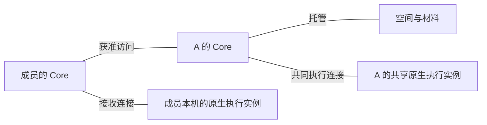

# 运行时架构

Core 是 Team Cross 在每台参与 Mac 上运行的本机后台服务，负责协作状态、访问关系和原生运行时的协调。理解运行时架构时，需要分别看本机入口、持久化会话、当前执行实例以及输入归属。

## Core 与本机入口

| 对象 | 职责与关系 |
| --- | --- |
| App / WebGUI | 提供创建、阅读和管理入口，通过 Core 操作协作 |
| Core | 管理空间、材料、成员、请求和输入归属；一个 Core 可以管理多个空间及运行时连接 |
| MCP 接入 | 让个人 Agent 通过工具调用 Core；工具连接本身不等于目标会话已具备接收能力 |
| 协作会话 | 空间内的独立执行对象，保存原生 fork、目录、模式和自己的权限及输入归属 |
| 原生运行时 | 加载会话、请求模型并执行工具；具体执行实例有自己的连接和生命周期 |
| 原生会话 | 以 Provider 的会话 ID、历史和设置保存对话上下文 |
| 工作目录 | 保存 Agent 实际读取和修改的文件，与会话身份分别管理 |

空间托管在发起者 A 的 Core，共同执行也留在 A；各成员的个人会话与接收连接保留各自的本机归属。托管者和成员是相对于具体空间的角色，同一个 Core 也可以托管另一个空间。

图中表示托管与连接关系。空间可以没有共同执行，也可以包含多个分别运行和暂停的协作会话，接收请求也不要求启用共同执行。App、后台 Core、客户端连接与原生会话各有生命周期，打开界面、服务在线和会话可输入是不同状态。

## 会话历史与当前执行实例

原生会话通过自己的 ID 和已保存历史持续存在。执行实例则是当前加载并推进会话的原生运行环境：同一种程序可以运行多个实例，一个会话也可以在释放必要占用后由不同实例先后接续。执行进程停止后，已持久化的会话仍可保留。

保留原生历史连续性，使用户能在受支持的个人客户端中查看并继续同一会话。Codex 的不同实例可以使用同一份原生会话库；各会话仍有独立身份和上下文。配置目录是否隔离与历史如何保留，由 Provider 和协作模式决定，见[原生会话连续性决策](../../sources/decisions/native-clients-and-models.md#原生会话连续性与运行实例归属)。

| 层次 | Codex | Claude Code 实验性接入 |
| --- | --- | --- |
| 持久化对话 | thread 及其原生历史 | session 及其 transcript |
| 当前执行 | app-server 内加载的 thread 运行状态 | 后台 job 对应的 worker |
| 后台管理 | 客户端或原生服务管理 app-server | daemon 管理一个或多个 job |

专属 app-server 与 Claude job 可以在承载一次执行和管理其生命周期的层面类比；两者的协议、占用机制和管理粒度仍分别判断。Claude 信任模式可以共用个人 daemon，同时保留本次 job 的独立归属，具体边界见 [Claude 接入](../../sources/decisions/claude-native-tui.md)。

## 执行实例由谁管理

| 接入关系 | Core 的职责 |
| --- | --- |
| Core 创建并管理实例 | 启动或恢复明确的原生会话，管理本次执行对象及其释放 |
| Core 连接已有实例 | 核对目标会话与实际承载它的实例，管理自己的接入连接，保留原有执行管理归属 |

“已有实例”指连接之前已经运行并加载目标会话的原生执行端。磁盘上存在历史、某个客户端能显示历史，并不能说明当前连接的实例持有该会话。即使在同一台 Mac 上，目标也可能由另一个 app-server 承载；必须区分历史可读、连接可达和原生可写。

当前可接入的原生入口、连接条件和客户端限制由[配对契约](../../sources/decisions/agent-pairing.md#当前接入范围)维护。

## 两类交接

| 动作 | 改变什么 | 延续什么 |
| --- | --- | --- |
| 共享会话的输入权交接 | 当前允许通过协作入口输入的成员 | 同一个原生会话、执行实例和执行主机 |
| 同一会话的执行归属交接 | 当前持有原生执行或写入占用的客户端 / 实例 | 已保存的会话 ID、历史及对应工作目录 |

输入权由 Team Cross 协调，决定成员能否通过协作入口写入；原生占用由 Provider 运行时管理，关系到另一个实例能否接续。两者分属不同层次。创建共同执行的新 fork 则建立新的会话身份，与恢复同一会话分开理解。

Codex 独立接收会话切到个人 Desktop 继续，属于执行归属交接；具体暂停、释放和恢复条件见[空间工作台](../../sources/decisions/space-workbench.md#按需新建接收会话)。Claude 的 attach、job 停止与个人续接按其[单一执行端契约](../../sources/decisions/claude-native-tui.md#单一执行端)判断。

## 按问题追溯来源

- 查询模块、存储与实际数据流 → [架构](../../sources/architecture.md)；字段与路由 → [协议](../../sources/protocol.md)。
- 查询 App/Core 发现、实例协调与退出 → [分发与首次体验](../../sources/distribution-and-onboarding.md)。
- 查询 fork、目录与恢复 → [目录与生命周期](../../sources/decisions/workspace-and-lifecycle.md)；配置继承 → [协作模式](../../sources/decisions/runtime-modes.md)。
- 查询客户端、账户与模型设置 → [原生客户端](../../sources/decisions/native-clients-and-models.md) / [Claude 接入](../../sources/decisions/claude-native-tui.md)。
- 查询成员连接与共享传输 → [输入与共享](../../sources/decisions/input-and-sharing.md)；接收连接与进程 → [配对契约](../../sources/decisions/agent-pairing.md) / [空间工作台](../../sources/decisions/space-workbench.md)。
